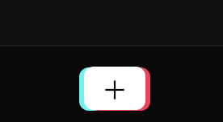
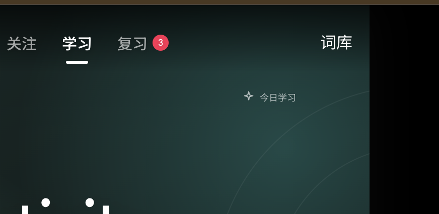
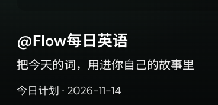

UI 测试报告
1. 用户没有测评在首页应该引导去测评 
2. 当前测试的为什么只有到词汇4000
3. 测评后应该也不是去选择知识点，而是去引导用户去创建目标如果没有目标（如果有可以就开始学习）
4. 在创建目标的页面 可以直接导入新的目标在选择材料那里，而且应该可以选择多个材料 
5. 在创建目标中选咋玩材料后应该显示选择知识点，并且可以支持全选全不选，默认是全选的
6. 在选择玩之后自动保存 而且要引导用户去首页学习而不是去做测评
7. 页面顶部tabl栏中我们没有关注和单独的复习 这里应该展示的是我们不同的目标和全部目标 
8. 暂时删除 标记为TODO 后续可能可以用评论的方式加笔记
9. encode的任务划过就算判定完了 不要弄个按钮 retrive 的任务做完题就滑动，滑倒队列底部应该重新重复队列头部无限滚动直到队列中的任务全部完了
10.  加号不要
11. 底部的词库改为显示所有收录的知识点（分页展示，展示知识点的分数，以及来源关联材料管理）//todo
12. 材料管理在目标页里面放一个入口
13. 点击左上角的flow 标签展示的应用介绍
14. 右上角的词库去掉
15. 左下角这里改为@{来源的材料名}，去掉今日的计划