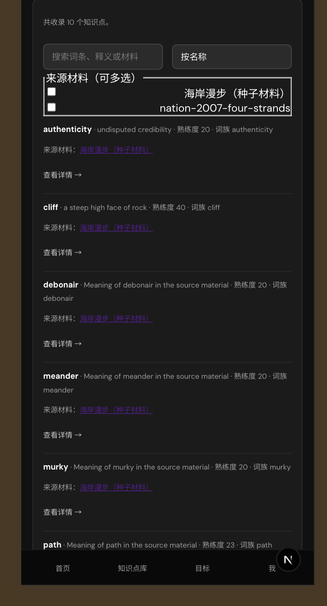
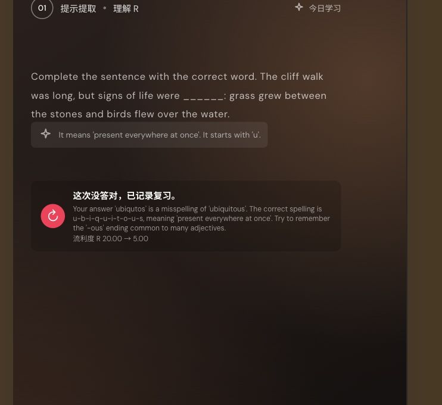
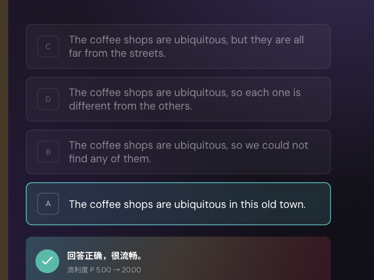

1.  页面太丑了和整体的UI不协调
2. 上传文件导入失败
3. 无法删除或者归档材料
4. 这个提示应该要用弹窗的格式体现
5.  打错了应该停留
6.  答案不是固定的第一个，但是序号A，B，C,D 应该是正序的
7.  去掉这个按钮
8. sqlite repository 还未测试接回内存数据库

## 处理记录

1. 调整来源材料筛选框和复选项布局，避免原生 fieldset 边框及文本错位。
2. 文件导入错误现在返回可读原因；空文本 PDF 会提示需要可选择文字的 PDF，且 `.markdown` 扩展名按 Markdown 处理。若仍失败，可根据具体文件和接口错误继续定位。
3. 在材料管理页加入归档与取消归档。归档材料从默认列表和新建目标的材料选项中隐藏，历史引用保留。
4. 材料关联冲突确认改为弹窗。
5. 答错后停留在当前题目，可在看完反馈后手动继续。
6. 选择题打乱选项内容，但展示编号始终按 A、B、C、D 顺序；提交仍使用原选项 ID。
7. 移除答题前的“跳过至队列底部”按钮；结果出现后显示继续按钮。
8. SQLite 仓储应接回项目原有的内存仓储作为应用运行时；SQLite 实现保留，但不由当前运行时启用。原运行时接入提交为 `055518f`（2026-11-16 08:46 +08:00，提交说明“feat: 添加 SQLite repository（待审核）”）。

### 第 8 条决策与实施计划

- **决策**：当前应用恢复使用 `InMemoryAppRepository` 与 `emptyLearningState()`；不打开或写入 `.flow/flow.sqlite`。SQLite repository、迁移和测试代码保留，作为未启用的实现，后续启用前另行评审。
- **运行行为**：学习状态仅保存在当前服务进程内存中；服务重启后重新创建状态并幂等初始化演示数据，不承诺跨进程重启持久化。既有 SQLite 文件保留在磁盘，不在本次处理中读取、迁移或删除。
- **实施计划**：替换 `lib/server/runtime.ts` 的 repository 类型及初始化，恢复失败时重建空内存仓储；移除运行时对 SQLite 数据库路径、目录和连接的初始化；修正文档中“运行时使用 SQLite”的现状描述。
- **验证计划**：运行 TypeScript 类型检查；确认运行时不再引用 SQLite 数据库路径或打开连接；检查 SQLite repository 自身的 `:memory:` 测试仍保持独立可运行。

### 第 8 条实施结果

- `lib/server/runtime.ts` 已恢复初始化 `InMemoryAppRepository(emptyLearningState())`；运行时不再读取 `FLOW_DATABASE_PATH`、创建 `.flow` 目录或打开 SQLite 连接。SQLite repository 代码、迁移与 `:memory:` 测试保留，但不会被应用启动路径调用。
- 已更新 loop1/loop2 相关文档，标记此前 SQLite 持久化描述为历史实现，并链接到本条新决策。
- 服务状态现存于服务进程内存，进程重启后重置；磁盘上已有 SQLite 文件未读取、迁移或删除。
- 验证：`npx tsc --noEmit` 通过；静态检查确认运行时文件不再引用 SQLite 数据库路径或连接。未运行测试套件。
