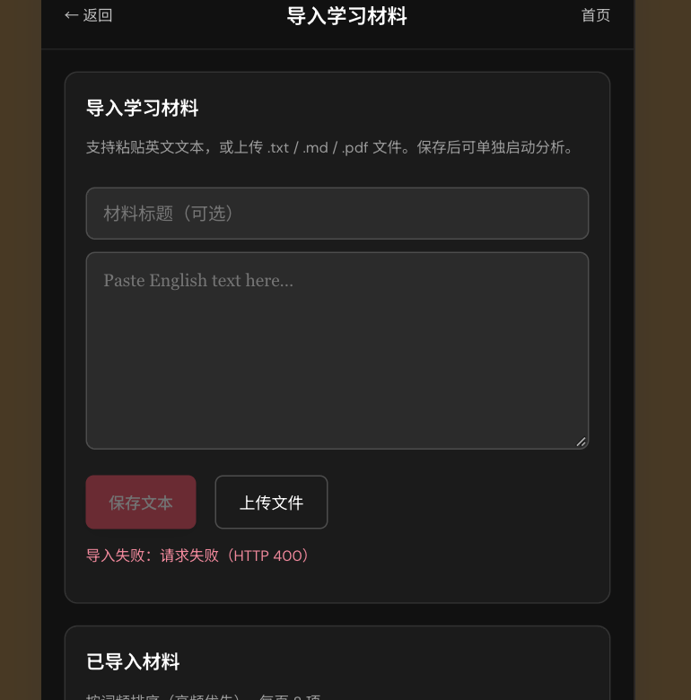
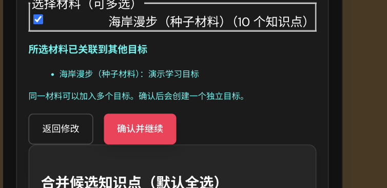

1.  页面太丑了和整体的UI不协调
2. 上传文件导入失败
3. 无法删除或者归档材料
4. 这个提示应该要用弹窗的格式体现
5.  打错了应该停留
6.  答案不是固定的第一个，但是序号A，B，C,D 应该是正序的
7.  去掉这个按钮
8. sqlite repository 还未测试接回内存数据库

## 处理记录

1. 调整来源材料筛选框和复选项布局，避免原生 fieldset 边框及文本错位。
2. 文件导入错误现在返回可读原因；空文本 PDF 会提示需要可选择文字的 PDF，且 `.markdown` 扩展名按 Markdown 处理。若仍失败，可根据具体文件和接口错误继续定位。
3. 在材料管理页加入归档与取消归档。归档材料从默认列表和新建目标的材料选项中隐藏，历史引用保留。
4. 材料关联冲突确认改为弹窗。
5. 答错后停留在当前题目，可在看完反馈后手动继续。
6. 选择题打乱选项内容，但展示编号始终按 A、B、C、D 顺序；提交仍使用原选项 ID。
7. 移除答题前的“跳过至队列底部”按钮；结果出现后显示继续按钮。
8. 已有 `test/sqlite-repository.jest.test.ts` 使用 `openSqliteDatabase(':memory:')` 覆盖 SQLite 仓储；`lib/server/runtime.ts` 当前运行时选用 SQLite。接入提交为 `055518f`（2026-11-16 08:46 +08:00，提交说明“feat: 添加 SQLite repository（待审核）”）。
