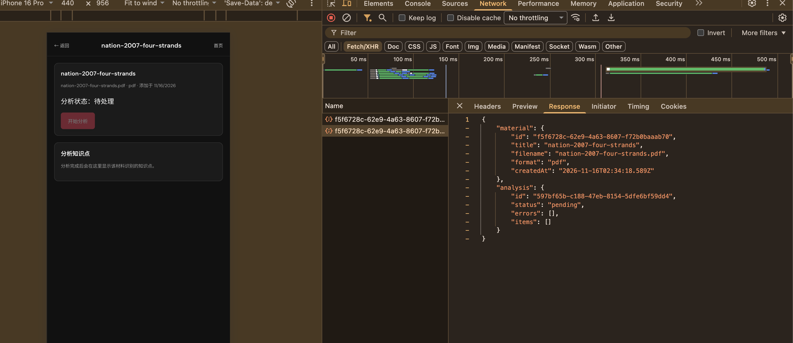
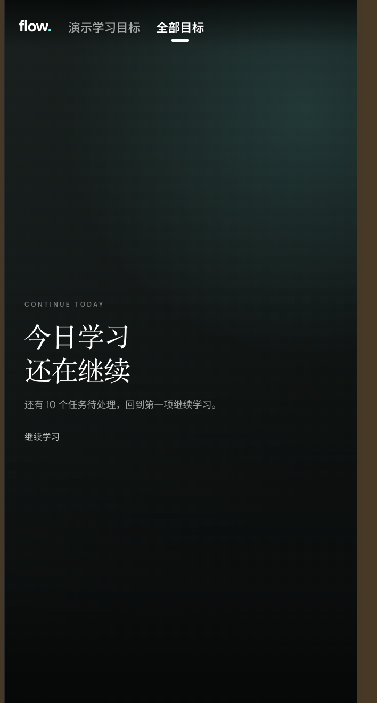
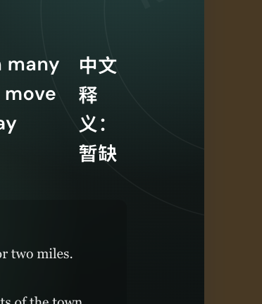
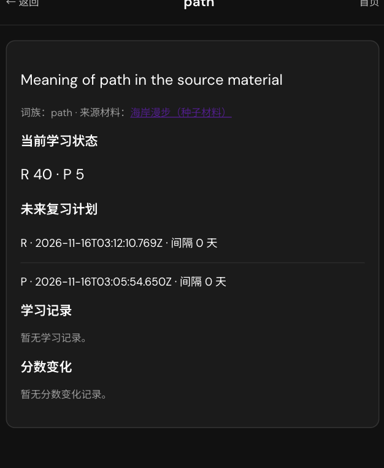
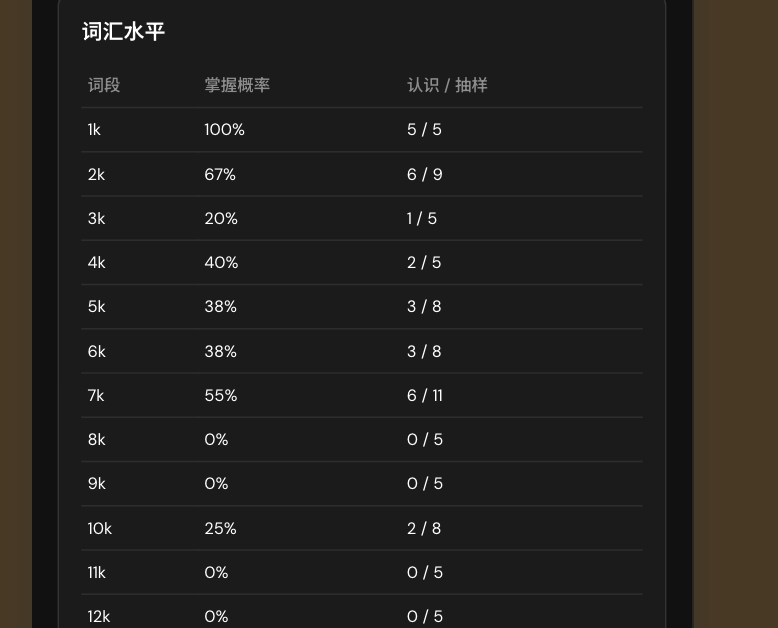

1.  无法开始分析
   - 处理：调查截图与分析状态逻辑，已定位为 `pending` 遗留状态没有超时恢复入口，页面会一直禁用“开始分析”。
   - Decision：[材料分析恢复与排序控件决策](material-analysis-and-controls.decision.md)，第 1 条：超时遗留状态需可恢复/重试，不重复导入材料。
2.  下拉框错位
   - 处理：调查确认窄屏下排序控件被搜索框挤压，原生下拉菜单覆盖相邻区域。
   - Decision：[材料分析恢复与排序控件决策](material-analysis-and-controls.decision.md)，第 2 条：窄屏控件保持可辨认宽度并正确锚定菜单。
3.  返回首页后没有自动回到上次完成的位置
   - 处理：调查确认首页重新加载时任务位置从队列第 0 项初始化；应续接到首个未完成任务。
   - Decision：[学习续接与答题交互决策](learning-feed-and-task-interaction.decision.md)，第 1 条。
4.  任务顺序显示错误 用测试数据库，初始测试 首个任务就是retrieve应该是encode 需要调查
   - 处理：调查当前排期规则和截图。截图对应知识点已存在学习状态（详情显示 R=40、P=5），不是未初始化的新词；学习状态已存在时按到期维度生成 RETRIEVE 属正常行为。未发现足以证明空白新数据库首任务错误的证据；需用明确清空并仅保留新知识点的数据库复现后再判断，不据此新增排序决策。
5.  中文释义显示暂缺
   - 处理：该截图呈现的是 sense 中文释义数据缺失，不是界面没有缺失提示。loop1 已决策：有已配置翻译能力时补全并存储 sense 释义；历史释义仍缺失时明确显示“暂缺”，不得串用其他 sense。[ENCODE sense 中文释义实施决策](../loop1/encode-sense-chinese-meaning.implementation-decision.md)。本条无需新增 decision。
6.  发音播放需要接入还需要接入音标
   - 处理：调查确认当前播放按钮仅显示原型提示，音标仅在数据存在时显示。
   - Decision：[ENCODE 发音与音标决策](encode-pronunciation.decision.md)：接入可用词条元数据及实际播放；缺失时明确提示。
7. "feedback": "Your sentence has the right idea, but there are grammar issues: 'climb' should be 'climbs' to agree with the singular subject 'path', and 'mountain top' should be 'the top of the mountain' or 'the mountain top'. Also check the spelling of 'meandering'. A correct version: 'A meandering path climbs to the top of the mountain.'", 这种feedback 应该在答错后在页面提示。
   - 处理：调查确认结果页当前无论对错都会展示 feedback。
   - Decision：[学习续接与答题交互决策](learning-feed-and-task-interaction.decision.md)，第 2 条：判错后显示纠错 feedback。
8.  题目的内容有问题这里直接说目标词是什么。
   - 处理：截图题干直接包含目标词 `path`，泄露了回忆答案。
   - Decision：[学习续接与答题交互决策](learning-feed-and-task-interaction.decision.md)，第 3 条：提示不得直接包含目标词。
9. 选择题的答案好像都是A 需要你去复核 如果是需要打乱题目答案的顺序
   - 处理：调查确认选择题按生成顺序显示选项，没有呈现时打乱；正确答案依赖选项 ID。
   - Decision：[学习续接与答题交互决策](learning-feed-and-task-interaction.decision.md)，第 4 条：打乱顺序并保持答案 ID 绑定。
10. 答题等待判题的时候应该显示动画
    - 处理：调查确认等待判题时没有明确的处理中动画/状态。
    - Decision：[学习续接与答题交互决策](learning-feed-and-task-interaction.decision.md)，第 5 条。
11.  这里学过encode 任务，以及一些retrieve 但是没有显示学习记录和分数变化
    - 处理：调查确认详情接口只根据 attempt 生成学习记录；流利度变化也只读取已结算 attempt，故缺少结算记录的已完成任务不会显示为学习事件。
    - Decision：[学习记录展示与词汇估计更新决策](learning-history-and-vocabulary-estimate.decision.md)，第 1 条：显示已完成任务；分数仅显示真实结算证据。
12. 在做任务的过程中是否会影响我们的词汇水平？
    - 处理：调查确认会。作答完成判题并成功结算后，系统按匹配的当前词表分类更新对应词频段的样本数、认识数和掌握概率；同时按 R/P 规则更新流利度。缺少匹配分类时，词汇水平估计不变（流利度仍可更新）；未结算的作答不产生更新。
    - Decision：[学习记录展示与词汇估计更新决策](learning-history-and-vocabulary-estimate.decision.md)，第 2 条记录现行规则；本条是调查答复，不改变现行规则。
