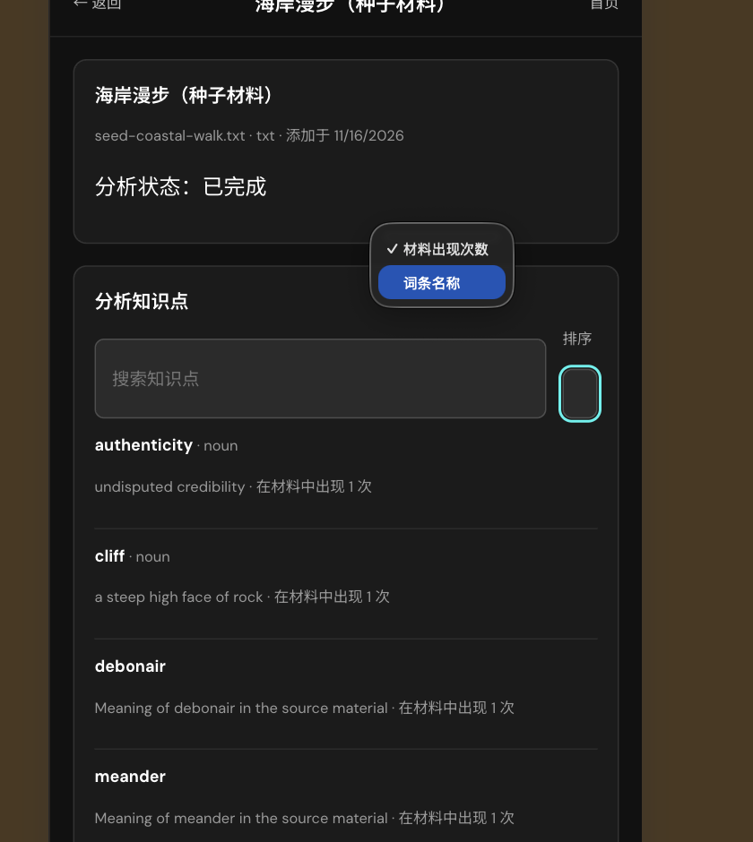
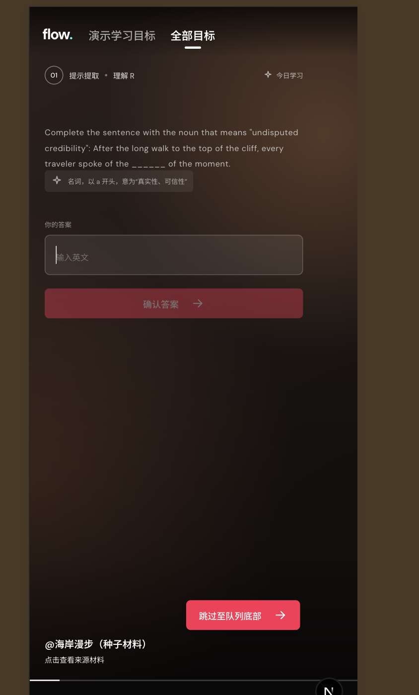

1.   无法开始分析
2.  下拉框错位
3.  返回首页后没有自动回到上次完成的位置
4.  任务顺序显示错误 用测试数据库，初始测试 首个任务就是retrieve应该是encode  需要调查
5. 中文释义显示暂缺
6.  发音播放需要接入还需要接入音标
7. "feedback": "Your sentence has the right idea, but there are grammar issues: 'climb' should be 'climbs' to agree with the singular subject 'path', and 'mountain top' should be 'the top of the mountain' or 'the mountain top'. Also check the spelling of 'meandering'. A correct version: 'A meandering path climbs to the top of the mountain.'", 这种feedback 应该在答错后在页面提示。
8.  题目的内容有问题这里直接说目标词是什么。
9. 选择题的答案好像都是A 需要你去复核 如果是需要打乱题目答案的顺序
10. 答题等待判题的时候应该显示动画
11. 这里学过encode 任务，以及一些retrieve 但是没有显示学习记录和分数变化
12. 在做任务的过程中是否会影响我们的词汇水平？