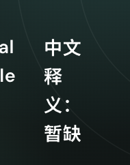
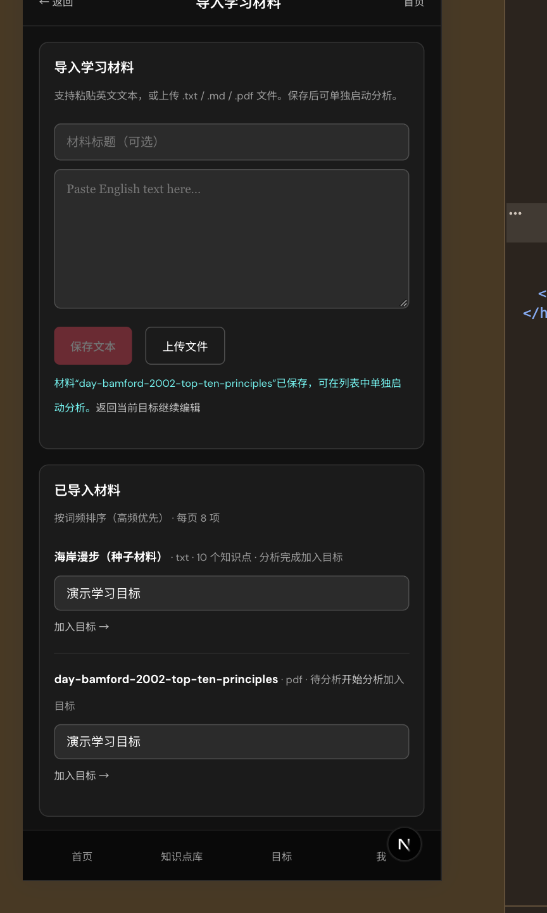
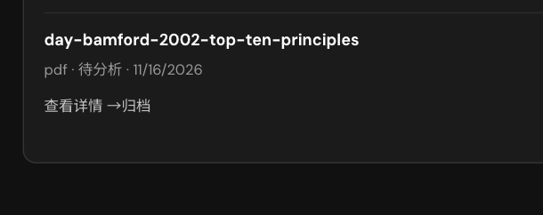
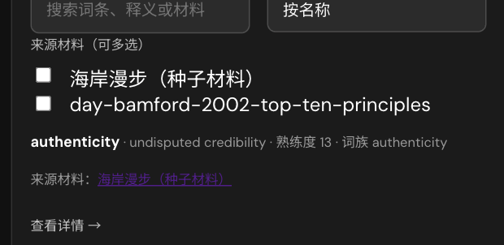

1. 无法发出声音
   - 调查：截图中有发音按钮、音标和 Free Dictionary API 来源。`components/learning/TaskCard.tsx` 会使用缓存的 `pronunciationAudioUrl` 调用浏览器 `audio.play()`；缺少 URL 时按钮禁用，播放失败时显示“播放失败”。当前实现已覆盖正常播放与失败提示，但仅凭截图不能判断这次失败来自 URL、浏览器音频策略还是设备输出。
   - Decision：[Loop3 发音播放失败反馈决策](pronunciation-playback-feedback.decision.md)：保留缓存音频播放，不将“有按钮”视为播放成功；明确播放失败状态及可检查的来源信息，后续实施时核对 URL 与错误反馈。
2. 中文释义还是显示暂缺
   - 调查：当前任务页读取当前 sense 的 `chineseMeaning`，没有值时显示“暂缺”；不会从其他义项借用释义。Loop2 已决定对已配置翻译能力补全并保存 sense 释义，历史缺失项仍明确显示“暂缺”，见 [中文释义实施决策](../loop1/encode-sense-chinese-meaning.implementation-decision.md)。本截图说明该条目的数据仍缺失，不能证明缺失提示逻辑错误。
   - Decision：[Loop3 历史中文释义补全决策](chinese-meaning-backfill.decision.md)：新分析继续按 Loop2 规则保存释义；已存在且缺失释义的知识点需有明确、可重试的补全路径，不跨 sense 复用。
3. 这个页面支持选择分析材料
   - 调查：截图是全局知识点库。当前 `app/knowledge/page.tsx` 已提供“来源材料（可多选）”筛选，并把多个 `sourceId` 传给接口；接口按任一所选来源筛选知识点。截图中的控件在窄视口显得拥挤，选择能力已有，主要问题是筛选器的可见性和易操作性。
   - Decision：[Loop3 知识库来源材料筛选呈现决策](knowledge-source-filter.decision.md)：保留多选筛选语义，优化窄屏控件布局、选中状态和清除入口的可见性。
4. 点击材料详情好像就自动开始解析了，但是其实我们需要手动点
   - 调查：材料详情页加载时只请求 `GET /api/materials/[id]`；该 GET 仅读取材料和分析状态。真正启动分析的是单独的 `POST /api/materials/[id]/analysis`，需点击按钮。截图显示的是已有 `pending` 状态及超时后的恢复按钮，可能让人误以为进入详情触发了分析。
   - Decision：[Loop3 材料详情手动启动分析决策](material-detail-manual-analysis.decision.md)：详情读取保持只读；未开始时明确显示“未开始”和手动启动入口，处理中状态与超时恢复状态不得造成自动启动的误解。
5. 材料分析管理页没有分的状态和详情页面中的状态不一样，一个是待分析 一个是正在分析
   - 调查：材料列表将 `pending` 显示为“待分析”，详情页将同一状态显示为“正在分析”；而详情页还会轮询并在超时后显示恢复入口，语义确实不一致。
   - Decision：[Loop3 材料分析状态文案决策](material-analysis-status-copy.decision.md)：列表与详情对同一分析状态使用一致的“分析中”文案；未创建分析记录时使用“未分析/未开始”，超时状态单独提示可恢复。
6.  这里没有样式 字体页突兀
   - 调查：截图为知识库条目及来源材料筛选区。现有页面使用 `.doc-list`、`.doc-muted` 等通用样式，列表标题、释义、来源链接层级较弱；不同内容的强调方式不够一致，造成字体突兀感。
   - Decision：[Loop3 知识库字体与层级样式决策](knowledge-typography.decision.md)：统一知识点列表的字体家族、字号、行高和标题/释义/来源层级，遵循现有暗色主题及窄屏布局。
