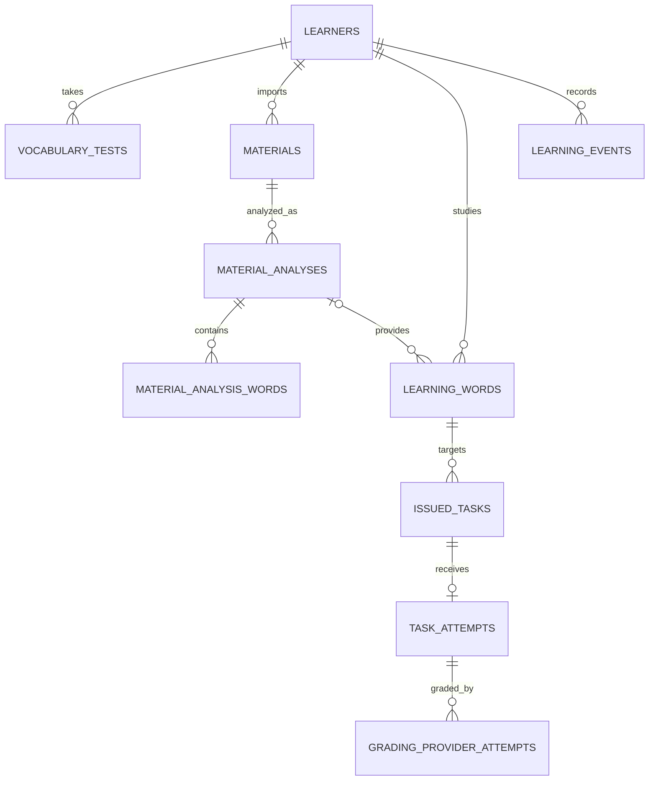

# Learning persistence model (Drizzle ORM)

Status: initial model proposal  
Date: 2026-11-10

The schema source is [`lib/db/schema.ts`](../lib/db/schema.ts). It targets SQLite through Drizzle's `sqlite-core`; it does not yet replace either existing SQLite store or add migrations. The repository/service implementation should adopt it in a later step after this model is reviewed.

## Persisted objects

| Object | Table(s) | Why it is stored |
| --- | --- | --- |
| Learner profile | `learners` | Current R/P goals, latest capacity estimate, language/content level, and daily task limit. |
| Vocabulary test | `vocabulary_tests` | Immutable test input, estimate, source/list version, and submission time. The learner row points to the current estimate/test. |
| Imported material | `materials` | File identity/checksum, extracted text or external storage key, and extraction metadata. |
| Material analysis | `material_analyses`, `material_analysis_words` | Versioned analysis, vocabulary-index provenance, per-word ranks/frequency/band/initial estimate, and unmatched words. Re-analysis creates a new analysis. |
| Learner word | `learning_words` | One mutable current R/P learning state per learner and sense. Each axis is explicit columns for indexed due-date selection and transactional updates. |
| Task generation run | `task_generation_runs` | Optional provider/model/prompt/error diagnostics. It is not a learner task unless generation succeeds. |
| Issued task | `issued_tasks` | Immutable candidate and task snapshots, both server grading material and learner-safe material, plus request idempotency key. |
| Task attempt | `task_attempts` | The first submission, validity, lifecycle state, grade, settlement snapshots/events, and one-time settlement timestamp. One task accepts one attempt. |
| Grading provider retry | `grading_provider_attempts` | Each external grading call/result, allowing retries to use the frozen first submission. |
| Learning audit event | `learning_events` | Append-only goal/task/score/schedule decisions and other explainability events. |

## Relationship and flow

Main write transaction on accepted completion:

1. Load the issued task and current learner word state; verify owner, task, axis, and first-submission rules.
2. Insert the attempt or return the existing attempt for an idempotent retry.
3. Apply pure score/schedule functions using the current persisted word state.
4. Update the word, mark the attempt settled, and append score/schedule events atomically.

Daily completed counts are derived from settled valid attempts by `(learner_id, attempt_date)`. Do not persist a second authoritative counter. A cache can be introduced later if measured query volume warrants it.

## Modeling choices

- Use explicit columns for learner/word ownership, task lifecycle, indexes, scores, targets, graduation flags, review levels, and due dates. ISO local-date strings sort lexically, including the `infinity` sentinel at the end.
- Keep versioned or variable-shaped domain inputs/results as typed JSON text. This preserves the pure domain model without making JSON the only queryable representation of current state.
- Keep full generated material server-side and persist the redacted learner view separately. API code must return only `learner_material_json`.
- Use `canonical_key + sense_id` uniqueness per learner to deduplicate imported words without collapsing distinct senses. The service decides how to form a canonical key (family ID when reliable, otherwise normalized lemma).
- Keep source materials and analysis snapshots attributable. The material-analysis word rank is scoped by analysis, not treated as a globally unique vocabulary ID.
- Avoid a separate daily-count table and a separate grading-owned word state. The repository transaction is the only settlement authority.
- Foreign keys use `RESTRICT` for issued tasks/attempted learning words so history cannot be invalidated by deleting a word. Learner deletion cascades; product retention policy may later replace this with anonymization.

## Current gaps and migration order

1. Add Drizzle database initialization and a versioned migration mechanism.
2. Decide the stable learner identity and canonical-key policy.
3. Add the repository port and SQLite/Drizzle adapter, then migrate `SqliteLearningStore` and `SqliteGradingStore` to one connection/transaction boundary.
4. Backfill existing JSON rows, validate them, and only then switch services to the new tables.
5. Add service-level integration around import, task issuance, and task settlement.

The `schema.ts` draft deliberately models the target shape; it does not run DDL or mutate the current `flow.sqlite` database.
