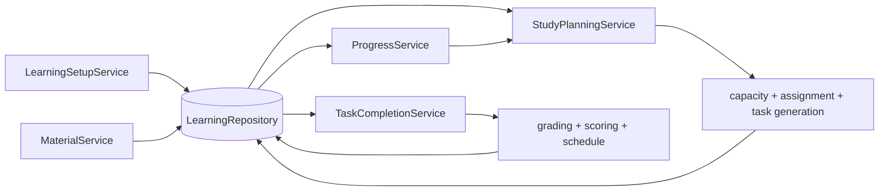

# Service architecture and implementation plan

Status: proposed plan  
Date: 2026-11-10

## Objective

Connect the existing pure learning functions and persistence into one durable learning loop:

1. Measure a learner's vocabulary and set learning goals.
2. Import and analyze target material, then add eligible words to the learner's vocabulary.
3. Plan and issue a task using the learner's goals, word state, due dates, and daily capacity.
4. Accept the learner's submission, grade it when needed, update fluency and schedule, and persist the result exactly once.
5. Continue planning until all eligible vocabulary meets the configured completion criteria.

The existing domain functions remain pure where practical. Services orchestrate calls and persistence; repositories own database access. Provider clients remain replaceable adapters.

## Current implementation

The domain logic already exists in these modules:

- `lib/vocabulary.ts`: vocabulary capacity tests, estimates, and initial score estimates.
- `lib/material-analysis.ts`: material text extraction and vocabulary analysis.
- `lib/goals.ts`: goal creation and goal changes.
- `lib/capacity.ts`: daily capacity planning and new-word admission estimates.
- `lib/task-assignment.ts`: selection of the next task candidate.
- `lib/task-material.ts`: task material generation and provider adapters.
- `lib/scoring.ts`, `lib/schedule.ts`: scoring and review scheduling.
- `lib/task-grading.ts`: fluency grading, retry behavior, and grading-store implementations.
- `lib/learning-store.ts`: SQLite persistence for users, goals, words, issued tasks, fluency attempts, and daily counts.

The main gap is application orchestration. Material import and planning are not yet connected to durable user state. Fluency grading and learning-state settlement also have separate persistence paths: `SqliteGradingStore` stores a grading snapshot/result while `SqliteLearningStore` performs word/schedule settlement. The application needs one authoritative submission workflow and a clear idempotency boundary.

## Proposed services

Create five application services. Do not create a service for every pure function.

### 1. `LearningSetupService`

Responsibilities:

- Create or load a learner profile.
- Start and submit a vocabulary capacity test.
- Persist the resulting vocabulary estimate and its source/version.
- Create and update R/P goals, reconciling existing word states through `updateGoals`.

Uses: `vocabulary.ts`, `goals.ts`, repository.

Candidate operations:

```ts
createLearner(input): Promise<LearnerProfile>
createVocabularyTest(userId, spec?): Promise<LearnerTestView>
submitVocabularyTest(userId, submission, date): Promise<VocabularyEstimate>
updateGoals(userId, goals, date): Promise<LearningSnapshot>
```

### 2. `MaterialService`

Responsibilities:

- Accept material bytes/text and metadata.
- Extract text and analyze words using the selected frequency index.
- Persist the original material, extraction metadata, analysis, and frequency-index provenance.
- Turn selected analysis rows into eligible learning words, estimating initial R/P scores where applicable.
- Avoid silently adding duplicate words to the same learner.

Uses: `material-analysis.ts`, `vocabulary.ts`, `vocabulary-reference.ts`, repository.

Candidate operations:

```ts
importMaterial(userId, file, options?): Promise<ImportedMaterial>
analyzeMaterial(userId, materialId): Promise<MaterialAnalysis>
addWordsToLearning(userId, materialId, wordIds, date): Promise<LearningWord[]>
```

### 3. `StudyPlanningService`

Responsibilities:

- Load an authoritative learning snapshot and issued/completed task counts.
- Calculate capacity and admit or defer new words.
- Select the next task candidate.
- Generate task content when required.
- Persist an immutable issued-task snapshot before returning it to the learner.
- Return a stable task on retries for the same request/idempotency key.

Uses: `capacity.ts`, `task-assignment.ts`, `task-material.ts`, repository.

Candidate operations:

```ts
getNextTask(userId, date, requestId): Promise<NextTaskResult>
getDailyPlan(userId, date): Promise<DailyPlan>
```

Planning should separate a deterministic selection decision from potentially slow material generation. If content generation fails or is unavailable, do not persist a task as successfully issued; return a retryable/unavailable result and preserve the selection decision for diagnostics as needed.

### 4. `TaskCompletionService`

Responsibilities:

- Load the frozen issued task and validate that the submission belongs to it.
- Preserve the first submission for an attempt; reject duplicate or mismatched submissions safely.
- Grade objective/retrieval tasks deterministically and call the grader for fluency tasks.
- Apply `score` and `schedule` using the word state consistent with the issued attempt.
- Atomically persist submission, grade/decision, score/schedule events, updated word, and daily count.
- Support retrying unavailable external grading without accepting a replacement task or answer.

Uses: `scoring.ts`, `schedule.ts`, `task-grading.ts`, repository transaction.

Candidate operations:

```ts
submitTask(userId, taskId, attemptId, submission, validity, date): Promise<CompletionResult>
retryGrading(userId, attemptId): Promise<CompletionResult>
```

There must be one authoritative settlement path. Refactor the current `gradeFluencyAttempt` / `SqliteGradingStore` / `SqliteLearningStore.settleFluency` interaction so grading does not independently persist a final word state that can diverge from the learning store. Grader retries may persist intermediate provider attempts, but only the repository transaction settles learner state and increments daily completion once.

### 5. `ProgressService`

Responsibilities:

- Return learner snapshot, daily plan status, due reviews, and per-axis progress.
- Determine whether the learner has reached the configured goal across eligible words.
- Explain what remains: due review, learning axis, capacity-blocked word, or completed goal.

Uses: repository read methods and small pure aggregation functions. It should not mutate schedules as a side effect of reading progress.

Candidate operations:

```ts
getProgress(userId, date): Promise<ProgressView>
getCompletionStatus(userId): Promise<LearningCompletionStatus>
```

## Service interface contracts

The following contracts define the application boundary. They are TypeScript-shaped design contracts, not yet implemented exports. Services receive a repository and external adapters through constructors so domain functions remain pure and providers can be replaced in tests or deployments. `learnerId` is the authenticated application identity; HTTP handlers must derive it from the session rather than trust a body field.

### Shared result and error rules

- Every write accepts an explicit `now` or local `date` when business-date behavior depends on it. `date` is `YYYY-MM-DD` in the learner's configured timezone; timestamps are ISO 8601 instants.
- Expected business outcomes are returned as discriminated unions (for example `no_task`, `invalid_submission`, `grading_unavailable`). Missing records, authorization mismatch, invalid input, and storage failures are distinct errors; services do not turn them into success-shaped empty values.
- A repeated write with the same idempotency key and same canonical request returns the original saved result. Reuse of that key for a different request returns `idempotency_conflict` and never overwrites the original.
- Services return learner-safe views. `GeneratedTask`, answer keys, grading rubrics, provider raw output, and private diagnostics are never returned by learner-facing operations.
- No service accepts a database handle. Reads and writes go through `LearningRepository`; operations marked atomic must be one database transaction.

### Shared application records

```ts
type ServiceErrorCode =
  | 'not_found' | 'forbidden' | 'invalid_input' | 'conflict'
  | 'idempotency_conflict' | 'already_submitted' | 'storage_error';

interface LearnerProfile {
  learnerId: string;
  goals: GoalSet;
  vocabularyEstimate: VocabularyEstimate | null;
  language: string;
  contentLevel: string | null;
  maxTasksPerDay: number;
  timezone: string;
}

interface ServiceError extends Error { code: ServiceErrorCode; details?: unknown }
```

`timezone` is included in the service contract because daily capacity and local due dates require one, but is absent from the current `learners` table. Add it with a documented default (initially `UTC`) before implementing date-sensitive APIs, or derive it from an explicit trusted application setting.

### `LearningSetupService`

```ts
interface LearningSetupService {
  createLearner(input: {
    learnerId: string; goals?: Partial<GoalSet>; language?: string;
    contentLevel?: string; maxTasksPerDay?: number; timezone?: string;
  }): Promise<LearnerProfile>; // idempotent by learnerId; existing profile is returned unchanged

  createVocabularyTest(input: {
    learnerId: string; spec?: VocabularyCapacityTestSpec; requestKey: string;
  }): Promise<{ testId: string; form: VocabularyCapacityLearnerView }>;

  submitVocabularyTest(input: {
    learnerId: string; testId: string; submission: VocabularyCapacityTestSubmission; submittedAt: string;
  }): Promise<
    | { status: 'estimated'; testId: string; estimate: VocabularyEstimate }
    | { status: 'invalid'; testId: string; errors: string[] }
  >; // persist evidence; on success atomically make this the learner's current estimate

  updateGoals(input: {
    learnerId: string; goals: Partial<GoalSet>; effectiveDate: string;
  }): Promise<{ goals: GoalSet; changedWords: number; snapshotVersion: number }>;
}
```

The test form, including its answer key, is server-side state. Only `VocabularyCapacityLearnerView` is returned. The current `vocabularyTests` table is shaped like a completed result and cannot safely support create-then-submit; add draft status, request key, and a private form/key snapshot (or an equivalent private test-session table). Invalid submissions are recorded for audit but do not replace the current estimate. Goal changes use `createGoals` and `updateGoals`, then save the goal set and all changed word schedules atomically.

### `MaterialService`

```ts
interface MaterialService {
  importMaterial(input: {
    learnerId: string; requestKey: string; name: string; filename: string;
    mimeType?: string; data: string | Uint8Array;
  }): Promise<{ materialId: string; status: 'imported' | 'already_imported'; format: MaterialFormat }>;

  analyzeMaterial(input: {
    learnerId: string; materialId: string; index: VocabularyFrequencyIndex;
    indexName?: string; indexVersion?: string;
  }): Promise<{ analysisId: string; analysis: MaterialAnalysis }>;

  addWordsToLearning(input: {
    learnerId: string; materialId: string; analysisId: string; ranks?: number[];
    effectiveDate: string; requestKey: string;
  }): Promise<{ added: LearningWord[]; skipped: Array<{ rank: number; reason: 'already_learning' | 'not_selectable' }> }>;
}
```

Import is idempotent by `(learnerId, requestKey)` and by content checksum; same key with different content conflicts. Analysis is an immutable snapshot and may be rerun with a new analysis ID. Word selection is scoped to the specified analysis and material, checks learner ownership, preserves frequency source provenance, derives stable canonical/sense keys, and skips duplicates rather than resetting an existing learner state. If `ranks` is omitted, add all selectable words; this default must be consistent in API handlers. The current schema needs a material `requestKey` if request-key idempotency is required; checksum uniqueness alone cannot detect same-key/different-content reuse.

### `StudyPlanningService`

```ts
type NextTaskResult =
  | { status: 'issued'; taskId: string; task: LearnerTask; candidate: TaskCandidate }
  | { status: 'no_task'; reason: Exclude<TaskAssignmentResult['status'], 'task_selected'>; nextDueDate?: string };

interface StudyPlanningService {
  getNextTask(input: {
    learnerId: string; date: string; requestKey: string;
  }): Promise<NextTaskResult>;

  getDailyPlan(input: { learnerId: string; date: string }): Promise<{
    date: string; completed: number; limit: number; dueReviews: number;
    eligibleNewWords: number; capacity: CapacityPlan; next: NextTaskResult;
  }>;
}
```

`getNextTask` loads one consistent snapshot, runs `estimateNewWordCapacity` and `selectNextTask`, and only calls `generateTask` after a candidate is selected. It persists generation diagnostics and the immutable issued task before returning the learner-safe payload. It returns the same issued task for a repeated `(learnerId, requestKey)`; it must not silently select a different candidate after a generation retry. When no candidate is selectable, it returns the pure selector's reason and does not create an issued task. The selector currently requires per-axis `materialAvailable`, but the persisted word model has no corresponding material-content availability fields; the repository must compute them from available generation inputs or the domain contract must be revised before implementation.

### `TaskCompletionService`

```ts
type TaskSubmission =
  | { taskType: 'ENCODE'; completed: boolean }
  | { taskType: 'RETRIEVE'; answer: string }
  | { taskType: 'FLUENCY'; response: string | Record<ReadingQuestionRole, string>;
      validity: AttemptValidity };

type CompletionResult =
  | { status: 'settled'; attemptId: string; scoreEvent: ScoreEvent; scheduleEvent?: ScheduleEvent; progress: WordProgressView }
  | { status: 'invalid'; attemptId: string; reason: string }
  | { status: 'grading_unavailable'; attemptId: string; retryable: true };

interface TaskCompletionService {
  submitTask(input: {
    learnerId: string; taskId: string; attemptId: string; submission: TaskSubmission;
    submittedAt: string; date: string;
  }): Promise<CompletionResult>; // atomic first-write boundary by taskId and attemptId

  retryGrading(input: { learnerId: string; attemptId: string }): Promise<CompletionResult>;
}
```

The service first loads the server-side issued snapshot and checks learner, task type, axis, and submission shape. ENCODE and RETRIEVE are evaluated using `score`; FLUENCY is evaluated using `gradeFluencyAttempt` and the configured `FluencyGrader`. A valid completion applies the resulting score/schedule transition to the latest authoritative word state and saves attempt, provider attempts, score/schedule events, word version, and daily count atomically. `attemptId` identifies the first submission; the unique task-attempt rule means a second attempt for the same task returns the original result (or `already_submitted` if the product chooses a conflict response), never scores again. A grading retry reuses the frozen task and first submission; it cannot accept replacement content. Invalid or unavailable attempts do not change word state or daily completed count. `retryGrading` is only valid for an owned, unsettled FLUENCY attempt.

The current pure scoring API exposes `score`, but `ScoreInput` is not exported and has no public evaluator for `TaskSubmission` against a generated RETRIEVE answer key. Export a submission/evaluation input type and add a deterministic task-evaluation function (or define it in the service with a separately testable pure module) before implementing the non-FLUENCY branches. The current grading function/store also settles score/schedule separately from `SqliteLearningStore`; the service must route intermediate provider attempts separately and leave final settlement exclusively to the repository transaction.

### `ProgressService`

```ts
interface ProgressService {
  getProgress(input: { learnerId: string; date: string }): Promise<{
    learner: LearnerProfile; completedToday: number; maxTasksPerDay: number;
    words: WordProgressView[]; dueReviews: number; remainingLearningAxes: number;
    completion: LearningCompletionStatus;
  }>;

  getCompletionStatus(input: { learnerId: string }): Promise<LearningCompletionStatus>;
}

interface WordProgressView {
  wordId: string; text: string;
  R: AxisSchedule & { due: boolean };
  P: AxisSchedule & { due: boolean };
}

interface LearningCompletionStatus {
  complete: boolean; totalWords: number; completedWords: number;
  remaining: Array<{ wordId: string; text: string; axes: Array<'R' | 'P'> }>;
  reason?: 'no_words' | 'incomplete_axes';
}
```

Completion means every in-scope word has both axes graduated under the stored per-axis target/review rules. A read computes due flags from the supplied local date and performs no writes. A learner with no in-scope words is not considered complete unless the product explicitly chooses vacuous completion; initial contract treats it as incomplete with reason `no_words` (add that reason to the view).

### `LearningRepository` port

Services depend on this port, not Drizzle query builders. Concrete record aliases can initially reuse schema/domain records, then be narrowed as persistence migrations are implemented.

```ts
interface LearningRepository {
  learners: {
    create(input: LearnerProfile): Promise<LearnerProfile>;
    get(learnerId: string): Promise<LearnerProfile | null>;
    updateSetup(learnerId: string, patch: Partial<LearnerProfile>): Promise<LearnerProfile>;
    saveVocabularyTest(test: VocabularyTestRecord): Promise<VocabularyTestRecord>;
    getVocabularyTest(learnerId: string, testId: string): Promise<VocabularyTestRecord | null>;
    setEstimate(learnerId: string, testId: string, estimate: VocabularyEstimate): Promise<void>;
  };
  materials: {
    create(input: MaterialRecord): Promise<{ record: MaterialRecord; created: boolean }>;
    get(learnerId: string, materialId: string): Promise<MaterialRecord | null>;
    saveAnalysis(analysis: MaterialAnalysisRecord): Promise<MaterialAnalysisRecord>;
    getAnalysis(learnerId: string, materialId: string, analysisId: string): Promise<MaterialAnalysisRecord | null>;
    addLearningWords(input: { learnerId: string; words: LearningWord[]; requestKey: string }): Promise<WordInsertResult>;
  };
  learning: {
    getSnapshot(learnerId: string, date: string): Promise<LearningSnapshot>;
    getWord(learnerId: string, wordId: string): Promise<LearningWord | null>;
    updateGoals(input: { learnerId: string; goals: GoalSet; words: LearningWord[]; expectedVersion?: number }): Promise<LearningSnapshot>;
  };
  planning: {
    getOrCreateIssuedTask(input: IssuedTaskRecord & { requestKey: string }): Promise<{ task: IssuedTaskRecord; created: boolean }>;
    saveGenerationRun(run: TaskGenerationRunRecord): Promise<void>;
    getIssuedTask(learnerId: string, taskId: string): Promise<IssuedTaskRecord | null>;
    getIssuedTaskByRequestKey(learnerId: string, requestKey: string): Promise<IssuedTaskRecord | null>;
  };
  attempts: {
    receive(input: TaskAttemptRecord): Promise<{ attempt: TaskAttemptRecord; created: boolean }>;
    get(learnerId: string, attemptId: string): Promise<TaskAttemptRecord | null>;
    appendGradingProviderAttempt(input: GradingProviderAttemptRecord): Promise<void>;
    settle(input: TaskSettlement): Promise<{ status: 'settled' | 'invalid' | 'duplicate'; result: CompletionResult }>;
  };
}
```

`attempts.settle` and `learning.updateGoals` are transaction boundaries. `attempts.receive` preserves the first payload and enforces one attempt per issued task; `attempts.settle` uses optimistic version checking or an equivalent row lock, then atomically writes all derived state and increments the daily count once. `getSnapshot` returns goals, vocabulary estimate, words, daily counts/capacity inputs, timezone, and a snapshot version needed by planning. `saveGenerationRun` and `appendGradingProviderAttempt` are diagnostic writes and must never themselves mark a learner attempt as complete.

The names above intentionally describe use cases rather than SQL operations. `MaterialRecord`, `VocabularyTestRecord`, `MaterialAnalysisRecord`, `IssuedTaskRecord`, `TaskGenerationRunRecord`, `TaskAttemptRecord`, `GradingProviderAttemptRecord`, `WordInsertResult`, and `TaskSettlement` are shared persistence DTOs to define alongside the first repository adapter; they should map one-to-one to the Drizzle tables without leaking Drizzle-specific types into service signatures.

### Contract-to-domain mapping

| Service operation | Pure/domain functions | Persistence boundary |
|---|---|---|
| `createLearner` / `updateGoals` | `createGoals`, `updateGoals` | learner + affected words in one transaction |
| vocabulary test create/submit | `createVocabularyCapacityTest`, `getVocabularyCapacityLearnerView`, `checkVocabularyCapacityTest`, `recordVocabularyCapacityTestResult` | private test form, evidence, estimate, learner profile |
| `importMaterial` / `analyzeMaterial` | `extractMaterialText`, `analyzeMaterialText` | original/extracted material + immutable analysis rows |
| `addWordsToLearning` | `estimateTargetWordInitialScores` | deduplicated word inserts |
| `getNextTask` | `estimateNewWordCapacity`, `selectNextTask`, `generateTask`, `toLearnerTask` | generation run + frozen issued task, idempotently |
| `submitTask` / `retryGrading` | task evaluator, `score`, `gradeFluencyAttempt`, `schedule` | first submission + provider attempts + one settlement transaction |
| progress reads | pure due/completion aggregation | consistent read only |

Before service implementation, resolve the contract/schema gaps called out above: learner timezone, vocabulary-test draft snapshot, request-key uniqueness for imports and issued tasks, availability inputs for generation, and deterministic RETRIEVE evaluation. These are blockers for correctness, not reasons to split the five service responsibilities further.

## Persistence boundary

Define a repository port consumed by the services; keep SQLite as its first adapter. Do not let the service layer issue SQL directly.

The initial port should cover:

- Learner profile, goals, vocabulary estimate, and test result.
- Imported materials and analysis provenance/results.
- Learning words and their current R/P schedule state.
- Immutable issued tasks and their generation metadata.
- First submissions, grading attempts/results, and settlement state.
- Daily completed-task counts and queryable audit events.
- Transactions for task settlement and goal changes.

Evolve `SqliteLearningStore` toward this repository implementation. Consolidate grading persistence into the same persistence boundary, or make grading-attempt persistence an explicitly coordinated repository capability. Avoid opening unrelated SQLite connections to the same database for one logical settlement.

## Main interaction flow



## Invariants to preserve

- Domain calculations stay independently testable and do not open database connections.
- A task's user-facing content, answer key/rubric, target word, axis, and issued date are frozen at issuance.
- The submission is tied to the issued task and cannot be swapped during retry.
- An attempt can settle at most once; duplicate requests return the prior result and do not increment daily counts again.
- Invalid or unavailable attempts do not change word scores, schedules, or completed-task counts.
- Score and schedule updates use the authoritative persisted word state and happen in the same transaction as the accepted attempt.
- Goal changes reconcile all affected word states atomically.
- Material analysis stores its frequency-index source/version so future re-analysis is interpretable.
- Completion status uses explicit per-axis graduation/goal rules and is computed from persistent learner state.

## Implementation sequence

### Phase 1: Repository contract and schema ownership

1. Define repository interfaces and shared records for learner, material, word, issued task, submission, and attempt.
2. Decide whether to evolve the current SQLite schema in place or add a versioned migration mechanism.
3. Add transaction methods for goal updates and task settlement.
4. Make the repository the sole owner of the SQLite connection used by application services.

### Phase 2: Completion and settlement loop

1. Define a single submission/settlement contract for ENCODE, RETRIEVE, and FLUENCY.
2. Route grading output into the same settlement transaction that updates word state and daily counts.
3. Make duplicate submissions and grading retries idempotent.
4. Persist attempt lifecycle states such as received, grading, unavailable, invalid, and settled.

### Phase 3: Task planning and issuance

1. Build `StudyPlanningService` from repository snapshots and existing capacity/assignment functions.
2. Generate materials after selection and freeze the returned task before exposing it to the client.
3. Add stable request IDs and handle retries without issuing a different task accidentally.

### Phase 4: Material onboarding

1. Persist imports and extracted text with metadata.
2. Persist analysis and index provenance.
3. Add selected words to learning state with deduplication and initial score estimates.

### Phase 5: Setup and progress APIs

1. Connect vocabulary test results and goals to the learner profile.
2. Implement progress and goal-completion queries.
3. Connect UI/API routes to services rather than directly to domain functions or the database.

## Completion criteria for the service layer

- A learner can be created, measured, and assigned R/P goals; those values survive process restart.
- A material can be imported, analyzed, and selected words can enter the learner's persistent word list.
- The planning service can issue a task from persisted state and return the same frozen task on retry.
- Completing ENCODE, RETRIEVE, or FLUENCY updates the relevant word state and daily count once.
- Failed, invalid, duplicate, or temporarily ungradable submissions follow the invariants above.
- The next task reflects the saved score, schedule, capacity, and due-date state.
- Progress reports completion only when all in-scope vocabulary meets the configured per-axis completion rules.

## Scope decisions

- Do not turn every domain module into its own service.
- Do not move scoring, scheduling, capacity planning, or analysis calculations into SQLite code.
- Do not make progress reads mutate learner state.
- Do not add a second independently authoritative grading/learning state store.
- Keep the first implementation as a modular monolith with SQLite; introduce other storage or queue infrastructure only when an actual deployment requirement calls for it.

