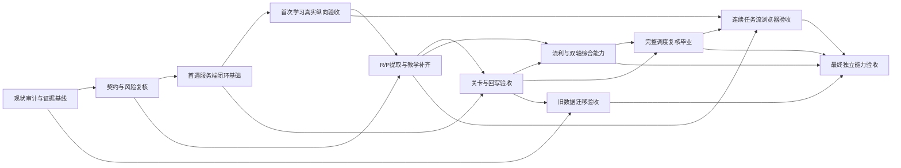

# 可交付能力驱动的实施计划（修订版）

> 状态：规划基线，2026-11-06。仅供后续实施与恢复；不改变算法规范。算法规则以 [algorithm.md](./algorithm.md) 为唯一权威，原始范围与 T01–T16 追踪关系见 [task-implementation-dag.md](./task-implementation-dag.md)。历史实现记录见 `implementation-status.md`，其中 DONE 仅为线索，不构成当前验收证据。

## 1. 目标与非目标

交付按算法规范工作的学习系统：双轴学习与计分、材料资格、服务端签发/提交、调度恢复，以及连续任务流。用户从真实入口可以学习、独立作答、获得反馈并继续；关键状态和证据可复现、可审计。

UI 以 `/task-preview` 的浅色、绿色、卡片和进度表达为视觉参考，形成适配移动端和桌面的纵向连续任务流。原型不定义算法和计分。

本计划本身不修改 `algorithm.md`，不降低算法门槛，不以编译通过替代用户能力验收。产品决策未定的语义不得由执行 Agent 自行补造。

## 2. 现状及复用判断

审计依据：源码入口、测试目录、`implementation-status.md`、原计划及当前 Git 状态。工作树已有未提交文件 `implementation-status.md`，另有其记载的构建生成文件变化；实施前须保留并核对，不得覆盖用户改动。

| 领域 | 已有实现/可复用 | 缺口与当前判定 |
|---|---|---|
| 契约、数据与导入 | `lib/tasks.ts` 抽象任务/实例/结果；`lib/db.ts` 双轴、先验、验证、速度、综合、重学和旧分数字段；`lib/targets.ts` 目标映射 | 过往 T01/T03/T04 的类型/编译证据不能证明数据库行为正确；迁移兼容性需针对当前 DB 实测 |
| 回写、调度 | `lib/scheduler.ts` 具备关卡回写、优先级、冷却、急救/重学及 P 综合相关逻辑；`lib/config.ts` | R 综合目前被跳过，因缺服务端可核验的多目标整段理解答案；需补能力并验证，不允许静默跳过。调度是否完整执行规范短路顺序要用确定性场景复核 |
| 材料与评估 | `lib/material.ts`、`lib/mfi.ts`、`components/task-cards.tsx` 有材料长度、语言覆盖、词归属、测速及缺口表达 | 主题元数据未进入派题候选；主题匹配不能视为已交付 |
| API 与持久化 | `app/api/task/{route.ts,result/route.ts,service.ts}` 有签发/恢复、证据检查、事务回写和幂等实现 | 需对当前代码版本执行真实 API/DB 验收；过往状态表只记载历史测试 |
| 任务 UI | `components/task-renderers.tsx`、`app/page.tsx` 有四类 renderer、连续流、恢复、失败保留输入、EMPTY、滑动/锁定语义 | T11–T13 和 T15 无真实浏览器闭环证据；源码契约测试不能证明交互。显式跳过/延期未实现，分析 `skip_count` 恒为 0 |
| 分析 | `lib/task-analytics.ts`、`app/api/task/analytics/route.ts` 可聚合多类指标 | 跳过率无真实事件源；需先明确并实现用户动作和事件语义 |
| 参考界面 | `app/task-preview/` | 历史上只记录原型文案调整，实际视觉/交互未浏览器验收；本轮未进行浏览器检查，外观判断沿用用户给定的设计约束，待能力验收实测 |
| 自动化 | `test/task-implementation-dag.test.cjs`、`test/task-flow-journey.test.cjs` 等 | 历史记录称算法测试 8 项、服务层旅程 6 项通过；须重新执行并绑定当前 commit，不能据历史标 DONE |

### 关键风险与待决策

1. R 综合任务的材料、逐词归属、服务端答案键及整段理解证据必须一致，否则算法路径不可触发。
2. 当前没有主题元数据输入契约；需确认主题源自词条标签、导入材料主题还是其他既有来源。实现前先查代码/算法规范，若规范不能决定则 BLOCKED。
3. 跳过和延期是不同的用户意图，会影响冷却、tick、分析及后续派题。算法未定义其状态语义；在产品决策前不把它纳入必须交付范围，也不伪报跳过率。
4. 迁移可能遇到证据不足的旧成绩；必须保留 legacy 值并禁止凭旧分生成认证、速度或毕业。
5. 真实浏览器测试需可用本地服务、数据库和稳定种子数据；环境不可用时记录阻塞证据和最小恢复动作。

## 3. 状态、证据和执行协议

状态：TODO（依赖未满足）、READY、IN_PROGRESS、BLOCKED、DONE、STALE、FAILED。DONE 要求节点契约验收通过且证据绑定当前 commit；改动上游契约后沿 DAG 将受影响验收标为 STALE。`implementation-status.md` 记录为 PARTIAL 的任务映射到本计划时不得自动继承 DONE。

每节点记录 ID、目标/阶段、依赖、输入输出契约、允许范围、可观察结果、Given/When/Then、验收命令和结果、证据位置、commit、阻塞原因、最近状态变化。证据至少保留命令输出或测试报告；浏览器节点保留运行配置、关键截图/交互记录和对应 commit。

独立 Worker 实现单节点、运行指定验证；独立 Verifier 从验收条件检查实际行为，不依赖 Worker 报告；主 Agent 决定依赖状态、集成并更新记录。不同 Worker 不得共享写工作区；用独立 worktree 或串行实现，合并后执行受影响回归。单问题自动修复最多两轮；范围扩大则拆分新节点。阻塞恢复见第 8 节。

## 4. 分阶段路线与退出条件

| 阶段 | 用户可见交付 | 节点 | 退出条件 |
|---|---|---|---|
| S0 现状基线与契约复核 | 可从当前状态恢复执行，关键接口和规则有可运行证据 | N00、N01 | 现有测试重跑并记录；契约/风险审查完成；不把历史 DONE 当现状 |
| S1 首次学习最小闭环 | 用户能从正式入口得到一项服务端签发任务、独立作答、提交并看到真实状态变化 | N02、N03 | 至少一个可重复的真实纵向旅程通过 API/浏览器；失败不记分、重复提交幂等 |
| S2 双轴基础训练 | R/P 各自可教学、独立提取、按关卡验证 | N04、N05 | 轴归属、分数、复核与 UI 操作端到端一致 |
| S3 流利、综合与完整调度 | 合格材料下完成流利/综合；等待、急救、重学和毕业按规范运行 | N06、N07 | R/P 综合路径可触发或明确因规范之外阻塞；候选缺材料不会被伪装为 EMPTY 等待 |
| S4 连续任务流及恢复 | 手机/桌面连续完成、刷新恢复、网络失败重试、空状态可理解 | N08 | 真实浏览器旅程覆盖关键正常/异常路径；主题与跳过语义未决项明确隔离 |
| S5 迁移回归与交付验收 | 当前数据安全迁移，完整必需旅程可重复 | N09、N10 | 算法/API/DB/UI 回归及完整学习旅程通过；无影响交付的 BLOCKED/FAILED/STALE |

最早可运行学习闭环在 S1 结束（N03），不是等所有技术模块齐备之后。

## 5. 技术实现 DAG（保留 T01–T16 追踪）

文件范围为主要入口，Worker 可经主 Agent 批准后增加必要文件；不得借节点扩大改算法规范。

| 新 ID / 旧追踪 | 阶段 | 目标与契约 / 主要范围 | 依赖 | Given / When / Then 验收及 Evidence |
|---|---|---|---|---|
| N00 / T01,T03,T04,T05,T06,T07,T09,T10,T14 | S0 | 复核当前分支、DB、既有测试及接口契约；不实现新业务。`git status`、`lib/{db,tasks,scheduler,targets}.ts`、API、test | — | Given 当前工作树；When 重跑现有算法/API 测试及类型检查；Then 结果绑定 HEAD、用户改动未覆盖，并形成缺口清单。Evidence：命令日志、commit、状态记录 |
| N01 / T01,T02 | S0 | 定义本轮纵向闭环选择、实例/结果证据字段与 UI 状态，映射算法不变量；`docs`、类型定义复核 | N00 | Given 现有 TaskInstance/API；When 合同审查；Then 每个后续能力的答案键、轴、关卡、事件来源、EMPTY 原因均有提供方；Evidence：契约矩阵与审查记录。未解决的产品规则标 BLOCKED |
| N02 / T03,T04,T05,T10 | S1 | 固定测试夹具下验证一个低先验 R 或 P 首遇任务的 DB/API 服务端路径；优先复用已有代码，仅补缺；`lib/db.ts`、`lib/scheduler.ts`、`app/api/task/` | N01 | Given 新词与确定先验；When 签发、独立提交；Then 只更新被考轴的真实观察/状态，事务一致且可恢复；Evidence：API/DB 集成测试和状态快照 |
| N03 / T10,T11,T12,T13,T15 | S1 | 最早的用户纵向能力：正式入口完成一次真实首遇任务、反馈和下一任务/EMPTY；`app/page.tsx`、renderer、task APIs | N02 | Given 可复位 DB 和浏览器；When 用户完成作答并提交；Then UI 展示服务端结果，刷新恢复一致，重复提交无重复计分；Evidence：Playwright/浏览器运行记录、截图、DB 前后状态及 commit |
| N04 / T07,T08,T11 | S2 | R/P 低分 RETRIEVE 和 ENCODE 材料/评估闭环；`lib/tasks.ts`、`lib/material.ts`、renderer | N01,N03 | Given R/P 各自低分词；When 独立作答；Then 每轴都有合格任务，答案揭示/提示不能认证，教学不加分；Evidence：资格契约测试、API 测试、浏览器各轴操作记录 |
| N05 / T05,T07,T10,T14 | S2 | 分段关卡、失败复核、目标分与轴独立回写；计分/调度/API | N02,N04 | Given 固定关卡及独立证据；When 通过/失败/目标变化；Then 仅通过提高历史 F，失败保分并置待复核，跨轴不迁移；Evidence：确定性单测和 DB/API 集成状态断言 |
| N06 / T08,T09,T14 | S3 | 连续材料 FLUENCY 与 R/P INTEGRATE 资格/服务端证据，优先补 R 综合缺口；`lib/material.ts`、`lib/mfi.ts`、scheduler、答案键持久化 | N04,N05 | Given 合格多目标材料及逐词/整段检查答案键；When 请求 R/P 综合；Then 仅合格轴/词被派发并可验证，缺材料返回明确原因；Evidence：确定性材料、调度、提交/API 测试。若材料来源契约缺失，创建补全节点并阻塞本节点 |
| N07 / T09,T10,T14 | S3 | 完整短路顺序、优先级、记忆/冷却、急救、重学、EMPTY 和毕业；scheduler/config/API | N05,N06 | Given 固定时间/tick 与竞争候选；When 调度；Then 按规范顺序唯一稳定决策；冷却按 7 个其他任务或 20 分钟，长期记忆独立；毕业含各项条件；Evidence：固定时钟测试、API 集成矩阵 |
| N08 / T02,T11,T12,T13,T15 | S4 | 连续任务流真实浏览器行为；`app/page.tsx`、CSS、renderer | N03,N04,N07 | Given 手机/桌面视口及任务流；When 完成、滑动、刷新、断网重试、遇 EMPTY；Then 未提交不误切题、服务端确认后切换、输入可恢复、空原因正确；Evidence：真实浏览器交互、关键截图、网络/状态记录。跳过/延期除非产品规则先确定，否则不验收为必需行为 |
| N09 / T03,T06,T14 | S5 | 旧数据迁移安全性与重放证据校验；`lib/db.ts` | N00,N05 | Given 证据完整/不完整的旧记录及重复迁移；When 迁移；Then 有证据只恢复实证最高关，无证据保留 legacy 且不认证/毕业，重跑幂等；Evidence：临时 DB 集成测试和迁移前后快照 |
| N10 / T15,T16 | S5 | 独立最终验收、分析事件来源审查及交付记录；测试与进度文件 | N06,N07,N08,N09 | Given 干净复位环境；When 执行覆盖的学习旅程/回归；Then 所有必需能力通过，指标仅由真实事件计算，无必需节点 BLOCKED/STALE/FAILED；Evidence：汇总报告、浏览器录像/截图、测试输出、commit 清单。跳过率只有语义和事件实现后才可声称可用 |

## 6. 纵向能力验收节点

技术节点通过不等于用户能力 DONE。N03、N04、N06、N07、N08、N10 分别是能力闭环门槛。

| 能力 | 旅程及必须观察的 Then | 证据 |
|---|---|---|
| 首次学习 | 导入/选取未测词 → 先验路由 → 服务端实例 → 教学或独立诊断 → 提交 → 正确更新 introduced、轴观察、时间锚；教学不授分 | N03 浏览器 + API/DB 状态断言 |
| R 与 P 独立提取 | 每轴独立选择任务，答案键留在服务端；错误后保留历史成绩并置当前验证失效；目标词错误触发同轴恢复 | N04/N05 确定性测试和浏览器交互 |
| 流利训练 | 具备连续材料、明确测速范围与整体理解/表达检查；不足证据不能认证 60+ 关卡 | N06 API 证据验证 + 浏览器计时操作 |
| 综合、复核、毕业 | 单轴资格可独立成立；综合逐词归属；急救先验证；毕业按目标、验证、速度、保持力全部成立 | N06/N07 场景矩阵与 DB 状态断言 |
| 连续下一题及恢复 | 提交得到反馈后切换；重复提交幂等；刷新恢复；失败网络保留输入；冷却等待/完成/材料缺失区分 | N03/N08 真实浏览器记录及事件检查 |

## 7. 并行与集成约束

- N00→N01→N02→N03 是最早闭环关键路径。N02 完成后，N04 的 R/P 材料探索与 N05 的关卡规则审查可分别准备，但共享 scheduler/db 时需隔离工作区并由主 Agent 串行集成。
- N06 与 N08 的设计/测试夹具可并行准备；代码集成须等待接口契约固定。N09 可在 N05 契约冻结后并行于 N06/N08 开发。
- 高冲突文件：`lib/scheduler.ts`、`lib/db.ts`、`lib/tasks.ts`、`app/page.tsx`。同一文件同一时段只允许一个写入 Worker；其他任务通过接口提案或独立 worktree。
- 每次合并记录合并 commit；上游输出字段/派题语义/答案键变化时，对依赖图可达的下游验收做影响分析并标 STALE，优先重跑验证而非重做实现。

## 8. BLOCKED、失败恢复与动态依赖

发现上游能力缺失时，当前节点立即停止依赖该能力的实现，标 BLOCKED，记录复现步骤、实际/预期差异、缺失契约和证据。判断：若既有上游未满足其验收，新增最小缺陷补全节点并依赖原上游；若上游已按契约完成但新能力确为遗漏，则建立新增能力节点。更新 DAG 并确认无环。补全通过后，将受影响下游标 STALE，先重验，必要时修复，再恢复原节点。

单问题最多两轮自动修复。第二轮仍不通过则 BLOCKED（可恢复且有动作）或 FAILED（修复预算耗尽/不可恢复）；无进展停止。BLOCKED 不阻塞无依赖节点。不得改弱测试、算法阈值、伪造数据或静默跳过任务路径。产品语义歧义记录问题、受影响节点及决策需求，维持 BLOCKED。

动态任务记录最少字段：`id,status,deps,contract,scope,acceptance,evidence,commit,blocker,last_transition,repair_attempts`。每次状态变更即更新机器可读进度；每次恢复先读该记录和 Git 状态。

## 9. 完整 Mermaid DAG

## 10. 最终完成条件

必需能力的纵向验收节点全部 DONE，当前 commit 的算法、API、DB、UI 关键测试及真实浏览器旅程通过；迁移可重复且无虚构认证；不存在影响交付的 BLOCKED/FAILED/STALE；未覆盖限制与产品决策单独记录。分析指标不得宣称覆盖不存在的真实事件。

## 计划摘要

- **5 个阶段，11 个工作包**（N00–N10；技术实现与纵向验收合并编排）。
- **最早闭环：S1 / N03**，在最小首遇服务端路径具备后即可从正式入口完成一次真实学习动作。
- **可并行：**契约稳定后，材料/轴任务与关卡验证可分离准备；迁移验收可与流利/综合及 UI 工作并行，冲突文件通过 worktree/串行集成控制。
- **最大三个风险：**R 综合缺少可核验答案证据；主题元数据来源未接入且语义待定；真实浏览器验收与旧数据迁移尚无绑定当前 commit 的证据。
- **产品决策：**跳过与延期对 tick、冷却、派题和统计的影响；主题来源若算法/现有数据不能确定；任何会改变规范任务动作或学习状态的 EMPTY/恢复语义歧义。其余遵循 `algorithm.md`，不另造规则。

## 独立自审

- 算法规则列出的首次路由、双轴关卡、材料资格、R/P 综合、冷却、急救、恢复、目标与毕业均有实现/验收节点；迁移和事件来源有单独审查。
- 每项用户能力都有纵向验收与行为证据，不以测试数量、源码检查或编译代替浏览器行为。
- N03 在全量改造前交付最小闭环；缺材料、EMPTY、重复提交、刷新和失败重试均规定可观察结果。
- R 综合和跳过事件当前不可触发/无来源的事实已显式列为缺口；不把未定义产品语义伪装成已完成能力。
- 依赖更新、STALE 重验、最多两轮修复、可中断进度记录和 DAG 无环检查均已定义，能从局部缺口恢复而无需重跑整个计划。
