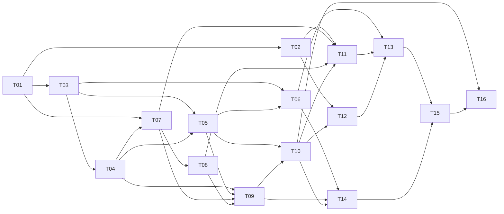

# 任务算法与连续刷题界面实施计划

> 状态：实施方案。算法、计分、目标与毕业规则以 [algorithm.md](./algorithm.md) 为准；本文件只规定开发顺序、交付边界和验收方式。`/task-preview` 提供视觉参考，不提供计分依据。

## 目标与范围

把当前按 `STEP12/STEP3/STEP4/STEP4R/MFI/PART_B` 派发的任务链，改为按 **学习目的 × R/P 轴 × 用途 × 证据** 派发；用户在一个连续任务流中完成教学、独立作答、反馈和下一题。移动端以单张卡片占据主要视口，纵向滑动切换；桌面端保持 `/task-preview` 的浅色背景、绿色强调色、卡片和进度表达。

首版覆盖四类任务：`ENCODE`、`RETRIEVE`、`FLUENCY`、`INTEGRATE`，以及无任务状态 `EMPTY`。已有题型可作为 renderer 复用，但旧题型名不再承担调度和计分语义。

## 分阶段交付

| 阶段 | 目标 | 完成标志 |
|---|---|---|
| 1. 契约与界面规范 | 固定任务实例、证据、交互状态的含义 | 前后端能按同一任务契约开发；原型不再展示旧算法结论 |
| 2. 状态与计分 | 迁移双轴状态、个人目标、先验及历史记录 | 只有合格的同轴独立考核可以认证关卡；旧分数不能自动毕业 |
| 3. 任务库与材料 | 补齐 R/P 的教学、提取、连续读写和综合任务实现 | 候选具备明确的材料条件、检查方式及逐词归属能力 |
| 4. 调度与接口 | 按规范短路顺序派题，原子提交结果 | 可稳定复现派题、冷却、急救、复核、等待与缺材料状态 |
| 5. 连续刷题 UI | 把真实任务接入单卡纵向任务流 | 手机、桌面、键盘和触屏均能完成完整学习循环 |
| 6. 端到端验收 | 校验迁移、完整旅程和事件数据 | 达到本文件的验收场景，具备后续参数校准所需记录 |

## 任务 DAG

节点完成的定义：代码和必要的验证均已完成，且下表的验收条件成立。依赖列列出**直接前置节点**；没有列出的节点可并行开发。编号只用于跟踪，不表示派题顺序。

| ID | 阶段 | 工作包与主要位置 | 依赖 | 验收条件 |
|---|---:|---|---|---|
| T01 | 1 | 定义 `TaskDefinition`、`TaskInstance`、`TaskResult`、证据与 `EMPTY` 原因；`lib/tasks.ts`、API 类型 | — | 类型明确 `type/axis/purpose/action/checkpoint/word_ids/renderer`；关卡在出题时确定；教学与补练可用空关卡 |
| T02 | 1 | 定义交互状态与视觉规范；`app/task-preview/` | T01 | 明确准备、作答、提交中、反馈、切换；移除原型中的 EWMA、教学加分和演示速度认证文案；设计移动端单卡与桌面布局 |
| T03 | 2 | 数据结构与迁移骨架；`lib/db.ts` | T01 | 保存 `introduced`、双轴观察/验证/速度/时间锚、逐轴综合、待重学、频率来源及历史分；迁移可重复运行且不会重复改写状态 |
| T04 | 2 | 目标和导入先验；`lib/targets.ts`、导入路径 | T03 | 目标使用 `60 + 40 × 速度位置`，无词频加分；校验支持速度范围；未考核双轴均为 0，`q` 只影响首次路由 |
| T05 | 2 | 关卡判定与结果回写；`lib/scheduler.ts` 或独立计分模块 | T01、T03、T04 | 通过才写入预声明关卡；失败保分并撤销验证；教学不计分；`≥60` 必须有合格连续测速及整体、目标词检查；双轴与游标独立更新 |
| T06 | 2 | 旧事件迁移及兼容读取；`lib/db.ts`、事件表 | T03、T05 | 有完整证据才重放最高已通过关卡；其余旧分保存为 `legacy_score`；旧记录不生成速度认证、双轴综合或毕业 |
| T07 | 3 | 任务定义注册与候选资格；`lib/tasks.ts` | T01、T04 | 以轴、分数范围、用途、材料、证据生成候选；低于 50 的 R/P 均有 RETRIEVE 入口；同分不靠旧题型固定顺序 |
| T08 | 3 | 材料与评估能力；`lib/material.ts`、`lib/mfi.ts`、现有题型组件 | T07 | 连续文本检查主题、其他语言材料、长度与测速；理解/表达结果能归属到目标词；材料不足可返回明确原因 |
| T09 | 4 | 调度器与优先级；`lib/scheduler.ts`、`lib/config.ts` | T04、T05、T07、T08 | 实现待重学→同轴综合→急救验证→普通复习→新词→兜底→`EMPTY`；`R_a=L_a`，共享冷却为 7 题或 20 分钟；同轴材料失败才回退 |
| T10 | 4 | 服务端任务实例与提交接口；`app/api/task/` | T05、T09 | 服务端核对实例、轴、关卡、目标词与独立作答证据；提交与事件回写在事务中完成；重复提交不增加 tick 或重复计分 |
| T11 | 5 | 四类任务的正式 renderer；`components/task-cards.tsx` 或拆分组件 | T02、T07、T08、T10 | R/P 各自呈现合格动作；揭示答案或使用提示后不能把本次当独立通过；连续读写的计时与检查完整 |
| T12 | 5 | 单卡纵向任务流外壳；`app/page.tsx`、样式 | T02、T10 | 当前任务可恢复；提交后反馈再切换；可点按钮或上滑进入下一题；请求中锁定切换；移动端输入、滚动和长篇阅读可用 |
| T13 | 5 | 将 renderer 与任务流接通；`app/page.tsx`、API | T06、T11、T12 | 新词、复习、急救、重学、综合、`EMPTY` 均能在同一入口完成；调试信息移至非学习主流程 |
| T14 | 6 | 算法与迁移场景验收 | T06、T09、T10 | 固定时间和 tick 的测试覆盖首遇路由、关卡、双闸门、急救、同轴综合、目标变更、毕业和旧数据迁移 |
| T15 | 6 | UI 与完整学习旅程验收 | T13、T14 | 手机/桌面完成导入→首次任务→复习→复核；刷新、重复提交、跳过、网络失败、长篇阅读和键盘输入均有确定行为 |
| T16 | 6 | 事件分析与参数校准准备 | T10、T15 | 可按任务定义、轴、关卡、用途统计通过率、复核失败率、材料缺失、跳过率、退出率与速度分布 |

**可并行工作：**T02 与 T03；T06 与 T07/T08；T11 与 T12。**主集成路径：**T01 → T03 → T04/T05 → T07/T08 → T09 → T10 → T11/T12 → T13 → T15。T14 在算法和接口稳定后即可开始，不必等界面完成。

## 连续刷题交互契约

1. **一屏聚焦一项任务。**卡片顶部展示方向、任务目的和进度；用户只看到完成当前动作所需的材料。分数显示为已通过最高关卡；失效时标为“待复核”。不把预测遗忘显示成扣分。
2. **提交后才能产生学习证据。**教学观看、独立作答、揭示答案后的补练分别记录。答题前展示答案或泄露提示的题不能认证关卡；提示后正确也不能覆盖首次独立失败。
3. **上滑用于切换任务。**提交并收到服务端确认后展示简短反馈，随后允许上滑或点击“继续”。未提交时上滑只可保留当前题或显式跳过；跳过必须记录为跳过，不计通过，不伪造失败。
4. **计时任务保留连续性。**阅读从展示完整材料后开始计时，读完再答理解题；写作按声明的起点计时。输入框获得焦点、长文内部滚动或查看题目时，不把普通手势误识别为切题。
5. **连续流有真实终点。**`EMPTY` 区分等待冷却、全部完成、材料不足；显示对应原因和可恢复动作。预取下一题可以改善过渡，但不得提前泄露独立考核的答案或材料。
6. **服务端是计分依据。**客户端只提交作答与可核验的计时信息；任务实例、关卡、归属、有效速度及是否通过由服务端确认。网络失败保持当前卡片与输入，重试不会重复计分。

## 阶段验收场景

- **新词：**低、中、高先验分别进入教学、诊断、验证；先验、观看和跨轴通过均不直接给另一轴成绩。
- **关卡：**20/35/50 依同轴独立准确性晋级；60 以上同时满足连续材料、速度、目标词和整体检查；个人目标位于边界之间时直接考精确目标分。
- **复核：**高分词失败后保留历史分并显示待复核；低难度任务通过不能恢复高分认证；严重遗忘先验证，目标词失败后才同轴重学。
- **调度：**R/P 的长期记忆独立，共享冷却独立于 `R_a`；达到同轴 75 且当前有效才进入该轴综合池；无材料时返回材料缺口而非等待时间。
- **毕业：**两轴分别满足目标分、当前验证、真实速度证据和 30 天保持力后毕业；低于 75 的个人目标不强制综合运用。
- **任务流：**连续完成多题、切换方向、刷新恢复、网络重试、重复提交和跳过，tick 与事件数始终符合实际完成次数。

## 当前代码的实施入口

- 算法状态与迁移：`lib/db.ts`、`lib/targets.ts`、`lib/config.ts`。
- 任务资格、调度与回写：`lib/tasks.ts`、`lib/scheduler.ts`、`lib/material.ts`、`lib/mfi.ts`。
- 接口：`app/api/task/route.ts`、`app/api/task/result/route.ts`。
- 正式任务流：`app/page.tsx`、`components/task-cards.tsx`；视觉参考：`app/task-preview/page.tsx`、`app/task-preview/page.module.css`。

当前 `/task-preview` 使用旧的平滑计分公式和演示判题，T02 必须先修正其规则文案。`app/page.tsx` 当前将任务与调试表并列展示，T12/T13 将学习主流程改为连续任务流。
