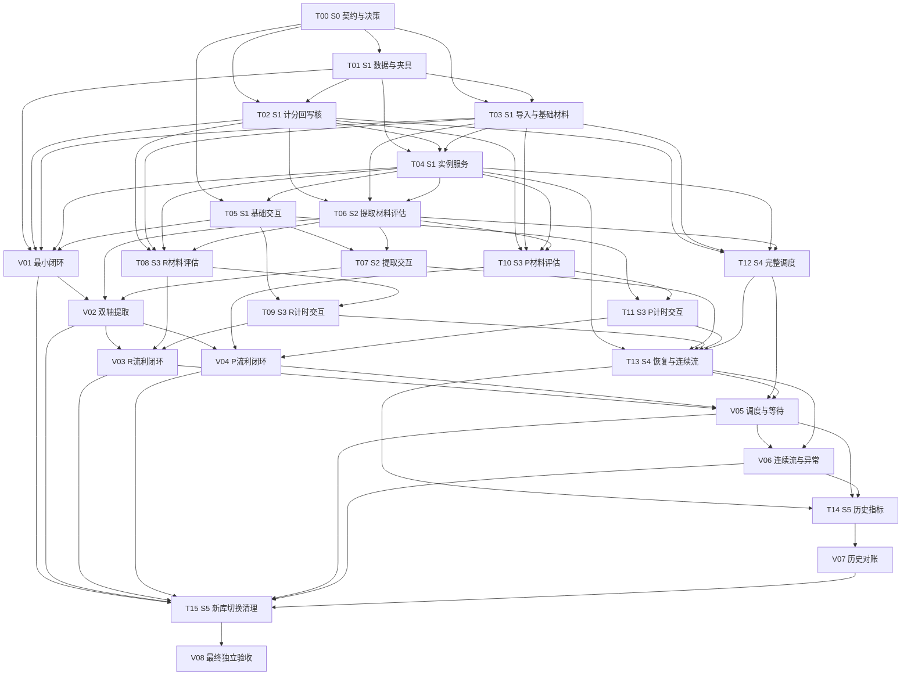

# 新算法任务系统：分阶段交付与执行 DAG

> 规划基线：2026-11-06；状态：待实施。本轮只创建本计划，不修改业务代码或 `algorithm.md`。共 6 阶段、24 工作包：16 个技术实现包 T00–T15，8 个独立纵向验收包 V01–V08。所有节点初始为 TODO；本文中的现状测试通过不等于节点 DONE。

## 1. 产品目标、非目标与权威来源

交付可以从正式 `/goals` 与 `/` 入口使用的学习系统：确认词义、设置双轴目标、导入、学习与提取、阅读和写作流利训练、反馈、继续、等待、跳过、退出、恢复以及可追溯历史。每项有效练习从材料到下一次调度完整贯通，正确性以用户行为、数据库变化和事件证据共同证明。

权威顺序：当前工作树的 [algorithm.md](./algorithm.md) → 经产品确认且留档的待决策补充 → 本计划契约 → 实现与测试。规范发生变化时重新审查受影响节点。历史 [task-implementation-dag.md](./task-implementation-dag.md)、[task-implementation-dag-new.md](./task-implementation-dag-new.md)、`implementation-status.md` 仅用于理解历史，不继承其中 DONE 或产品规则。

当前规范明确取消 INTEGRATE、q/首次诊断、verified/speed_verified/integrated/axis_done/graduated 的派发与计分作用、pending_relearn 抢占及永久毕业。失败讲解属于当前反馈。用户请求中的综合、复核、毕业例子不是本版需求；本计划覆盖它们的退役验证，不创建新的综合或毕业能力。保留显式跳过，不实现延期。

规范末尾明确“不要考虑旧数据，现在是原型阶段”：本计划的迁移指 schema 版本化、新库初始化、原型切换和种子升级，不搬迁旧成绩或重放历史认证。不得在开发验收时删除用户当前 `flow.db`；使用新临时库/独立开发库。非目标包括新增账号体系、通用阅读能力认证、完全防粘贴、扩大 PDF/OCR 功能、独立重学计分任务。

## 2. 现状审计与复用分析

仓库没有 `.codegraph/`，按仓库指令跳过 CodeGraph。已阅读算法、任务模型/数据库、调度和计分、任务服务/API、正式页/预览/renderer、目标导入/材料/LLM/分析及相关测试。当前工作树已有用户改动，包括 `docs/algorithm.md`、`lib/db.ts`、`lib/scheduler.ts`、`app/page.tsx`、`package.json`，以及手工测试、分数历史和旧计划等未跟踪文件；后续实施先记录差异，不覆盖或重置它们。

| 模块与主要源码 | 可复用部分 | 必须修改、替换或补全 |
|---|---|---|
| `lib/db.ts`：WordRow、createDb、task_instances、events | SQLite/WAL、轴级 F/H/时间锚、introduced/observation、事务、实例持久化 | 当前共享冷却借 max(last_ts,last_ts_r)，R 返回 C×L；需要明确词级锚、7 tick、R=L。实例只有 issued/submitted/skipped，缺退出/无效/判分重试状态和版本材料存储。旧迁移重放认证不用于新库 |
| `lib/tasks.ts`：TASK_LIBRARY、eligibleTaskDefinitions | 类型定义、renderer 路由、实例 ID | 当前 ENCODE/RETRIEVE 范围重叠，FLUENCY 从 50 开始，存在 INTEGRATE/checkpoint 与旧 purpose。替换成唯一分数映射及 stage、单词单轴实例；正式提示不能使 cued 无效 |
| `lib/scheduler.ts`：priority、getNextTaskInstance、applyTaskResult | 词/轴候选、strict 范围、优先级结构、事务入口 | 仍有 q、维护缺口、毕业、综合、pending_relearn、材料降档；计分 Math.max、成功 H×2/失败 H÷2，ENCODE 不设 5。替换这些语义，删除旧 applyResult 等路径的正式调用 |
| `app/api/task/{route.ts,service.ts,result/route.ts,skip/route.ts}` | 单一活跃实例、并发 GET 收敛、服务端判题、幂等提交、事务后派下题、skip | `retrievalFallback` 违规降档；提交时查实时 meaning，缺完整不可变答案快照；只靠字段删除脱敏不足，snapshot 亦须检查答案泄漏；判分失败前答案尚未持久化；exit 只是事件非终态 |
| `lib/material.ts`、`lib/mfi.ts` | 分词/连续材料检查框架、书籍来源/主题/词汇水平辅助 | 现有最低长度/首次出现检查不等于 100 词且 5 次；缺各档材料版本、后台生成/补充、失效、使用记录、P 中文场景。书籍/MFI 不是 R FLUENCY 的必需前置 |
| `lib/llm.ts`、service 中 R/P 判题 | 服务端配置、超时、结构化响应校验、同义释义判断、表达判断 | 增加 uncertain、判定依据、答案冻结、重试作答；P 要分别判断目标表达/整体复述，允许不影响理解的小错。生成和评估必须分开 |
| `lib/goals.ts`、`lib/targets.ts`、`app/api/goals/`、`app/goals/page.tsx` | 多来源导入、手工 gloss 与 AI 建议确认、目标选择 | 速度推目标和 q 改成直接 target_R/P 与可选初分 [0,60)；gloss 修改触发材料失效；记录 freq_source；水平只影响材料，不改变档位 |
| `components/task-renderers.tsx`、`app/page.tsx` | 正式任务流、提交锁、反馈/继续、空白区上滑、输入控件避让、跳过按钮 | 缺三档不同控件；P 连续任务泄露 chunk；R 缺回看累计；反馈仍讲关卡；下一题与上一题反馈数据需分离；刷新与计时中断不能沿用旧用时 |
| `components/task-cards.tsx`、`app/demo/`、`app/task-preview/` | 展示、排版和部分交互参考 | 独立旧演示不作为评分实现；预览档位 00–19/20–34/35–49/50–59 等、观看不计分、60%+40% 平滑文案均不符合当前规范 |
| `lib/task-analytics.ts`、analytics API、`app/score-history/` | 事件聚合、skip/exit 分母、历史展示框架 | attempts 必须纳入有效不变分作答并排除 invalid；删除复核/认证产品语义；速度缺失 null；需要终态互斥和判分依据的真实事件源 |
| `test/*.test.cjs`、三个 runner | node:test、临时 SQLite、mock LLM、TS 编译执行设施 | 旧断言大量锁定错误产品行为；部分“UI 测试”读取源码字符串，不是真实行为。保留夹具设施，逐条将旧规则测试替换为规范案例，不允许只删除失败测试 |

### 本轮验证范围

已实际执行：`node test/run-task-dag-tests.cjs`（8/8）、`node test/run-task-flow-tests.cjs`（39/39，含子测试）、`node test/run-llm-tests.cjs`（5/5），退出码均 0。前两组明确包含 q、综合、毕业、降档等旧规则，结果只说明当前实现与旧测试一致。未做新版业务验收、构建或真实 LLM 质量认证。

已尝试 Browser 技能连接 `http://localhost:3000/task-preview`，初始化失败：`Importing module "node:process" is not allowed in node_repl`。未成功导航、点击或截图，因此没有实际视觉与交互验证证据。基于源码可确认预览具备轴切换、分数档按钮、局部反馈；配色、响应式、焦点、可读性、滚动和计时体验都仍是待验假设。V01 必须先恢复浏览器能力，V08 补做预览和正式页实测，不把源码检查当截图验收。

开发约束：Next/React、strict TS、better-sqlite3 的 Node runtime；package.json 当前没有 test 脚本，执行上述 runner，不写不存在的 npm test 作为现有命令。有多种 lockfile，T00 记录所用包管理器/版本，避免无关依赖升级。LLM 真实环境需要现有配置项，但日志不得记录密钥。测试注入 clock/ID/provider，禁止等待 20 分钟的真实睡眠测试。

## 3. 必须先解决的决策与技术风险

下表决策由产品负责人确认，T00 负责记录选择、理由、版本及影响节点；执行 Agent 不擅自选产品参数。本轮不要求立即回答才能提交计划。可先编写接口和测试骨架，但未决定的行为不能标 DONE。测试使用显式参数不代表产品默认值。

| ID | 待决策事项 | 最早阻塞节点 |
|---|---|---|
| D1 | R/P 目标默认值；用户明确填写合法值时可继续开发，默认入口必须最后关闭此决策 | T03（默认入口）、V08 |
| D2 | 目标词曝光的可验证事件、H 增强函数/幅度；P 未写对目标词时，失败反馈曝光何时确认？反馈未见就退出如何避免提前增强？不能默认成功翻倍 | T02、T04、V01 |
| D3 | 用户水平匹配阈值；英文词数、缩写/连字符、多词语块、允许词形及出现次数统计口径；本项目存在 break the ice 类语块 | T03 的内容校验、T06、T08、T10 |
| D4 | FLUENCY 中断具体事件（切后台、刷新、离线等）、刷新恢复与显式退出边界；不得用无输入超时推断离开 | T09、T11、T13 |
| D5 | 每档材料准备/补充数量、使用后复用策略、生成及判分重试上限与时间预算、显示小数精度 | T03、T08、T10、T12、T13 |
| D6 | 并发窗口/状态冲突策略；gloss/目标范围修改时已签发实例如何处理；禁止对新答案键判旧答案 | T04、T13 |
| D7 | 新词“目标缺口最大”按原始 target−F 还是归一化 gap 比较（目标不等时结果不同）；同优先级/同词频 tie-break 固定规则；freq 缺失时如何补充/排序，禁止暗混词频来源 | T04、T12 |
| D8 | ENCODE 完成是否进入分析 attempts（规范称有效任务又称有效作答）；退出判分待重试实例是否关闭该作答，以及首次提交不足 30 词的继续编辑边界 | T10、T13、T14 |

跨模块最大风险：

1. **材料、答案键、判定和 UI 不一致**：P 泄题、同档生成失败降档、R 无合格材料等使路径假可达。T03 先建立统一版本材料管线，T08/T10 早做真实 AI 样本；V03/V04 从导入入口验证，不仅插入数据库跳过材料。
2. **实例状态与异步判分/计时的原子性**：反馈曝光、重复请求、重试、跳过并发可能多加 tick、误扣分或多增强 H。T00 固定状态机，T04 建持久化作答，T09/T11 计时协议，T13 故障注入验证。
3. **旧规则残留及未决记忆参数**：旧测试全绿仍可能不合规；D2 直接阻塞最小闭环。T02/T12 纯函数黄金数据与旧字段扰动测试，T15 检查所有正式入口和脚本，V08 独立回归。

## 4. 共用契约与验收设施

以下是实施接口设计，T00 落为带版本的类型/契约说明；不扩大算法语义。

- C1 状态：每词单独 F_R/F_P、introduced；每轴 observation、H、nullable last_ts；词级 last_ts_any/last_tick_any；全局 tick；直接目标与 freq_source。初始 H=1h，分数不舍入存储。有效事务只更新目标轴；共享锚单独更新。
- C2 材料：id/version、word_id/axis/stage、已确认 sense/version、水平/主题/词频来源、状态 preparing/ready/failed（失效材料另有标记）、public_payload、server_answer_key、grading_requirements、timing_protocol、计数校验与依据、生成/使用记录。一次任务仅一词一轴。R 短文恰好 100 词、目标至少 5 次；P 中文情境不公开目标英文。所有正式题在签发前完成校验和答案冻结。
- C3 实例：规范的 instance_id/definition_id/word_id/axis/type/stage/purpose/score_before/material_id/version/target_sense/payload/grading_requirements/timing_protocol，加契约版本与冲突校验版本。公开 DTO 用白名单构造，独立验证 task、snapshot、HTML、错误响应均不泄漏答案；choice 允许选项包含正确项，但不透露正确索引；cued 仅公开规定支架；ENCODE 公开教学内容。
- C4 作答：instance_id、attempt_id、首次完整 response、计时片段/序号、曝光事件。服务端计算答案判定/速度/分数，不接受客户端的 passed、wpm 或 score 作为权威。判定返回 target/overall 各检查、依据、valid/invalid/uncertain/service_error、原因和 score_before/after。只读客户端计时不是防作弊保证，但须校验顺序、重复、缺片段及与服务端会话的相容性。
- C5 生命周期：issued → 作答持久化/判分中 → completed 或等待判分重试；另有 skipped/exited/invalid 终态。精确中间状态名由 T00 固定。首次已接受完整作答被冻结，判分失败保留该作答；不足 30 词属继续编辑，不冻结为一次有效完成。终态互斥，重复请求返回同一结果；无效重开始用新 attempt 和新计时，不能拼接旧片段。跳过返回下一实例可能还是同一词，这是规范允许的结果。
- C6 调度：输入 scope、clock、tick、C1 与材料可用性；输出候选原因/同档材料需求/任务或 EMPTY。EMPTY 区分普通等待、达标等急救、材料准备/失败、范围无词，返回原因与 next_available_at（不可确定 null）。同档生成失败后重新比较其他候选，不直接切轴或降档。
- C7 事件：completed（含有效不变分）、invalid、interrupted、task_skipped、task_exit、material_job、grading_retry；实例/attempt 唯一幂等键。保存规范要求的答案、依据、所有计时片段、词数/目标次数、wpm 或 null、状态前后、原因/材料版本。聚合从真实事务事件计算，不由前端上报分数。

共用夹具由 T00 定接口、T01 实现数据库工厂：临时库、可控毫秒时钟、固定 ID、各档可用/失败材料、AI success/false/uncertain/timeout/schema-error 响应、并发栅栏与事务失败注入。测试数据覆盖 R/P 分数 0、5、20、40、60、80、100，另加 0+/20−ε/40−ε/60−ε；没有锚、只有另一轴锚、有 observation 及无 observation 各组合。禁止多个任务各建一套 scheduler/mock/DB。

验证层级：U=单元/契约，I=DB/API 集成，E=完整行为旅程，B=真实浏览器，H=人工内容/体验判断。每包保留 `test-report/new-algorithm/<ID>/`：运行命令与退出码、环境/版本、输入夹具、期望与实际、DB 前后快照和事件；B 加截图、操作序列/录屏与网络关联 instance_id；H 加样本与审阅结论。证据不能只有“通过”一行。没有浏览器能力时 B 节点 BLOCKED，U/I 可继续。

## 5. 分阶段交付路线

| 阶段 | 目标及可交付用户能力 | 必要节点与前置依赖 | 退出条件与阻塞条件 |
|---|---|---|---|
| S0 契约与风险基线 | 明确可执行规则及复现环境 | T00；无需前置 | 契约、决策责任、夹具/命令有版本；未决 D 逐节点阻塞，不拿虚设参数宣布完成 |
| S1 最小真实闭环 | 导入并确认 gloss，ENCODE→5，冷却后 choice，反馈与下一题 | T01–T05、V01；依赖 T00 和 D2 等适用决策 | V01 在正式入口贯通；不是直接调用回写。首个 E/B 在此出现。若曝光结算或真实材料链缺失则停在本阶段 |
| S2 双轴完整提取 | R/P choice/cued/free，成功升档、失败退档、合法提示及同义词判定 | T06、T07、V02；V01 为集成基线 | 六条轴/档路径均服务端签发可达；任一档只有类型名无材料/UI 不退出 |
| S3 双轴流利训练 | R 阅读/回看/理解与 P 中文复述/实测速度；允许当前分数升降 | T08–T11、V03、V04；依赖 V02 与共用材料管线 | 两条流利链各有真实材料与浏览器证据；中断规则/内容质量未定不可完成 |
| S4 全调度与连续恢复 | 达标仍急救、自然等待、材料失败替选、跳过/退出/刷新/重试 | T12、T13、V05、V06；T12 可与 S3 并行开发，阶段退出等 V03/V04 | 完整调度边界与恢复旅程通过；不允许无限请求、永久“已完成”或伪冷却 |
| S5 可交付版本 | 用户查看真实分数历史/统计；干净安装、正式入口和预览一致 | T14、V07、T15、V08；依赖 S4 | 全部必需节点 DONE，无影响交付的 BLOCKED/STALE/FAILED；真 AI 和人工质量验收未通过不能以 mock 替代 |

S1 只在明确的开发验收数据范围交付最小能力，不对外声称已支持全算法；未完成档位不可降档伪装可练。随着后续节点接入，扩展同一管线。无需完成所有技术模块才首次端到端验证。

## 6. 技术实现工作包

依赖表中的 ID 是硬依赖（全部满足才验收）；技术任务可先对冻结接口开发，但不能据 mock 下游验收 DONE。每包范围控制在一项明确交付；不改 `algorithm.md` 是全部节点非目标。表中证据使用第 4 节统一目录规则。

### T00 · S0 · 契约、决策和测试基线

- **依赖**：无。**文件**：本计划、拟新增 `docs/new-algorithm-contracts.md`、`docs/new-algorithm-decisions.md`，`test/` 共用夹具接口。
- **输入→输出**：当前算法/源码/旧测试 → C1–C7 类型草案、状态转移表、D1–D8 决策台账、旧测试逐项保留/替换清单、可执行 runner 方案。
- **范围/非目标**：规定错误码、重试预算配置接口和证据标准；不实现完整业务，不替产品拍板。记录未决项和所阻塞节点即可完成计划契约部分，受阻节点仍不得 READY。
- **G/W/T**：Given 新执行者只有仓库和台账；When 按命令启动基线并核对每种状态转移；Then 可复现现状，唯一档位/幂等/无效不更新等不变量都有测试编号，未决参数不可被默认常量掩盖。
- **验证/证据**：U、人工契约审查；命令记录、决策版本和字段生产者/消费者矩阵。**阻塞**：无法定位规范版本、接口与规范冲突未解决。

### T01 · S1 · 新 schema 与统一测试数据库

- **依赖**：T00。**文件**：`lib/db.ts`、`lib/seed.ts`、`lib/manual-test-fixtures.ts`、拟新增测试 DB 工厂；仅数据边界。
- **输入→输出**：C1/C2/C5/C7 → 新库 schema、实例/作答/材料版本及事件唯一约束、可注入 DB/clock 的夹具。
- **范围/非目标**：新 schema 版本和原型新库初始化，保留现有 SQLite 技术；不做旧学习成绩迁移、不改现有用户库。
- **G/W/T**：Given 空临时库；When 初始化两次并写重复 instance/attempt/event；Then schema 幂等、初始 H=1h/无锚/无 observation，唯一约束生效，失败事务无半笔状态；旧认证迁移不在新库执行。
- **验证/证据**：U/I；schema dump、事务回滚/并发约束结果、初始化前后快照。**阻塞**：未支持材料版本、判分待重试或互斥终态。

### T02 · S1 · 纯算法与原子回写核

- **依赖**：T00、T01；D2。**文件**：`lib/tasks.ts`、`lib/config.ts`、从 `lib/scheduler.ts` 提取的新计分/记忆模块。
- **输入→输出**：冻结实例+C4 服务端判定+曝光证据 → 单轴新分、记忆/词级锚/tick/事件的事务结果。
- **范围/非目标**：一次完成全部分数表/公式作为共享纯函数；不生成材料，不实现 UI 或完整调度，不根据客户端正确率计分。
- **G/W/T**：Given 各边界分数与目标 60；When ENCODE 完成及三档成功/失败；Then 分别 5、20/5、40/5、60/20，不截断到目标，不回 0。Given R 旧 80、两题对且 200wpm；Then 精确写入 60+50/3.75，可下降；P 同测 25/42.5/60wpm→60/80/100。目标失败→40；只有整体失败→不变但有效记录。无效先于质量判定。
- **验证/证据**：U/I；全分支表、公式边界、只改目标轴、未舍入比较、重复结算仅一次与无效全字段不变快照；曝光增强按 D2 实测。**阻塞**：D2 未决；沿用 H÷2/Math.max/提示无效/旧认证任一规则。

### T03 · S1 · 可学习导入与共用材料管线首版

- **依赖**：T00、T01；适用 D1/D3/D5。**文件**：`lib/goals.ts`、`lib/targets.ts`、goals API/page、`lib/material.ts`、拟新增材料仓储/任务处理模块；复用 `lib/llm.ts`。
- **输入→输出**：目标、词表/书源、初分、确认 gloss、水平 → 合法 C1、新词 ENCODE/R/P choice 的 C2、后台准备作业与可查询失败原因。
- **范围/非目标**：目标直设 60–100、初分 [0,60)、freq_source；先当前档再下一档的可扩展作业接口。首版实现 ENCODE/choice 生成、校验、缓存/使用记录和 gloss 失效；其他档由后续 producer 接入，返回明确未就绪，不降档。不重写 PDF。
- **G/W/T**：Given 无分/合法初分/60 初分/非法目标；When 正式导入；Then 无分为 0、合法分保留且 observation=false、非法输入拒绝无部分入库。Given 未确认 AI gloss；When 准备；Then 不成为正式判分材料；确认后产生可练材料；改 gloss 后旧版不可新派发。生成达到配置上限停止并保存失败原因。
- **验证/证据**：U/I/H；导入 HTTP、材料/job DB 快照、AI 脱敏样本及人工答案检查。**阻塞**：材料只有示例句没有答案键/提示/版本，后台作业无实际执行入口或重启无法恢复。

### T04 · S1 · 实例服务与最小可用调度链

- **依赖**：T01、T02、T03；D6/D7、D2 曝光协议。**文件**：`app/api/task/service.ts`、task/result routes、`lib/scheduler.ts`；实现新的服务模块可减少共享文件冲突。
- **输入→输出**：C1/C2 + next/submit → C3/C4/C5/C7，首条正式服务链。
- **范围/非目标**：接通按分数档位、新词/普通复习竞争和双闸门的公共选择核、单活跃实例、答案冻结、首次作答先持久化再调用 evaluator、事务幂等和下一任务；基础 choice 固定选项判分。全集急救/EMPTY 时间与复杂材料替选由 T12 扩展。既有全量 snapshot 不可泄漏答案。
- **G/W/T**：Given 可用 ENCODE/choice 与可控时间；When 并发 GET、双 POST、判分服务故障、提交事务故障；Then GET 收敛到完整同实例，首次有效结算一次，失败保留答案/状态，重试不换答案；public DTO 无 server key。下一任务准备失败不能把已提交结果报告成用户答错或丢失反馈。
- **验证/证据**：I；HTTP 请求响应、DB/事件、并发时序、公开响应答案扫描。**阻塞**：作答未先保存、重复加 tick、答案从实时 gloss 而非快照读取。

### T05 · S1 · 教学与选择题正式交互

- **依赖**：T00、T04。**文件**：`components/task-renderers.tsx`、`app/page.tsx`、相关 CSS；拆出基础 renderer 供后续扩展。
- **输入→输出**：ENCODE/choice 的 C3 → 学完确认/选择 response、曝光事件、反馈与继续。
- **范围/非目标**：R/P ENCODE 与 choice，沿用正式页布局/锁定；绑定上一题 result 与下一题各自实例 ID；不实现 cued/free 或流利。
- **G/W/T**：Given 服务端签发教学/选择；When 学完确认、选择错项、重复点击、反馈后继续；Then 展示真实 5/20/5 变化，首次答案不可覆盖，反馈讲解不另发计分任务或增加 tick，未提交上滑无动作。
- **验证/证据**：组件行为 I、B/H 由 V01 汇总；本包保留点击请求与状态输出。**阻塞**：本地判题冒充服务端结果、只能在 demo 操作。

### T06 · S2 · 三档双轴提取材料与评估

- **依赖**：T02、T03、T04。**文件**：材料 producer/evaluator 新模块、`lib/material.ts`、service 适配；避免直接扩大旧 service 单体。
- **输入→输出**：word/sense/axis/stage → R/P choice/cued/free 的材料与判定结果/依据。
- **范围/非目标**：扩展全部六条提取路径；R 释义按目标义 AI 判定同义表达，P 仅忽略大小写和首尾空格、预允许词形；规定提示合法。无测速或先验判断。
- **G/W/T**：Given R 同义/近义但错义、P 大小写/额外内部字符/许可与非许可词形；When 同档提交；Then 按规范成功或失败；uncertain/service_error 不改状态且持久化待重试；每档都有生产材料，free 不带选项/字母答案。
- **验证/证据**：U/I/H；六档样本、provider fixture、服务端依据、公开 DTO。**阻塞**：任一档无有效答案键，P 过度标点规范化使错误答案通过。

### T07 · S2 · 双轴提取交互与反馈

- **依赖**：T05、T06。**文件**：拆分的 retrieval renderer、`components/task-renderers.tsx` 路由。
- **输入→输出**：六档 public payload → 选择/提示输入/无提示输入及首次完整 response。
- **范围/非目标**：复用选择控件、键盘/移动输入/反馈；不编写客户端评分；不把按要求使用提示视为作弊。
- **G/W/T**：Given 两轴三档签发；When 用户使用提供的提示或无提示作答；Then 控件与 stage 一致，错误后展示讲解且下一次按新分数调度，不能反馈后修改覆盖首次成绩；P free 显示意思/意图但不泄词。
- **验证/证据**：组件行为测试，六档操作请求；B/H 在 V02。**阻塞**：共用文本框掩盖 choice/cued/free 的正式语义差异。

### T08 · S3 · R 流利材料与服务端评估

- **依赖**：T02、T03、T04、T06；D3/D5。**文件**：R material producer/evaluator、材料仓储与 service 接口。
- **输入→输出**：目标义/水平 → 恰好 100 词/目标≥5 次的短文、两道题、私有答案/原文依据，R 检查结果与词数。
- **范围/非目标**：复用 AI 与校验基础；支持无书源词；缓存/补充遵守共用作业规则。不用零碎细节题替换整段理解，不更新文中其他词。
- **G/W/T**：Given 99/100/101 词、目标 4/5 次、错义或难度不合材料；When 生成后校验；Then 仅完全合格材料可签发；两题键在签发前固定。Given 有效计时；When 两题结果四组合；Then 交 T02 得出规定分支，整体失败不变分不等于 invalid。
- **验证/证据**：U/I/H；计数黄金样本、真实 AI 有界生成记录与逐题依据审阅、key 脱敏检查。**阻塞**：生成成功直接等同 ready，或依赖书源才能产生 R FLUENCY。

### T09 · S3 · R 阅读、回看与计时

- **依赖**：T05、T08；D4。**文件**：R fluency renderer、新 timing 协议/服务校验模块、service 接线。
- **输入→输出**：C2/C3 timing_protocol → 初次/各次回看片段、两题 response、有效性结果。
- **范围/非目标**：文本实际显示才计时；读完藏原文答题，回看藏题并累计；不把答题时间计入，不宣称通用读速。
- **G/W/T**：Given 初读 20s、回看 10s、答题 40s；When 两题均对提交；Then reading_seconds=30、wpm=200，F≈73.333 未舍入；题文按阶段互斥。中断、缺片段、重复片段或计时无效时不更新任何学习字段，重新开始不能接旧时间。
- **验证/证据**：U/I、计时 fake clock 轨迹；B/H 在 V03。**阻塞**：D4 未决、回看计时无法被服务端验证。

### T10 · S3 · P 流利材料与服务端评估

- **依赖**：T02、T03、T04、T06；D3/D5/D8。**文件**：P material producer/evaluator、共用词数/timing 校验、service 接线。
- **输入→输出**：词义/水平/目标词形 → 无英文泄漏的中文场景/判定要求；最终文本与用时 → 两项判定、原文依据、有效词数。
- **范围/非目标**：检查目标词用法与整体复述分离；小错不影响理解可通过；无意义重复不能凑数。保留原答用于重试，不要求重新表达。
- **G/W/T**：Given 29 词、30 词无意义重复、目标词缺失、非目标小错、AI uncertain；When 提交；Then 分别继续完成/不算有效凑数/有效条件下退40/按质量判定通过/不改状态待重试。Given ≤5s 且缺目标词；Then 先判无效不扣分；>5s 有效 30 词 72s→25wpm→60。
- **验证/证据**：U/I/H；有意义计数/质量样本、双项依据、真实 AI 评估记录和失败持久化快照。**阻塞**：将所有语法错都失败、目标英文从 payload 或 snapshot 泄漏。

### T11 · S3 · P 连贯写作交互

- **依赖**：T05、T10；D4。**文件**：P fluency renderer、共用 timing 客户端；只在本轴模块改动。
- **输入→输出**：中文情境 → 主动开始、最终文本、包含构思停顿修改的完整用时。
- **范围/非目标**：少于 30 词提示继续，保留草稿，最终词数不包括删除内容；不展示英文范文或目标词；不新增粘贴检测产品规则。
- **G/W/T**：Given 未点开始；When 等待/开始后输入并删改/提交；Then 开始前不计时、开始后全部时间纳入、只算最终有效词数；失败显示具体未满足要求，语言合理但未用目标词不能误称语言错误；中断需重新计时。
- **验证/证据**：组件/I 计时与输入行为；B/H 在 V04。**阻塞**：把打字活动时间当总用时，重试丢失原答。

### T12 · S4 · 完整调度、同档保底与等待时间

- **依赖**：T02、T03、T04、T06；D5/D7。**文件**：`lib/scheduler.ts`、新 candidate/availability 模块、材料作业接线、`lib/config.ts`。
- **输入→输出**：全范围候选+ready/failed/preparing 材料 → 急救→普通≥1→新词→低优先复习→EMPTY。
- **范围/非目标**：材料 producer 接口由 T03 提供，本包不重复实现生成器；后台优先当前/下一档、接近60准备流利、持续补充、水平/主题/词义变更重匹配；重启恢复任务、有限重试。去掉旧 q/毕业/重学/综合分支，不改变档位。
- **G/W/T**：Given introduced、有实测锚且 L<0.2 的达标 R80，与普通高 P 候选；When 调度；Then R80 FLUENCY recover 优先且不预扣分。给其无材料且生成失败后重新比较候选，绝不降档。Given R=L、C≤0.5、gap>0 与边界；Then P 按规范；无轴锚不算 urgency，仍受词冷却。新词按 freq 与已确认缺口规则选轴，同分 R 优先。
- **等待验收**：Given tick 固定；When 计算 EMPTY；Then 普通等到 max(轴到 L≤0.9 的时刻、词到 C≤0.5 的时刻)，急救为严格 L<0.2 的首个可表示时刻，最终取可用材料候选的最早时刻；已达标实测轴保留急救等待；纯材料缺口 wait=null，空范围单独原因。有材料的急救不等普通冷却。
- **验证/证据**：U/I；边界矩阵、确定性候选 trace、材料重试耗尽/进程重启日志、EMPTY 时间数值；V05 补全真实两轴材料。**阻塞**：无限重试、缺材料排除最高项后不再遍历其他新词、达标永久消失。

### T13 · S4 · 生命周期恢复与连续流整合

- **依赖**：T04、T07、T09、T11、T12；D4/D5/D6/D8。**文件**：task service/routes、`app/page.tsx`、共享 flow/timing controller。
- **输入→输出**：C5 的 refresh/retry/skip/exit/interruption + C6 → 恢复的同一实例/作答或明确终态与下一题。
- **范围/非目标**：网络失败保留原答，判分重试复用不可变答案；显式跳过、退出分开；EMPTY 四类 UI、截止时刷新和手动刷新。反馈与下一实例分离，不靠重新挂载丢输入。不延期、不修改跳过词优先级。
- **G/W/T**：Given 已提交但响应丢失；When 刷新/重试；Then 返回原结果、tick 不变。Given 跳过/提交/退出并发；Then 只有一个终态和唯一相应事件；重复 skip 不再记事件且可返回同词新实例。Given FLUENCY 中断；Then 全学习状态不变，新开始新计时；未提交上滑忽略。给 wait=null，不能零延迟自动轮询；材料恢复后刷新可派发。
- **验证/证据**：I/E 故障/并发轨迹；B/H 在 V06。**阻塞**：静默丢答、自动无限重试、退出被重复计入、当前任务展示上一题判分。

### T14 · S5 · 练习历史与有事件来源的分析

- **依赖**：T13、V05、V06；D8。**文件**：`lib/task-analytics.ts`、analytics API、`app/score-history/`、正式页反馈/进度。
- **输入→输出**：C7 真实事件 → 分数/依据/材料版本/实测速度历史与跳过率、退出率分子分母。
- **范围/非目标**：保留有效不变分记录、无测速 null、AI 重试、invalid/中断原因；删除最高分保底及复核/毕业文案。不新增无来源指标。
- **G/W/T**：Given 2 次有效作答（含一次不变分）、1 skip、1 exit、1 invalid；When 查询；Then attempts=2、skip=1/3、exit=1/4，invalid 不进入分母；无测速 null 不沿用前次；重复事件不重复计算。ENCODE 计入方式按 D8 单独测试。
- **验证/证据**：U/I；从真实 API 行为产生事件再聚合的对账；B 在 V07。**阻塞**：聚合依赖伪造计数或把 invalid 当失败。

### T15 · S5 · 原型切换、残留清理与运行入口

- **依赖**：V01、V02、V03、V04、V05、V06、V07。
- **文件**：`lib/db.ts` 新库入口、seed/manual fixtures、`app/task-preview/`、`app/demo/`、`components/task-cards.tsx`、相关 scripts/tests/package scripts/说明。
- **输入→输出**：已验收链路 → 干净启动方式、新版种子、更新预览与正式路由、回归命令、可恢复执行台账。
- **范围/非目标**：移除正式调用链的旧算法及旧测试语义；预览复用正式 renderer 或清楚标记演示，0/choice/cued/free/fluency 五档一致；旧 DB 不作成绩迁移也不自动删除。
- **G/W/T**：Given 新路径空 DB 与已有原型库分别启动；When 运行文档指定安装/初始化/测试/构建命令；Then 新库运行新版，旧库被版本识别并提示切换，不偷偷重放旧成绩；正式入口不会进入 INTEGRATE/诊断/毕业/降档；预览不再显示平滑计分或旧档位。
- **验证/证据**：I/E、`npx tsc --noEmit`、`npm run build` 和更新后的三个 runner；保存残留搜索解释清单（历史文档可保留，不凭搜索零命中验收）。**阻塞**：必须改真实用户库才能验收、存在另一个可调用旧计分入口。

## 7. 纵向能力交付与独立验收节点

这些节点由不同于主要实现者的验收 Agent 执行；不实现整套业务，必要时仅新增行为测试与证据。每个 V 都检验 **材料 → 候选资格 → 调度 → 服务端实例 → 正式 UI → 提交 → 证据验证 → 状态回写 → 下一任务/EMPTY**。不能通过手工指定 task 类型绕开调度；可用可控时钟推进自然时间。发现上游缺口按第 10 节补最小节点。

### V01 · S1 · 首次学习最小闭环

- **依赖**：T01–T05。**模块**：goals API/page、task API、正式 `/`、基础 renderer；测试新增 `test/new-algorithm-journey*`。
- **输入→输出**：空库、明确目标/已确认词义、真实准备的基础材料 → 第一份跨层学习闭环证据；不验完整流利/急救。
- **Given**：显式设置 target_R=target_P=80（测试参数，不是产品默认值）、两轴0、一个词，生产材料管线 ready，D2 已确认。
- **When**：从 `/goals` 导入，`/` 自动签发 ENCODE，用户确认 R 学完；推进20分钟再请求时，P 的缺口可能更大，应先完成调度器选择的 P ENCODE；再次推进20分钟，两轴同分时按已确认 tie-break 得到 R choice，分别重跑成功/失败。不能强制下一题仍是 R。
- **Then**：ENCODE 目标轴 0→5、introduced=true、observation=false，按曝光规则 H/锚/tick 一次；冷却前 EMPTY 而非强行连续同词；choice 5→20 或5，observation=true；另一轴不变；反馈继续由调度器提供真实下一题或明确等待，刷新不重复加分。
- **Evidence**：I/E/B/H；导入→job→实例→response→DB/event→下一响应完整关联、桌面/窄屏截图与操作、学习文案审阅。
- **阻塞**：浏览器仍不可用、fixture 绕过所有真实导入材料链、D2 未定。输入夹具可mock provider，但至少一次使用真实已校验内容；真实模型质量在 V08 完成。

### V02 · S2 · R/P 提取升降与导入/目标调整

- **依赖**：V01、T06、T07。**模块**：目标页、六档 renderer、材料/evaluator/API；范围不含流利。
- **输入→输出**：带合法初分的导入、多词/双轴状态 → 六条可达提取链与目标调整行为证据。
- **Given/When**：R/P 各从 5/20/40 经正式导入，非目标轴先通过有效历史到达其目标且尚未急救，目标轴满足冷却后进入 choice/cued/free，选择/提示输入/无提示提交正确与错误答案；R 同义表达、P 允许词形；改个人目标并重新请求。
- **Then**：对应 20/5、40/5、60/20；提示不使 cued 失效；初分无 observation；目标改动不改历史 F，仅改需求；升到60后请求 FLUENCY 材料需求而非退到 RETRIEVE（流利未接入时明确材料缺口）。失败反馈无额外实例计分；初分≥60、目标0被拒绝。
- **Evidence**：U/I/E/B/H；六档服务端签发 trace、每个 UI 控件交互及回写，目标修改快照。**阻塞**：任一方向/档位无法实际派发或用客户端判定冒充服务端结果。

### V03 · S3 · R 流利阅读与回看

- **依赖**：V02、T08、T09。**模块**：R 材料生产、R renderer、API/计分；不验 P。
- **输入→输出**：经提取到60的词与无书源数据 → 可使用的 R FLUENCY 完整链证据。
- **Given/When**：真实同档材料100词/5次 ready、当前 R60/80、target_R=100，非目标轴已达标且未急救，满足普通资格；阅读/读完/回看/答两题，覆盖两题对的149/150/200/225/300wpm、目标错、仅整体错，以及中断。
- **Then**：149→40，150/225/300→60/80/100，200精确约73.333且可下降；目标错40、仅整体错原分但记有效事件；无效状态全不变；回看累计且题文互斥，无 P 或其他词自动加分；下次按结果分数档位派题。
- **Evidence**：U/I/E/B/H；边界用可控时钟、至少一次真人完整阅读；材料答案原文依据与交互截图。**阻塞**：只能人工塞入 task 实例、R材料未符合水平、把整体错记成无效。

### V04 · S3 · P 流利复述与判分重试

- **依赖**：V02、T10、T11。**模块**：P producer/evaluator、renderer、API；不验 R。
- **输入→输出**：经提取到60的词 → 中文场景引出目标表达的完整链。
- **Given/When**：P60/80、target_P=100、非目标轴已达标且未急救、合法场景，主动开始，输入删改至30个有效词，提交不同质量与速度（25/42.5/60wpm、低于25），模拟一次 AI 超时后重试。
- **Then**：双通过分别60/80/100，低速40；目标失败40、仅整体失败原分且有效；≤5s 优先无效；29词继续完成无有效成绩；全链客户端无目标英文泄漏；失败重试保留首次完整文本、不先扣分、不重计用时；后续任务只按新分数派发。
- **Evidence**：U/I/E/B/H；语义人工审查、真实中文场景、network DTO、稿件/计时/判分重试/DB 串联证据。**阻塞**：场景无法自然引出目标或仅靠包含目标词判通过。

### V05 · S4 · 调度、达标等待与材料恢复

- **依赖**：V03、V04、T12、T13。**模块**：全 scheduler/材料 jobs、正式目标范围与 EMPTY 页面；范围包括全部 purpose 的可达性。
- **输入→输出**：混合范围、频率、分数/锚/材料状态 → 完整决策序列与四类 EMPTY 证据。
- **Given/When**：分别构造急救/普通≥1/新词/低优先兜底，strict 与默认全库，已达目标且有 observation，只有另一轴锚，全部材料失败；请求下一项、推进到返回的等待时间、使材料 job 恢复。
- **Then**：分支顺序与轴选择正确、档位只随 F；R80 达标急救仍 FLUENCY，失败后40下次 free；L=0.2 不能急救，首个严格小于时才可；7其他有效任务或20分钟解除共享冷却，skip/invalid 不推进 tick；达标不永久消失，纯材料失败不能假装等冷却；恢复后可派原档。
- **Evidence**：U/I/E/B；候选排序/排除原因、数值等待边界、真实两轴材料签发、EMPTY 截图及后继任务。**阻塞**：任意必需路径永远不可达或返回 wait=0 无限轮询。

### V06 · S4 · 连续刷题和异常恢复

- **依赖**：V05、T13。**模块**：正式 `/`、生命周期 routes、计时/持久化；不增加新产品动作。
- **输入→输出**：各任务实例与断网/响应丢失/并发事件 → 可恢复的完整会话。
- **Given/When**：完成题后按钮/空白区上滑继续；未提交上滑；输入区滚动；请求处理中重复点击；刷新、双标签提交、判分失败、生成耗尽、显式 skip/exit、FLUENCY 中断后重新开始。
- **Then**：只在反馈后切题，不误触提交/跳过；相同已提交响应重放不重复写；判分保留原答；跳过不降优先级且可能重遇同词，无自动无限跳过；终态互斥；无效不更新；等待有可理解原因、停止与手动重试入口；新计时不拼接旧片段。
- **Evidence**：I/E/B/H；桌面键盘、移动窄屏触控操作记录，故障注入请求/状态轨迹，退出/跳过分子来源。**阻塞**：刷新丢首次答案、重复事件、无停止路径、浏览器未实测。

### V07 · S5 · 用户可解释的分数历史与指标

- **依赖**：T14。**模块**：score-history、反馈/进度、analytics API。
- **输入→输出**：V03–V06 类真实练习事件 → 用户可理解、可对账的历史展示；不接受手填统计作为证据。
- **Given/When**：R80有效200wpm下降、整体失败不变分、一次skip/exit/invalid、无测速提取，进入分数历史并查询指标。
- **Then**：可区分“表现降低”“整体未过但分不变”“无效不计分”，无测速显示无数据；显示实例/材料/判定与变化原因；分子分母与数据库一致，重复重试不增加 attempts；不宣称永久毕业或历史最高保底。
- **Evidence**：I/E/B/H；事件与报表逐行对账、截图、用户文案审阅。**阻塞**：只有日志没有正式可见历史，或指标无对应事件生产者。

### V08 · S5 · 独立最终交付验收

- **依赖**：T15（传递依赖全部前置 V）。**模块**：全部正式入口、task-preview、安装/测试说明；范围为验收，不重做实现。
- **输入→输出**：干净新库、真实 AI 配置、可用浏览器、冻结版本 → 可重复交付报告。
- **Given/When**：新执行者按说明从空库启动；导入、确认释义、明确目标，通过两轴教学/三档提取至流利，达标后等待急救、降分再练、连续操作/刷新/跳过/退出、查历史，另做缺材料恢复；实测 `/task-preview` 的轴/档切换和各控件。
- **Then**：所有必需能力在正式入口可达；跨层答案/时钟/分数/事件一致；无旧规则入口；预览与正式任务语义一致，桌面/窄屏文本无遮挡、键盘焦点可用、长文可滚动；真实模型样本的答案、难度与反馈经人工确认；所有节点的证据绑定此版本或已重验。
- **Evidence**：更新后三组 runner、TS/build、完整 E/B/H、真实 LLM 脱敏样本、清洁库启动与恢复记录、决策关闭清单、已知非阻塞局限。mock 通过不能替代真实 AI/产品体验验收。
- **阻塞**：任一 D 未决影响交付、必需节点非 DONE、浏览器/真实 provider 不可用、上下游证据失配。不得将“环境未测”写成 PASS。

## 8. 完整 Mermaid DAG

节点箭头为全部硬依赖；D 决策的额外门禁见第 3 节，不作为实现工作包计数。V 是纵向验收节点；阶段门禁见第 5 节，允许跨阶段无依赖技术任务提前开展。



## 9. 并行、集成冲突与成本控制

- T01 后 T02 与 T03 可并行；T04 合并后，T05 与 T06 可以并行；T06 后 T08、T10、T12 可并行；T09 与 T11 可以并行；V03/V04 独立验收并行。纵向 V01 必须尽早进行，不能因忙于后续模块延期。
- `lib/tasks.ts`/公共 C1–C7 由 T00/T02 主责；schema 由 T01 主责。其他节点向负责人提交最小变更，先确认版本再合并。T03 负责唯一材料仓储、作业重试和 provider 接口；T06/T08/T10 只增 producer/evaluator，不各建后台服务。
- `lib/scheduler.ts`/`app/api/task/service.ts` 为冲突热点：T02 提取纯回写，T04 提取实例仓储/调度适配；后续按模块文件扩展，由一个集成者串行接线。T08/T10 的公共 timing/word-count 先在 T00 定接口，由先合并节点实现一次，另一个复用，不能同时改不同定义。
- T05 先拆 renderer 路由与公共 UI，T07/T09/T11 分文件实现；`app/page.tsx` 在 T13 集中整合。测试各包按前缀分文件，共用 fixture 修改需声明消费者。
- 执行 Agent 默认只读本节点、契约、相关源码、上游证据 manifest，不要求通读整个计划历史。每包通常一轮实现加一次验证；发现需同时重写三个以上独立边界，应拆出最小补全节点而非扩大上下文。以依赖和验证成本控制粒度，不承诺固定工时。
- 并行 Agent 使用隔离分支/工作区，若只能共享同一工作树则有冲突的文件串行写；合并后针对受影响链运行测试。所有验收必须在集成后的版本执行，不能拿各分支单独 PASS 直接退出阶段。
- U/I 为日常快速反馈；只在 V 节点和关键计时/手势变更做 B/H；V03/V04/V08 的真实模型样本集复用并保留模型/提示版本，日常回归使用确定性桩。不得为节省成本取消真人计时/场景语义验收。

## 10. 状态、恢复及动态 DAG 规则

后续 T00 建立 `docs/new-algorithm-execution.json`（拟新增）作为执行事实来源，证据在 `test-report/new-algorithm/`。不依赖 Agent 会话记忆。记录模板：

```json
{
  "id": "T04",
  "phase": "S1",
  "status": "TODO",
  "depends_on": ["T01", "T02", "T03"],
  "decision_dependencies": ["D2", "D6", "D7"],
  "owner": null,
  "contract_version": null,
  "source_revision": null,
  "working_tree_diff_hash": null,
  "evidence": [],
  "expected": null,
  "actual": null,
  "blockers": [],
  "repair_attempts": 0,
  "next_action": null
}
```

状态转换：

| 状态 | 判定与允许动作 |
|---|---|
| TODO | 依赖或适用决策未满足，不宣称可执行；可只读准备 |
| READY | 所有硬依赖 DONE、适用决策已确认、接口/环境可用 |
| IN_PROGRESS | 单一 owner 领取，写明起始版本、文件范围、验证命令 |
| DONE | 本节点 G/W/T 全满足、规定层级有证据、集成版本复验通过；V 节点经独立验收者签署 |
| BLOCKED | 缺材料/接口/决策/环境等具体前置条件；明确责任、恢复动作和证据，不静默跳过 |
| STALE | 上游契约/规范/材料/实现变化使旧证据可能失效；先重新验证，必要时实现修复 |
| FAILED | 在已满足前置条件的情况下仍未达验收、有限修复预算用尽；需重新分派或改变实现方案 |

前置能力缺失：发现者立即停止受影响提交，记录缺字段/材料/事件及实际失败证据；协调者新增唯一 ID `FIX-<原节点>-<序号>`，内容只补最小缺口，写同样输入输出/GWT/证据。新增节点依赖原提供者及真正必要节点，消费者改依赖该 FIX；检查无环，更新 Mermaid 和台账。原上游不整包重跑；若其 DONE 声明因此不成立，标 STALE 并重验相关断言。FIX 完成后重验受影响消费者，再恢复原任务；无关 DONE 保留。

验收失败：记录 expected/actual、测试输入、日志与可复现命令。确定性问题最多 **2 轮**自动修复，每轮重跑相关测试。发现外部缺口转 BLOCKED；预算耗尽仍错误转 FAILED。禁止为 PASS 修改算法预期、放宽材料门槛、删必需场景或设置 skip。旧测试变更必须附“旧规范→当前规范”映射，并先加入当前规则的正反行为断言。

契约变更：提交 diff 与生产者/消费者名单，按 DAG 传递标记受影响节点 STALE，包括已验收 V 和阶段门。冻结新版本后先运行受影响证据；通过即可恢复 DONE，不默认重新实现。一次“只是新增可选字段”也需要确认是否影响公开 DTO、隐私、序列化或素材哈希。

重试/停止：产品运行的生成和判分重试上限由 D5 确定，和上述 Agent 修复预算分开；每次 job/attempt 记录次数、超时及停止原因。耗尽后保留失败/待重试，显式用户重试也受单次有界预算约束，不后台无限启动新批次。EMPTY 到期只触发一次检查，持续无任务使用受控退避/手动刷新，不使用零延迟循环。skip 后同词再次出现是允许行为，必须保留退出入口，不能为了避免重现偷偷改变优先级。

中断恢复执行：新 Agent 先读台账，核对规范/源码版本和未提交 diff，查 IN_PROGRESS 的证据与最后命令；未确定命令是否完成时先检查结果再运行，避免重复副作用。重新确认 READY/BLOCKED/STALE，只领取一个可验收节点；所有恢复决定写台账，不依靠口头交接。

## 11. 覆盖自检与最终完成条件

最终提交计划前按独立审查视角复核如下；这是计划审查，不是业务验收完成声明。

| 审查问题 | 计划中的闭合方式 |
|---|---|
| 每项必需能力有实现任务？ | 导入/目标/gloss T03，唯一分档与全计分 T02，提取 T06/07，R T08/09，P T10/11，调度/材料保底 T12，实例 T04，恢复 T13，历史 T14 |
| 每项用户能力有端到端证据？ | V01–V07 覆盖首次学习、双轴六档、双流利、达标急救与等待、连续恢复、历史；V08 全入口验收；取消的路径由 T15 验证不再派发 |
| 下游材料、字段、答案键、事件有生产者？ | C2 由 T03+各 producer，C3/C5由T04/T13，计时由T09/T11，C7由T02/T04/T13；T14 明确依赖真实事件；无书源仍有 R 材料路径 |
| 是否只验代码存在？ | 所有节点都有初态/动作/数值或状态断言；源码/编译仅辅助，所有可见能力有 B/H |
| 最小闭环是否足够早？ | S1 V01 已走正式导入→派题→UI→回写→下一项，S2 前必须退出验证 |
| 有不可触发类型或必需能力静默跳过？ | 六档提取与两流利各有签发证据；同档材料失败重新比较，禁止 fallback 降档；INTEGRATE 明确退役 |
| 跳过、失败、等待、恢复有定义？ | C5/C6/T13 与 D4/D6/D8 门禁；不冒充决策已定，缺决定阻塞适用节点 |
| 有无限重试或不能停止的路径？ | D5 有界预算、task/job持久化、V06 退出与重复 skip 验收、EMPTY无零延迟轮询 |
| 可最小修复上游缺口？ | FIX 节点、DAG 无环检查、受影响证据 STALE，避免重跑全部 |
| 可无会话记忆恢复？ | 执行 JSON、决策/契约版本、证据清单、dirty diff 哈希和 next_action |

审查后明确修正的依赖：T14 等待 T13/V06 的真实退出/跳过事件；V05 等待 V03/V04 和 T13，避免调度只用假流利材料或未实现的 EMPTY UI 验收；V01 明确接受另一轴先教学，V03/V04 设置目标100保证有普通需求；T04 提前保存首次答案并检查 snapshot 泄漏；D2 提前阻塞 S1，避免先交付错误记忆更新；T15 等所有 V01–V07 后统一退役旧入口；最终验收明确不迁移旧分数。

最终 DONE 必须同时满足：

1. D1–D8 中影响产品行为的事项已确认并版本化，所有规范必需能力对应节点 DONE，证据无 STALE。
2. 从干净原型库按文档可启动，无需手工改 DB 才能触发任务；导入/目标/词义和材料准备具备真实 UI 与后台执行入口。
3. 唯一档位、独立双轴、直接分数、有效曝光记忆、共享冷却、急救与 EMPTY 规则全部满足；旧认证/毕业/降档规则不可从正式入口触发。
4. 两轴所有任务链在正式页面可独立验收，连续流/计时/中断/并发/重试/skip/exit 有浏览器及状态证据；历史与指标可逐事件对账。
5. 真 AI 内容质量和 B/H 完成，异常不误扣分，重试有界；所有规定自动检查及 build 通过只是必要条件之一。
6. 本轮只交计划；任何实现节点尚未执行，不据本轮现有测试结果提前打勾。
