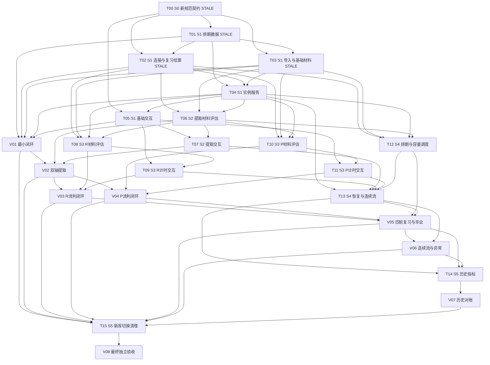

# 新算法任务系统：分阶段交付与执行 DAG

> 规划基线：2026-11-06；按 2026-11-07 当前工作树的 [algorithm.md](./algorithm.md) 修订。共 6 阶段、24 工作包：T00–T15、V01–V08。执行事实以 [new-algorithm-execution.json](./new-algorithm-execution.json) 为准。旧规范下已完成的节点在本次规范变更后须重验；纯函数测试通过不等于正式流程通过。

## 1. 产品目标、非目标与权威来源

交付可以从正式 `/goals` 与 `/` 入口使用的学习系统：确认词义、设置双轴目标、导入、学习与提取、阅读和写作流利训练、反馈、继续、等待、跳过、退出、恢复以及可追溯历史。每项有效练习从材料到下一次调度完整贯通，正确性以用户行为、数据库变化和事件证据共同证明。

权威顺序：当前工作树的 [algorithm.md](./algorithm.md) → 经产品确认且留档的待决策补充 → 本计划契约 → 实现与测试。规范发生变化时重新审查受影响节点。旧计划和 `implementation-status.md` 仅用于理解历史，不继承其中 DONE 或产品规则。

当前规范取消 INTEGRATE、q/首次诊断以及旧 verified/speed_verified/integrated/axis_done 的派发与计分作用。新版有**独立定义的毕业状态**：双轴 0 分词的连接任务一次初始化双轴；按词汇量和词频排名有估计初分的词直接从对应档位开始；R/P 各自达标且有有效 FLUENCY 通过后，各自按相邻 1、3、7、30 个本地日复习，不互等；两轴各自通过最后一轮后词才毕业。失败讲解不另计分；保留显式跳过，不实现延期。

规范末尾明确“不要考虑旧数据，现在是原型阶段”：本计划的迁移指 schema 版本化、新库初始化、原型切换和种子升级，不搬迁旧成绩或重放历史认证。不得在开发验收时删除用户当前 `flow.db`；使用新临时库/独立开发库。非目标包括新增账号体系、通用阅读能力认证、完全防粘贴、扩大 PDF/OCR 功能、独立重学计分任务。

## 2. 现状审计与复用分析

仓库没有 `.codegraph/`，按仓库指令跳过 CodeGraph。当前工作树有用户未提交改动；不得重置、覆盖、清理或迁移现有 `flow.db`。已完成的独立新算法模块和测试见下表；正式 `/goals`、`/`、task API 仍走旧实现。

| 模块与主要源码 | 可复用部分 | 必须修改、替换或补全 |
|---|---|---|
| `lib/new-algorithm-db.ts`、测试 DB 工厂 | schema v2 已有独立轴级 due/review/graduation、`axis=both` 连接、日容量和按轴确定/条件预约约束，Jest 临时库测试不碰 `flow.db` | 仍未接正式 app；T02/T03/T12 等节点实现结算、导入与真实调度 |
| `lib/new-algorithm-score.ts`、`lib/new-algorithm-settlement.ts` | R/P 提取与 FLUENCY 分数纯函数、冻结作答原子结算与幂等 | ENCODE 现只更新单轴；须改成一次连接同时 `max(F_R,5)`/`max(F_P,5)`，并在同一事务独立更新目标轴学习完成、复习级别、排期和容量；旧 H 增强不得进入新版派题 |
| `lib/new-algorithm-memory.ts`、Jest 记忆场景 | 旧版本的 L/H/C 算例可留作历史回归材料 | 新规范不以 L/H 选任务；共享冷却改按 7 个任务或 20 分钟的布尔门槛。现有记忆测试不是新版调度验收 |
| `lib/new-algorithm-import.ts` | 临时库导入、目标与初分校验、词义版本失效 | 导入时按词汇量和可比词频排名估计 R/P 初分，仅双轴 0 分词先做连接；补词级引入日期、容量前置检查及正式 goals API/page |
| `lib/tasks.ts`、`lib/scheduler.ts` | 类型定义与部分实例/事务设施 | 旧 q、优先级、急救、旧毕业字段和材料降档均不能沿用；改为按轴 `due_at_a` 排序、复习优先、学习逾期次之、容量允许才引入新词 |
| `app/api/task/{route.ts,service.ts,result/route.ts,skip/route.ts}` | 单一活跃实例、并发 GET 收敛、服务端判题、幂等提交、事务后派下题、skip | `retrievalFallback` 违规降档；提交时查实时 meaning，缺完整不可变答案快照；只靠字段删除脱敏不足，snapshot 亦须检查答案泄漏；判分失败前答案尚未持久化；exit 只是事件非终态 |
| `lib/material.ts`、`lib/mfi.ts` | 分词/连续材料检查框架、书籍来源/主题/词汇水平辅助 | 现有最低长度/首次出现检查不等于 100 词且 5 次；缺各档材料版本、后台生成/补充、失效、使用记录、P 中文场景。书籍/MFI 不是 R FLUENCY 的必需前置 |
| `lib/llm.ts`、service 中 R/P 判题 | 服务端配置、超时、结构化响应校验、同义释义判断、表达判断 | 增加 uncertain、判定依据、答案冻结、重试作答；P 要分别判断目标表达/整体复述，允许不影响理解的小错。生成和评估必须分开 |
| `lib/goals.ts`、`lib/targets.ts`、`app/api/goals/`、`app/goals/page.tsx` | 多来源导入、手工 gloss 与 AI 建议确认、目标选择 | 速度推目标和 q 改成直接 target_R/P 与词汇量/排名估计初分 0–60；gloss 修改触发材料失效；记录 freq_source；词汇量和排名决定初始档位；用户水平仍用于材料难度 |
| `components/task-renderers.tsx`、`app/page.tsx` | 正式任务流、提交锁、反馈/继续、空白区上滑、输入控件避让、跳过按钮 | 缺三档不同控件；P 连续任务泄露 chunk；R 缺回看累计；反馈仍讲关卡；下一题与上一题反馈数据需分离；刷新与计时中断不能沿用旧用时 |
| `components/task-cards.tsx`、`app/demo/`、`app/task-preview/` | 展示、排版和部分交互参考 | 独立旧演示不作为评分实现；预览档位 00–19/20–34/35–49/50–59 等、观看不计分、60%+40% 平滑文案均不符合当前规范 |
| `lib/task-analytics.ts`、analytics API、`app/score-history/` | 事件聚合、skip/exit 分母、历史展示框架 | attempts 必须纳入有效不变分作答并排除 invalid；删除复核/认证产品语义；速度缺失 null；需要终态互斥和判分依据的真实事件源 |
| `test/new-algorithm-scenarios.jest.test.cjs`、`test/new-algorithm-memory.jest.test.cjs` 与 DB runner | 可读的计分轨迹、旧 L/C 轨迹、独立库约束 | 计分轨迹把 ENCODE 当单轴，记忆轨迹把 L<20% 当急救；两者对新版签发/连接/排期均不构成 PASS。按新规范重写场景 |

### 本轮验证范围

已有旧 DAG 8/8、旧 task flow 39/39、通用 LLM 5/5 的历史记录；旧业务 runner 已从当前 `test/` 退役。独立旧版新算法纯计分 5/5、临时库 13/13、Jest 计分轨迹 14/14、Jest 记忆轨迹 9/9 曾通过；其中连接、L/C 调度和毕业预期与本次权威规范冲突，标记旧证据 STALE，不能作为新版 T02/V01/V05 通过依据。正式材料、派题、API、浏览器和人工内容验收仍无新版通过证据。

| 节点 | 本次核对状态 | 已有成果与下一步 |
|---|---|---|
| T00 | DONE | v0.3 冻结 C1–C7；用户已确认 O1–O3 的可调整原型默认值 |
| T01 | STALE | v2 测试仍通过；O1 需要每日预约累计 task_count 与原子消耗，须升级 schema 并重验 |
| T02 | BLOCKED | 纯计分与复习纯规则已提交并通过 25 项测试；T01 schema v3 后完成原子结算/预约消耗 |
| T03 | IN_PROGRESS | 初分、时间窗、API/page 与材料 helper 已实现；补 route 测试，T01 v3 后接 task_count 原子准入 |
| T04–T15、V01–V08 | TODO | 尚无本版完整业务或纵向验收证据；依 DAG 顺序推进 |

此前 Browser 技能连接 `http://localhost:3000/task-preview` 失败，没有视觉或交互验收证据。浏览器 UI 改由人验证；不要求恢复 AI 自动化浏览器能力。源码可确认预览有轴切换、分数档按钮和局部反馈，但配色、响应式、焦点、可读性、滚动和计时体验仍待人工检查。V01–V08 分别记录人工 UI 验收，V08 检查预览和正式页；源码检查不能替代人工验收。

开发约束：Next/React、strict TS、better-sqlite3 的 Node runtime。现有 `npm run test:new-algorithm-scenarios` 和 `npm run test:new-algorithm-memory` 是旧语义轨迹；重写前不得当作本版通过率。`npx tsc --noEmit` 仍有 `app/score-history/page.tsx:57` 与 `lib/manual-test-fixtures.ts:183` 的既有错误。测试注入 clock、用户时区、ID、provider 与容量，禁止真实等待 20 分钟或 41 天。

## 3. 决策与变更门禁

D1–D8 曾由用户授权设为可调整原型值，记录在 [决策台账](./new-algorithm-decisions.md)。本次规范覆盖其中冲突条目：D1 的 80 默认值已写入规范；D2 的 H×1.5 与曝光证据不再参与新版调度或回写验收；D7 只保留新词来源可比较的词频排序与稳定 tie-break，不再用于普通优先级。D3–D6、D8 与材料、计时、并发、分析相关的部分仍须逐项核对。旧契约 v0.2 和旧证据先标 STALE，冻结新版契约后再恢复对应节点。

原型实施默认值 O1–O3 已由用户确认并记入[决策台账](./new-algorithm-decisions.md)与[契约](./new-algorithm-contracts.md)。**100 次仅是规范中的模拟示例，不是通用默认容量。**规范明确每轴 1/3/7/30 相邻本地日间隔与最短第 1/4/11/41 天路径；两轴起点可以不同，不得改成累计间隔。所有受影响任务按确认值补齐实现和验收。

主要风险：

1. 旧模块和测试仍按 L/H 急救、普通优先级、单轴 ENCODE 工作。需要先修数据契约和结算核，再接正式入口；不能用绿色旧测试证明新调度。
2. `learning_complete_a` 需要该轴分数和有效、达目标的 FLUENCY 通过记录；满足后该轴立即独立排期，另一轴可继续学习。单靠 RETRIEVE 到 60 不得进入定期复习。
3. 容量要同时考虑按初分计算当天 3/5/7/9 个最小成功任务、共享冷却、材料和时间，以及未来 41 天各轴的确定排期与条件预约。失败、目标变更和跨日逾期须撤销受影响轴旧预约并重排，不能静默后移另一轴确定的 `due_at_a`。
4. 各轴 `review_level_a` 的失败退级、未降分但未通过、独立完成、两轴都毕业的词级终态必须在结算事务中幂等；材料和判分失败不能推进复习。

## 4. 共用契约与验收设施

T00 将 [new-algorithm-contracts.md](./new-algorithm-contracts.md) 从 v0.2 改版并冻结后，下游使用同一套接口：

- C1 词状态：`F_R/F_P`、`introduced`、各轴有效 FLUENCY 达标证据、`learning_complete_R/P`、`review_level_R/P`、`graduated_R/P`、汇总 `graduated`、`due_at_R/P`、`last_ts_any/last_tick_any`、全局 tick、目标与词频来源。旧 H/轴锚可留历史，但不参与新版选择或结算要求。
- C2 材料：版本、词义、水平、任务档位、公开题面、私有答案键和签发前校验；连接材料是词级唯一份，复习 R/P 分别需要 FLUENCY 材料。
- C3/C4 实例与作答：连接实例 `axis=both`，其余 `axis=r|p`；冻结材料、答案、计时及首次完整作答；服务端判分，不接受客户端上传分数为权威。
- C5/C7 生命周期和事件：`issued → grading/grading_retry → completed`，另有 skipped/exited/invalid；单实例终态互斥。完成事件要保存双轴前后分数、目标轴 FLUENCY 达标证据、复习级别、`due_at_a`/容量变化及 tick，支持逐行重放对账。
- C6 调度与容量：输入 scope、now、本地时区、每日容量、41 天排期、材料可用性；输出按定期复习→当天/逾期学习→容量允许的新词排序的候选或有原因的 EMPTY。冷却条件为无锚或 7 个其他有效任务或 20 分钟；材料不足重比其他候选，不降档。

共用夹具用独立临时库与 fake clock，覆盖本地跨日、时区/夏令时、7 tick/20 分钟、容量 0/不足/刚好、3/5/7/9 项最小路径、1/4/11/41 天、目标调整、复习失败与重试。严禁对 `flow.db` 做迁移或测试。U=纯函数/契约、I=DB/API、E=通过正式服务的完整旅程，均由 AI 自动校验；B=人工浏览器 UI 操作记录，H=人工材料与体验审阅。自动证据保留运行命令、版本、输入、期望/实际、DB/事件快照；人工证据保留检查人、版本、操作/样本、结论及问题。无需 AI 自动化浏览器测试；缺 B/H 的 V 节点记录人工验收待办，不得标 DONE。

### 自动推进与人工验收边界

按第 8 节 DAG 由协调者自动领取所有依赖已满足、无需人工参与的 READY 节点。**每个 DAG 节点单独分派给一个新的 subagent；一个 subagent 只负责一个节点，不跨节点复用。**协调者负责排程、接口协调、分支集成、集成后验收和执行台账，不代替节点 subagent 扩大任务范围。无依赖冲突的 READY 节点并行分派；依赖边未满足的节点不得提前验收。T00–T15 的技术验收由节点 subagent 实施并由协调者复核；V01–V08 的 U/I/E 部分同样由节点 subagent 自动完成。自动验收必须调用正式服务和真实状态回写，不能只跑孤立纯函数或 mock 即宣称纵向闭环完成。真实 provider 的可机械校验部分可自动执行；语义质量仍交 H。

V01–V08 的 B/H 是人工门禁：AI 先生成可复现的测试数据、操作步骤、预期结果和证据链接，标记 `BLOCKED`，在 `blockers/next_action` 写明“待人工 UI/内容验收”，再继续**不依赖该 V 节点**的其他 READY 技术节点。人工验收通过后记录检查人、版本和结果，重验受影响的自动断言，才将 V 节点标 DONE 并解锁其下游。人工发现问题则按 FIX 规则修复；不能把缺人工证据写成 PASS。整个计划不要求 AI 自动化浏览器检查，也不把浏览器工具故障当作技术节点阻塞。

| 人工门禁 | 需要人检查的内容 |
|---|---|
| V01 | 正式导入、连接和首次选择的页面操作；基础材料可理解性 |
| V02 | R/P 三档控件、提示、答案与反馈的实际使用 |
| V03 | R 阅读材料和答案依据；真人阅读、回看与计时体验 |
| V04 | P 中文场景、判分解释；真人写作与计时体验 |
| V05 | 排期、容量、逾期、等待及毕业在页面上的呈现 |
| V06 | 连续刷题、刷新、跳过/退出、桌面键盘与窄屏触控 |
| V07 | 分数历史、指标和说明文案的可读性 |
| V08 | 正式入口和预览的完整 UI 走查、真实内容质量及整体体验 |

## 5. 分阶段交付路线

| 阶段 | 当前进度 | 退出条件 |
|---|---|---|
| S0 契约与风险基线 | T00 v0.3 DONE | 新版 C1–C7、O1–O3 原型默认值和旧→新测试迁移已冻结，执行台账与计划一致 |
| S1 最小真实闭环 | T01 STALE（需 schema v3）；T02/T03 部分子范围已交付，等待 T01 后完成集成；T04/T05/V01 未做 | 正式导入后双轴 0 分词一次连接并签发 choice；有估计初分的词跳过连接并按分数派题，结算/反馈/API/UI 有 I/E/B 证据 |
| S2 双轴完整提取 | T06/T07/V02 未做 | R/P 三档材料、判定、交互在正式入口可达，升降分正确 |
| S3 双轴流利训练 | T08–T11/V03/V04 未做 | R/P 材料、计时、判定、有效通过证据及真实内容 B/H 完整 |
| S4 排期、容量与恢复 | T12/T13/V05/V06 未做 | 同日学习、R/P 各自的 1/3/7/30 天复习、失败退级、41 天容量、毕业、逾期/EMPTY、材料失败替选及恢复可验 |
| S5 历史与交付 | T14/T15/V07/V08 未做 | 历史显示分数和复习排期/毕业来源；干净新库正式入口和预览通过最终验收 |

阶段门按 DAG 而非文件存在判断。T12 可在 S3 技术开发期间由独立 subagent 并行准备，V05 仍须等真实双轴 FLUENCY 链路；S1 的纯函数或临时库 PASS 不能代替正式入口的纵向 V01。等待人工 V 门禁期间，继续推进没有该门禁依赖的 READY 节点，每个节点仍单独分派。

## 6. 技术实现工作包

依赖表中的 ID 是硬依赖（全部满足才验收）；技术任务可先对冻结接口开发，但不能据 mock 下游验收 DONE。每包范围控制在一项明确交付；不改 `algorithm.md` 是全部节点非目标。表中证据使用第 4 节统一目录规则。

### T00 · S0 · 新规范契约、决策与测试迁移（DONE，v0.3 冻结已明确部分）

- **依赖**：无。**文件**：本计划、`docs/new-algorithm-contracts.md`、`docs/new-algorithm-decisions.md`、`docs/new-algorithm-test-mapping.md`、执行台账。
- **已有**：v0.2 契约、D1–D8、24 节点台账和旧测试迁移清单；见 `test-report/new-algorithm/T00/baseline.md`。这些记录保留历史，不代表 v0.3 可用。
- **新输入→输出**：现行 `algorithm.md` 与旧契约 diff → C1–C7 新字段、连接与复习状态转移表、日历/容量决策、测试迁移清单及影响矩阵。
- **G/W/T**：Given 旧 L/H 急救与新 `due_at` 规则；When 审查所有消费者；Then 明确废弃旧候选/单轴 ENCODE 假设，逐条列出旧测试改写或移出当前通过率的理由；规范未定的时区/容量实现口径不得藏在常量里。
- **完成证据**：新契约版本、决策台账更新、规范差异映射、可复跑的测试清单；审查 T01/T02/T03 的 STALE 范围。

### T01 · S1 · 新 schema 与统一测试数据库（STALE；v2 需要容量计数扩展）

- **依赖**：T00。**文件**：`lib/new-algorithm-db.ts`、测试 DB 工厂；正式库接入留 T15。
- **交付**：schema v2 增加轴级 `fluency_pass`、学习完成、review level、due、毕业和时区字段；仅 ENCODE 可用 `axis=both` 且同词只能成功一次；材料与实例的词/轴/档位由复合外键绑定；增加每日容量、确定/条件预约表。临时库 Jest 测试 5/5 通过，含重复初始化、错误库版本拒绝、唯一约束、外键和事务回滚；报告见 `test-report/new-algorithm/T01/schema.md`。没有改动 `flow.db`。
- **新输入→输出**：新版 C1/C2/C5/C7 → 词级连接实例 `axis=both`、各轴 FLUENCY 达标证据、`review_level_R/P`、`due_at_R/P`、轴级/词级毕业、本地日、每日容量、按轴确定/条件预约与事件唯一约束。
- **G/W/T**：Given 空临时库与重复连接/复习提交；When 初始化、结算、回滚、跨日重启；Then schema 幂等，连接只一实例，R/P 可在不同日各自复习，毕业轴不再签发，容量预约不重复，故障没有半笔状态。原型新库启动，不迁移旧成绩。
- **完成证据**：schema dump、约束/回滚/并发测试、跨日与复习状态快照。

### T02 · S1 · 纯计分、连接与原子排期回写核（IN_PROGRESS；原子复习结算续作）

- **依赖**：T00、T01。**文件**：`lib/new-algorithm-score.ts`、`lib/new-algorithm-settlement.ts`、新版复习/排期纯函数。
- **已有**：提取和 R/P FLUENCY 公式、旧单轴 ENCODE 与幂等事务、Jest 14 场景/23 次转移及旧记忆轨迹；见 `test-report/new-algorithm/T02/partial.md`、`scenarios.md`、`memory.md`。旧证据不覆盖新连接和复习。
- **新输入→输出**：冻结实例+服务端判定+本地日/容量状态 → 原子更新 F、连接/目标轴 FLUENCY 证据、`learning_complete_a`、`review_level_a`、`due_at_a`、轴级/词级毕业、预约、tick 和事件。
- **G/W/T**：仅双轴 0 分词的一次连接使两轴各到 5 且只加一个 tick；R/P 三档与 FLUENCY 继续用规范绝对计分，保留未舍入值。各轴有达标有效 FLUENCY 即独立开始 1 天复习；该轴有效通过即独立推进 1→3→7→30→轴毕业，两轴都毕业才词毕业；失败按 1→1、3→1、7→3、30→7，降分轴清除通过证据并按当天补练，未降分但未通过不推进。结算一轴不得改另一轴排期；无效/不确定/服务失败不改排期；重复提交不重复预约或 tick。
- **完成证据**：新版 Jest 数值/状态轨迹、临时库全字段前后与事件、跨日/时区/目标变更/回滚矩阵；旧 H 增强不得作为新回写断言。

### T03 · S1 · 导入、目标与材料管线首版（IN_PROGRESS；正式入口与持久化作业续作）

- **依赖**：T00、T01。**文件**：`lib/new-algorithm-import.ts`、goals API/page、材料仓储/作业模块。
- **已有**：临时库原子导入、直接目标/初分校验、gloss 版本失效；见 `test-report/new-algorithm/T03/partial.md`。正式 API、材料作业未实现。
- **新输入→输出**：目标/词表/词汇量/可比词频排名/已确认 gloss/水平 → 估计初分、按初分准备的首题材料、可查询作业状态；新词准入前供 T12 读取材料与容量估计。
- **G/W/T**：词汇量 V 与可比词频排名 rank 按规范映射到 R/P 初分；仅双轴 0 分先连接，否则按分数直接签发首题；估计初分不设置 FLUENCY 通过证据。未确认 gloss 不产生正式判分材料；版本变更使旧材料不可再签发。有限重试耗尽记录原因；已有导入代码须按新 schema 重验。
- **完成证据**：导入 HTTP、临时库与材料/job 快照、合格内容的脱敏样本与人工检查。

### T04 · S1 · 实例服务与最小可用调度链（TODO）

- **依赖**：T01、T02、T03。**文件**：`app/api/task/service.ts`、task/result routes、新调度服务。
- **输入→输出**：新 C1/C2 + next/submit → 词级连接、基础 choice 的正式 C3/C4/C5/C7 链。
- **范围**：单活跃实例、答案冻结、首次作答持久化后判定、事务幂等和下一任务；按目标轴 `due_at_a` 选当天/逾期学习候选，按共享冷却等待。完整复习/容量/毕业排序留 T12，但不能调用旧 L/H 急救路径。
- **G/W/T**：Given 可用连接和 choice；When 并发 GET、双 POST、判分与事务失败；Then 同词只有一次连接并同时写双轴，choice 按当前轴分数签发，重复结算仅一次，反馈不丢失，公开 DTO/snapshot 不泄私有答案。
- **完成证据**：HTTP 请求响应、DB/事件、并发轨迹和答案扫描。

### T05 · S1 · 教学与选择题正式交互

- **依赖**：T00、T04。**文件**：`components/task-renderers.tsx`、`app/page.tsx`、相关 CSS；拆出基础 renderer 供后续扩展。
- **输入→输出**：一次词级连接与 R/P choice 的 C3 → 学完确认/选择 response、反馈与继续。
- **范围/非目标**：连接只显示一次，确认后两轴分数同时更新；choice 按当前目标轴显示。沿用正式页布局/锁定；绑定上一题 result 与下一题各自实例 ID；不实现 cued/free 或流利。
- **G/W/T**：Given 服务端签发连接/选择；When 确认学完、选择错项、重复点击、反馈后继续；Then 展示连接两轴各至少 5、choice 20/5，首次答案不可覆盖，反馈讲解不另发计分任务或增加 tick，未提交上滑无动作。
- **验证/证据**：组件行为 I、B/H 由 V01 汇总；本包保留点击请求与状态输出。**阻塞**：本地判题冒充服务端结果、只能在 demo 操作。

### T06 · S2 · 三档双轴提取材料与评估

- **依赖**：T02、T03、T04。**文件**：材料 producer/evaluator 新模块、`lib/material.ts`、service 适配；避免直接扩大旧 service 单体。
- **输入→输出**：word/sense/axis/stage → R/P choice/cued/free 的材料与判定结果/依据。
- **范围/非目标**：扩展全部六条提取路径；R 释义按目标义 AI 判定同义表达，P 仅忽略大小写和首尾空格、预允许词形；规定提示合法。无测速或先验判断。
- **G/W/T**：Given R 同义/近义但错义、P 大小写/额外内部字符/许可与非许可词形；When 同档提交；Then 按规范成功或失败；uncertain/service_error 不改状态且持久化待重试；每档都有生产材料，free 不带选项/字母答案。
- **验证/证据**：U/I/H；六档样本、provider fixture、服务端依据、公开 DTO。**阻塞**：任一档无有效答案键，P 过度标点规范化使错误答案通过。

### T07 · S2 · 双轴提取交互与反馈

- **依赖**：T05、T06。**文件**：拆分的 retrieval renderer、`components/task-renderers.tsx` 路由。
- **输入→输出**：六档 public payload → 选择/提示输入/无提示输入及首次完整 response。
- **范围/非目标**：复用选择控件、键盘/移动输入/反馈；不编写客户端评分；不把按要求使用提示视为作弊。
- **G/W/T**：Given 两轴三档签发；When 用户使用提供的提示或无提示作答；Then 控件与 stage 一致，错误后展示讲解且下一次按新分数调度，不能反馈后修改覆盖首次成绩；P free 显示意思/意图但不泄词。
- **验证/证据**：组件行为测试，六档操作请求；B/H 在 V02。**阻塞**：共用文本框掩盖 choice/cued/free 的正式语义差异。

### T08 · S3 · R 流利材料与服务端评估

- **依赖**：T02、T03、T04、T06；D3/D5。**文件**：R material producer/evaluator、材料仓储与 service 接口。
- **输入→输出**：目标义/水平 → 恰好 100 词/目标≥5 次的短文、两道题、私有答案/原文依据，R 检查结果与词数。
- **范围/非目标**：复用 AI 与校验基础；支持无书源词；缓存/补充遵守共用作业规则。不用零碎细节题替换整段理解，不更新文中其他词。
- **G/W/T**：Given 99/100/101 词、目标 4/5 次、错义或难度不合材料；When 生成后校验；Then 仅完全合格材料可签发；两题键在签发前固定。Given 有效计时；When 两题结果四组合；Then 交 T02 得出规定分支，整体失败不变分不等于 invalid。
- **验证/证据**：U/I/H；计数黄金样本、真实 AI 有界生成记录与逐题依据审阅、key 脱敏检查。**阻塞**：生成成功直接等同 ready，或依赖书源才能产生 R FLUENCY。

### T09 · S3 · R 阅读、回看与计时

- **依赖**：T05、T08；D4。**文件**：R fluency renderer、新 timing 协议/服务校验模块、service 接线。
- **输入→输出**：C2/C3 timing_protocol → 初次/各次回看片段、两题 response、有效性结果。
- **范围/非目标**：文本实际显示才计时；读完藏原文答题，回看藏题并累计；不把答题时间计入，不宣称通用读速。
- **G/W/T**：Given 初读 20s、回看 10s、答题 40s；When 两题均对提交；Then reading_seconds=30、wpm=200，F≈73.333 未舍入；题文按阶段互斥。中断、缺片段、重复片段或计时无效时不更新任何学习字段，重新开始不能接旧时间。
- **验证/证据**：U/I、计时 fake clock 轨迹；B/H 在 V03。**阻塞**：回看计时无法被服务端验证或中断事件与 D4 冲突。

### T10 · S3 · P 流利材料与服务端评估

- **依赖**：T02、T03、T04、T06；D3/D5/D8。**文件**：P material producer/evaluator、共用词数/timing 校验、service 接线。
- **输入→输出**：词义/水平/目标词形 → 无英文泄漏的中文场景/判定要求；最终文本与用时 → 两项判定、原文依据、有效词数。
- **范围/非目标**：检查目标词用法与整体复述分离；小错不影响理解可通过；无意义重复不能凑数。保留原答用于重试，不要求重新表达。
- **G/W/T**：Given 29 词、30 词无意义重复、目标词缺失、非目标小错、AI uncertain；When 提交；Then 分别继续完成/不算有效凑数/有效条件下退40/按质量判定通过/不改状态待重试。Given ≤5s 且缺目标词；Then 先判无效不扣分；>5s 有效 30 词 72s→25wpm→60。
- **验证/证据**：U/I/H；有意义计数/质量样本、双项依据、真实 AI 评估记录和失败持久化快照。**阻塞**：将所有语法错都失败、目标英文从 payload 或 snapshot 泄漏。

### T11 · S3 · P 连贯写作交互

- **依赖**：T05、T10；D4。**文件**：P fluency renderer、共用 timing 客户端；只在本轴模块改动。
- **输入→输出**：中文情境 → 主动开始、最终文本、包含构思停顿修改的完整用时。
- **范围/非目标**：少于 30 词提示继续，保留草稿，最终词数不包括删除内容；不展示英文范文或目标词；不新增粘贴检测产品规则。
- **G/W/T**：Given 未点开始；When 等待/开始后输入并删改/提交；Then 开始前不计时、开始后全部时间纳入、只算最终有效词数；失败显示具体未满足要求，语言合理但未用目标词不能误称语言错误；中断需重新计时。
- **验证/证据**：组件/I 计时与输入行为；B/H 在 V04。**阻塞**：把打字活动时间当总用时，重试丢失原答。

### T12 · S4 · 完整排期、容量与材料保底调度（TODO）

- **依赖**：T02、T03、T04、T06；适用 D5/D7 需按新规范复核。**文件**：新 scheduler/candidate/容量投影模块、材料作业接口。
- **输入→输出**：scope、当地日期、`due_at_R/P`、`review_level_R/P`、容量/预约、共享冷却、材料 → 复习→学习→新词的正式候选或有原因的 EMPTY。
- **范围**：未来 41 天的已确定排期与按轴条件预约分列；新词按估计初分对应的当日最少 3/5/7/9 个任务及 R/P 各自预计达标后的第 1/4/11/41 天容量检查，还要校验剩余时间和材料。每次有效结算撤销目标轴过时条件预约并重算总容量；超容量停止准入新词并报告短缺。逾期 `due_at_a` 不静默后移。材料失败改比其他候选，不降档。
- **G/W/T**：Given 同时有已到期的 R 复习、同词 P 逾期学习、新词；When 调度；Then 按组别与对应 `due_at_a`、词 ID、同词 R→P 稳定选取，已毕业轴不派发。Given 7 tick 或 20 分钟；Then 冷却解除，skip/invalid 不计。Given 容量刚好/不足、单轴复习失败、目标变化、跨日/夏令时、材料失败；Then 另一轴排期不被改写，预约和 EMPTY 原因/next_available_at 可复算，没有零延迟循环或无限重试。
- **完成证据**：纯函数边界矩阵、临时库投影与事务前后、41 天日视图、候选 trace、同档材料恢复和数值等待时间；V05 在真实双轴材料上复验。

### T13 · S4 · 生命周期恢复与连续流整合

- **依赖**：T04、T07、T09、T11、T12；D4/D5/D6/D8。**文件**：task service/routes、`app/page.tsx`、共享 flow/timing controller。
- **输入→输出**：C5 的 refresh/retry/skip/exit/interruption + C6 → 恢复的同一实例/作答或明确终态与下一题。
- **范围/非目标**：网络失败保留原答，判分重试复用不可变答案；显式跳过、退出分开；新版 EMPTY 原因（今日完成、容量不足、冷却、材料、空范围）UI、到期刷新和手动刷新。反馈与下一实例分离，不靠重新挂载丢输入。不延期、不修改跳过词优先级。
- **G/W/T**：Given 已提交但响应丢失；When 刷新/重试；Then 返回原结果、tick 不变。Given 跳过/提交/退出并发；Then 只有一个终态和唯一相应事件；重复 skip 不再记事件且可返回同词新实例。Given FLUENCY 中断；Then 全学习状态不变，新开始新计时；未提交上滑忽略。给 wait=null，不能零延迟自动轮询；材料恢复后刷新可派发。
- **验证/证据**：I/E 故障/并发轨迹；B/H 在 V06。**阻塞**：静默丢答、自动无限重试、退出被重复计入、当前任务展示上一题判分。

### T14 · S5 · 练习历史与有事件来源的分析

- **依赖**：T13、V05、V06；D8。**文件**：`lib/task-analytics.ts`、analytics API、`app/score-history/`、正式页反馈/进度。
- **输入→输出**：C7 真实事件 → 分数/依据/材料版本/实测速度历史与跳过率、退出率分子分母。
- **范围/非目标**：保留有效不变分记录、无测速 null、AI 重试、invalid/中断原因；展示连接、两轴达标证据、复习日期/级别、容量短缺与毕业事件；删除旧最高分保底和旧毕业文案。不新增无来源指标。
- **G/W/T**：Given 2 次有效作答（含一次不变分）、1 skip、1 exit、1 invalid；When 查询；Then attempts=2、skip=1/3、exit=1/4，invalid 不进入分母；无测速 null 不沿用前次；重复事件不重复计算。ENCODE 计入方式按 D8 单独测试。
- **验证/证据**：U/I；从真实 API 行为产生事件再聚合的对账；B 在 V07。**阻塞**：聚合依赖伪造计数或把 invalid 当失败。

### T15 · S5 · 原型切换、残留清理与运行入口

- **依赖**：V01、V02、V03、V04、V05、V06、V07。
- **文件**：`lib/db.ts` 新库入口、seed/manual fixtures、`app/task-preview/`、`app/demo/`、`components/task-cards.tsx`、相关 scripts/tests/package scripts/说明。
- **输入→输出**：已验收链路 → 干净启动方式、新版种子、更新预览与正式路由、回归命令、可恢复执行台账。
- **范围/非目标**：移除正式调用链的旧算法及旧测试语义；预览复用正式 renderer 或清楚标记演示，连接/choice/cued/free/fluency 与复习任务一致；旧 DB 不作成绩迁移也不自动删除。
- **G/W/T**：Given 新路径空 DB 与已有原型库分别启动；When 运行文档指定安装/初始化/测试/构建命令；Then 新库运行新版，旧库被版本识别并提示切换，不偷偷重放旧成绩；正式入口不会进入 INTEGRATE/诊断/L/H 急救/旧毕业路径；新版毕业只由双轴 30 天复习通过产生；预览不再显示平滑计分或旧档位。
- **验证/证据**：I/E、`npx tsc --noEmit`、`npm run build` 和更新后的三个 runner；保存残留搜索解释清单（历史文档可保留，不凭搜索零命中验收）。**阻塞**：必须改真实用户库才能验收、存在另一个可调用旧计分入口。

## 7. 纵向能力交付与独立验收节点

这些节点须独立于实现过程验收；不实现整套业务，必要时仅新增行为测试与证据。AI 自动验证 **材料 → 候选资格 → 调度 → 服务端实例 → 提交 → 状态回写 → 下一任务/EMPTY** 的 U/I/E；人通过正式 UI 检查同一链路的可用性，并审阅真实内容。不能通过手工指定 task 类型绕开调度；可用可控时钟推进自然时间。发现上游缺口按第 10 节补最小节点。

### 给人工验收者的清单

下面是你需要做的全部 V 节点人工检查。AI 先准备测试词、词汇量/排名、账号/独立测试库、可访问页面、具体操作步骤和预期结果，并完成技术校验；你无需读懂后面的 Given/When/Then、数据库字段或计算公式。每项只需记录“通过/不通过”、发现的问题和使用的版本；没有准备好可操作页面时，AI 不能请你验收，也不能把该项标为通过。

| 节点 | 你打开并操作什么 | 你只需判断什么 |
|---|---|---|
| V01 首次学习 | 在目标页导入低频与高频测试词、确认词义；低频词完成连接题，高频词查看是否直接出现较高档位的首题 | 词义与题目清楚；提交后能看到反馈和下一步；桌面与手机宽度都能正常操作 |
| V02 提取练习 | 按 AI 准备的词，分别做 R/P 的选择、有提示、无提示练习；试一次答错并改目标 | 六种题目形式、提示和反馈容易理解；答错后的下一题符合直觉；目标设置页面可用 |
| V03 阅读流利度 | 用一份真实生成的英文材料阅读、点“读完”、回看并回答两题 | 文章通顺且难度合适；题目有明确依据；计时、回看和反馈符合实际操作感受 |
| V04 写作流利度 | 阅读中文场景，写一段英文，修改文字后提交；查看评分与解释 | 场景自然地引出目标词；输入和计时顺手；评分解释与自己的答案相符 |
| V05 复习与容量 | 使用 AI 准备的不同到期日期测试数据，打开今日任务和未来容量视图 | R/P 可以在不同日复习；到期、逾期、容量不足和毕业的显示及提示能看懂 |
| V06 连续使用与恢复 | 连做几题，再试刷新、跳过、退出、断网后重试；桌面键盘和窄屏触控各操作一次 | 不丢已提交答案、不重复计分；能看懂等待/错误提示，知道如何继续或停止 |
| V07 历史记录 | 完成 AI 准备的升分、降分、跳过等练习后打开分数历史 | 每次变化的原因能看懂；日期、分数和统计数字的呈现清楚 |
| V08 最终走查 | 从空的独立测试库按提供的步骤完成一次完整学习，并查看正式页和预览页 | 全流程可用；文字、布局、焦点、滚动、材料、反馈和整体体验达到可交付水平 |

以下各 V 的 Given/When/Then 和 U/I/E 是 AI 的技术验证说明；人工只按上表操作。发现问题时给出页面、操作步骤和看到的结果即可，由 AI 复现、修复和重验。

### V01 · S1 · 词级连接与首次选择闭环

- **依赖**：T01–T05。**模块**：goals API/page、task API、正式 `/`、基础 renderer。
- **输入→输出**：空临时新库、确认词义、目标 R/P=80、双轴 0 分与不同估计初分、ready 材料 → 首份跨层闭环证据。
- **Given/When**：从 `/goals` 导入；双轴 0 分时正式页面签发**一次** `axis=both` 连接任务并确认；有估计初分时直接签发对应档位；同词冷却前请求与推进 20 分钟后请求；由调度器按新顺序签发相应首题，对 choice 分别答对/答错并刷新。
- **Then**：双轴 0 分词连接后两轴从 0→5 且只增加一次 tick；非零估计初分词跳过连接，按对应分数档位派首题；准入后 introduced=true；不得第二次签发 P ENCODE。choice 只更新目标轴到 20 或 5；材料、实例、反馈、下一题/EMPTY 与 DB/事件一致。无效或重复请求不额外计入容量。
- **Evidence**：AI 的 I/E 与人工 B/H；导入→job→连接→选择→DB/event→下一响应完整关联，人工记录桌面/窄屏操作。缺人工证据标 BLOCKED，不停止无依赖技术节点。

### V02 · S2 · R/P 提取升降与目标调整

- **依赖**：V01、T06、T07。**模块**：目标页、六档 renderer、材料/evaluator/API。
- **Given/When**：先完成词级连接，再通过正式链使 R/P 各到 5/20/40，测试 choice/cued/free 的正确、错误、提示、R 同义与 P 允许词形；修改个人目标。
- **Then**：结果分别到 20/5、40/5、60/20；只改目标轴；初分不等于有效 FLUENCY 通过证据。目标变更不改历史 F，但重算学习完成资格与排期；到 60 仍需有效 FLUENCY 达目标才能进入定期复习。材料缺口不得降档。
- **Evidence**：U/I/E/B/H；六档真实签发、控件与回写、目标修改前后快照。

### V03 · S3 · R 流利阅读与回看

- **依赖**：V02、T08、T09。**模块**：R 材料生产、R renderer、API/计分；不验 P。
- **输入→输出**：经提取到60的词与无书源数据 → 可使用的 R FLUENCY 完整链证据。
- **Given/When**：真实同档材料100词/5次 ready、当前 R60/80、target_R=100，非目标轴状态与本轴独立，本词仍在学习队列且冷却已解除；阅读/读完/回看/答两题，覆盖两题对的149/150/200/225/300wpm、目标错、仅整体错，以及中断。
- **Then**：149→40，150/225/300→60/80/100，200精确约73.333且可下降；目标错40、仅整体错原分但记有效事件；无效状态全不变；回看累计且题文互斥，无 P 或其他词自动加分；未完成学习流程时下次按结果分数档位派题；有效达目标 FLUENCY 须留下本轴通过证据。
- **Evidence**：U/I/E/B/H；边界用可控时钟、至少一次真人完整阅读；材料答案原文依据与交互截图。**阻塞**：只能人工塞入 task 实例、R材料未符合水平、把整体错记成无效。

### V04 · S3 · P 流利复述与判分重试

- **依赖**：V02、T10、T11。**模块**：P producer/evaluator、renderer、API；不验 R。
- **输入→输出**：经提取到60的词 → 中文场景引出目标表达的完整链。
- **Given/When**：P60/80、target_P=100、非目标轴状态与本轴独立、合法场景且学习任务已到期，主动开始，输入删改至30个有效词，提交不同质量与速度（25/42.5/60wpm、低于25），模拟一次 AI 超时后重试。
- **Then**：双通过分别60/80/100，低速40；目标失败40、仅整体失败原分且有效；≤5s 优先无效；29词继续完成无有效成绩；全链客户端无目标英文泄漏；失败重试保留首次完整文本、不先扣分、不重计用时；学习补练按新分数派发；有效达目标 FLUENCY 须留下本轴通过证据。
- **Evidence**：U/I/E/B/H；语义人工审查、真实中文场景、network DTO、稿件/计时/判分重试/DB 串联证据。**阻塞**：场景无法自然引出目标或仅靠包含目标词判通过。

### V05 · S4 · 排期、容量、定期复习与材料恢复

- **依赖**：V03、V04、T12、T13。**模块**：全 scheduler、容量视图、正式目标范围与 EMPTY 页面。
- **输入→输出**：一次连接与 R/P 各自达标有效 FLUENCY → 同日学习、各轴独立的 1/3/7/30 天相邻复习、两轴毕业汇总或失败补练的可追溯轨迹。
- **Given/When**：用可控本地时钟/容量完成最短 9 任务学习路径，分别推进各轴达标后的第 1、4、11、41 天；再令 R 比 P 早一天达标，验证错开的复习日期、R 复习时 P 仍学习、R 已毕业时 P 仍复习。插入单轴目标失败、整体失败但不降分、无效、跨日逾期和材料耗尽；以 100 次作为示例输入，再构造刚好和不足容量、strict/default scope。
- **Then**：每轴达标且有有效 FLUENCY 通过即独立排 1 天；该轴通过即独立升级，通过自己的 30 天轮后 `due_at_a=∞`，两轴都毕业才词毕业。失败按 1→1、3→1、7→3、30→7 只退目标轴；降分轴退出复习并当天补练，未降分但未通过不推进；无效不改排期。已到期复习先于逾期学习，再于新词；冷却按 7 tick 或 20 分钟；未来 41 天预约和容量重算、逾期及 EMPTY 原因准确。材料失败不降档，比较下一候选。
- **Evidence**：AI 的 U/I/E 与人工 B；每轴 `due_at_a`、`review_level_a`、毕业与通过记录、日容量/预约、候选 trace、真实签发、EMPTY 与恢复的人工页面检查。缺正式入口或人工 UI 证据不得 DONE。

### V06 · S4 · 连续刷题和异常恢复

- **依赖**：V05、T13。**模块**：正式 `/`、生命周期 routes、计时/持久化；不增加新产品动作。
- **输入→输出**：各任务实例与断网/响应丢失/并发事件 → 可恢复的完整会话。
- **Given/When**：完成题后按钮/空白区上滑继续；未提交上滑；输入区滚动；请求处理中重复点击；刷新、双标签提交、判分失败、生成耗尽、显式 skip/exit、FLUENCY 中断后重新开始。
- **Then**：只在反馈后切题，不误触提交/跳过；相同已提交响应重放不重复写；判分保留原答；跳过不降优先级且可能重遇同词，无自动无限跳过；终态互斥；无效不更新；等待有可理解原因、停止与手动重试入口；新计时不拼接旧片段。
- **Evidence**：I/E/B/H；桌面键盘、移动窄屏触控操作记录，故障注入请求/状态轨迹，退出/跳过分子来源。**阻塞**：刷新丢首次答案、重复事件、无停止路径、浏览器未实测。

### V07 · S5 · 用户可解释的分数历史与指标

- **依赖**：T14。**模块**：score-history、反馈/进度、analytics API。
- **输入→输出**：V03–V06 类真实练习事件 → 用户可理解、可对账的历史展示；不接受手填统计作为证据。
- **Given/When**：R80有效200wpm下降、整体失败不变分、一次skip/exit/invalid、无测速提取，进入分数历史并查询指标。
- **Then**：可区分“表现降低”“整体未过但分不变”“无效不计分”，无测速显示无数据；显示实例/材料/判定与变化原因；分子分母与数据库一致，重复重试不增加 attempts；明确区分新版毕业事件与旧字段，不宣称历史最高保底。
- **Evidence**：I/E/B/H；事件与报表逐行对账、截图、用户文案审阅。**阻塞**：只有日志没有正式可见历史，或指标无对应事件生产者。

### V08 · S5 · 独立最终交付验收

- **依赖**：T15（传递依赖全部前置 V）。**模块**：全部正式入口、task-preview、安装/测试说明；范围为验收，不重做实现。
- **输入→输出**：干净新库、真实 AI 配置、可用浏览器、冻结版本 → 可重复交付报告。
- **Given/When**：新执行者按说明从空库启动；导入、确认释义、明确目标，通过一次连接、两轴三档提取至流利，各轴达标后按自身第 1/4/11/41 天复习直至各自毕业，包含错开达标日，并测试失败退级与降分补练、连续操作/刷新/跳过/退出、查历史，另做缺材料恢复；实测 `/task-preview` 的轴/档切换和各控件。
- **Then**：所有必需能力在正式入口可达；跨层答案/时钟/分数/事件一致；无旧规则入口；预览与正式任务语义一致，桌面/窄屏文本无遮挡、键盘焦点可用、长文可滚动；真实模型样本的答案、难度与反馈经人工确认；所有节点的证据绑定此版本或已重验。
- **Evidence**：更新后的全部新版 runner、TS/build、完整 E/B/H、真实 LLM 脱敏样本、清洁库启动与恢复记录、决策关闭清单、已知非阻塞局限。mock 通过不能替代真实 AI/产品体验验收。
- **阻塞**：任一 D 未决影响交付、必需节点非 DONE、人工 UI/内容验收尚未完成、真实 provider 不可用、上下游证据失配。AI 浏览器工具不可用不单独阻塞；不得将“环境未测”写成 PASS。

## 8. 完整 Mermaid DAG

节点箭头为全部硬依赖；D 决策的额外门禁见第 3 节，不作为实现工作包计数。V 是纵向验收节点；阶段门禁见第 5 节，允许跨阶段无依赖技术任务提前开展。



## 9. 并行、集成冲突与成本控制

- 并行单位是 DAG 节点，每个节点有自己的 subagent。T01 后 T02 与 T03 可并行；T04 合并后，T05 与 T06 可以并行；T06 后 T08、T10、T12 可并行；T09 与 T11 可以并行；V03/V04 独立验收并行。纵向 V01 必须尽早分派，不能因忙于后续模块延期。所有可并行节点必须满足 DAG 依赖、决策门禁、文件隔离三个条件。
- `lib/tasks.ts`/公共 C1–C7 由 T00/T02 主责；schema 由 T01 主责。其他节点向负责人提交最小变更，先确认版本再合并。T03 负责唯一材料仓储、作业重试和 provider 接口；T06/T08/T10 只增 producer/evaluator，不各建后台服务。
- `lib/scheduler.ts`/`app/api/task/service.ts` 为冲突热点：T02 提取纯回写，T04 提取实例仓储/调度适配；后续按模块文件扩展，由一个集成者串行接线。T08/T10 的公共 timing/word-count 先在 T00 定接口，由先合并节点实现一次，另一个复用，不能同时改不同定义。
- T05 先拆 renderer 路由与公共 UI，T07/T09/T11 分文件实现；`app/page.tsx` 在 T13 集中整合。测试各包按前缀分文件，共用 fixture 修改需声明消费者。
- 节点 subagent 只读本节点、契约、相关源码、上游证据 manifest，不要求通读整个计划历史。每个节点通常一轮实现加一次验证；发现需同时重写三个以上独立边界，应报告协调者，由协调者拆出最小补全节点并更新 DAG，不得自行接管其他节点。以依赖和验证成本控制粒度，不承诺固定工时。
- 并行节点使用相互隔离的分支/工作区；协调者先检查文件重叠和共享资源。若环境只能提供同一工作树，文件有重叠或共用 schema/API/fixture 的节点必须串行，只有互不冲突的改动才可并行。每个 subagent 提交节点级 diff、验证命令和结果、剩余风险；协调者按 DAG 顺序集成。所有验收必须在集成后的版本执行，不能拿各分支单独 PASS 直接退出阶段。
- 同一 `new-algorithm-execution.json` 只由协调者写入，避免并行节点覆盖台账。协调者在分派时记录唯一 owner 和起始 revision；收到 subagent 结果后复核证据、更新状态和下一动作。节点 subagent 不并行改共享台账、计划 DAG 或 `algorithm.md`。
- 提交纪律：每个 DAG 节点各自形成独立 commit，不把多个节点合并成一个交付提交。协调者对 `TODO/STALE → IN_PROGRESS`、`IN_PROGRESS → BLOCKED/FAILED` 等执行状态转移单独提交台账；节点验收后，协调者将该节点的实现、证据和最终 `DONE` 状态一并提交。提交信息包含节点 ID，例：`task(T01): add isolated schema and DB factory`、`task-state(T01): mark in progress`。节点提交必须基于复核后的集成版本；不得在 subagent 的未核验工作树直接写 DONE 或提交伪 PASS。
- U/I/E 自动验证随 READY 节点推进；B/H 是 V 节点的人工验收，不要求 AI 自动化浏览器。关键计时/手势变更须更新对应人工检查清单；V03/V04/V08 的真实模型样本集复用并保留模型/提示版本，日常回归使用确定性桩。不得为节省成本取消真人计时/场景语义验收。

## 10. 状态、恢复及动态 DAG 规则

`docs/new-algorithm-execution.json` 已存在，作为执行事实来源；本次规范变更已使旧版已验节点 STALE，证据保留在 `test-report/new-algorithm/`。不依赖 Agent 会话记忆。记录模板：

```json
{
  "id": "T04",
  "phase": "S1",
  "status": "TODO",
  "depends_on": ["T01", "T02", "T03"],
  "decision_dependencies": ["D6", "D7"],
  "open_dependencies": [],
  "owner": null,
  "contract_version": null,
  "source_revision": null,
  "working_tree_diff_hash": null,
  "evidence": [],
  "expected": null,
  "actual": null,
  "blockers": [],
  "repair_attempts": 0,
  "next_action": null
}
```

状态转换：

| 状态 | 判定与允许动作 |
|---|---|
| TODO | 尚未开始或依赖未满足；可只读准备 |
| READY | 所有硬依赖 DONE、适用决策已确认、接口/环境可用；所有影响本次分派验收范围的 `open_dependencies` 均已解决。若节点仅部分范围受 OPEN 影响，协调者可分派独立 subagent 做不依赖该 OPEN 的隔离部分，但 owner 与实际范围必须记录；节点不得 DONE，直到 OPEN 解锁并补齐验收 |
| IN_PROGRESS | 恰有一个节点 subagent 负责；协调者写明 agent owner、起始版本、文件范围和验证命令。一个 subagent 不同时领取多个节点 |
| DONE | 本节点 G/W/T 全满足、规定层级有证据、集成版本复验通过；V 节点的人工 B/H 经检查人记录通过 |
| BLOCKED | 缺材料/接口/决策/环境或等待人工 B/H；明确责任、恢复动作和证据；继续其他无依赖的 READY 节点 |
| STALE | 上游契约/规范/材料/实现变化使旧证据失效或可能失效；保留旧证据，先按新规范修复并重验，不直接恢复 DONE |
| FAILED | 在已满足前置条件的情况下仍未达验收、有限修复预算用尽；需重新分派或改变实现方案 |

前置能力缺失：发现者立即停止受影响提交，记录缺字段/材料/事件及实际失败证据；协调者新增唯一 ID `FIX-<原节点>-<序号>`，内容只补最小缺口，写同样输入输出/GWT/证据。新增节点依赖原提供者及真正必要节点，消费者改依赖该 FIX；检查无环，更新 Mermaid 和台账。原上游不整包重跑；若其 DONE 声明因此不成立，标 STALE 并重验相关断言。FIX 完成后重验受影响消费者，再恢复原任务；无关 DONE 保留。

验收失败：记录 expected/actual、测试输入、日志与可复现命令。确定性问题最多 **2 轮**自动修复，每轮重跑相关测试。发现外部缺口转 BLOCKED；预算耗尽仍错误转 FAILED。禁止为 PASS 修改算法预期、放宽材料门槛、删必需场景或设置 skip。旧测试变更必须附“旧规范→当前规范”映射，并先加入当前规则的正反行为断言。

契约变更：提交 diff 与生产者/消费者名单，按 DAG 传递标记受影响节点 STALE，包括已验收 V 和阶段门。冻结新版本后先运行受影响证据；通过即可恢复 DONE，不默认重新实现。一次“只是新增可选字段”也需要确认是否影响公开 DTO、隐私、序列化或素材哈希。

重试/停止：产品运行的生成和判分重试上限由 D5 确定，和上述 Agent 修复预算分开；每次 job/attempt 记录次数、超时及停止原因。耗尽后保留失败/待重试，显式用户重试也受单次有界预算约束，不后台无限启动新批次。EMPTY 到期只触发一次检查，持续无任务使用受控退避/手动刷新，不使用零延迟循环。skip 后同词再次出现是允许行为，必须保留退出入口，不能为了避免重现偷偷改变优先级。

中断恢复执行：协调者先读台账，核对规范/源码版本和未提交 diff，查 IN_PROGRESS 的证据与最后命令；未确定命令是否完成时先检查结果再运行，避免重复副作用。失联或中断的节点先由协调者确认旧 subagent 已停止并检查其 diff，再由**新的独立 subagent**接手同一节点；不得把两个节点合并给一个 subagent。重新确认 READY/BLOCKED/STALE，只分派一个可验收节点；所有恢复决定写台账，不依靠口头交接。

## 11. 覆盖自检与最终完成条件

| 审查问题 | 闭合方式 |
|---|---|
| 双轴 0 分才做一次词级连接，非零估计初分能跳档吗？ | T01/T02/T04/T05 实现；V01 从正式导入分别验 0 分连接双轴变 5 且一次 tick，以及估计初分直接派题 |
| 单轴达标是否有有效 FLUENCY 证据？ | T02 按轴保存通过记录；V03/V04、V05 验证一轴可先进入复习，另一轴 RETRIEVE 到 60 仍不能进入复习 |
| R/P 独立的 1/3/7/30 天复习及毕业可达吗？ | T01/T02/T12 按轴排期与结算，V05 用不同达标日、各轴第 1/4/11/41 天、单轴失败与错开毕业验证 |
| 41 天容量是否可复算？ | T12 区分确定与条件预约，V05 测足额/不足、结果变更、逾期与停止准入 |
| 用户行为与报告能否对账？ | T04/T13/T14 生产实例/事件，V01–V07 对照 API、DB、UI 和历史 |
| 旧 L/H 急救与旧毕业会误入正式链吗？ | T00 迁移测试，T15 查正式调用链，V08 验证只有新版 `due_at`/毕业语义 |
| 人工 UI/内容验收尚未进行时怎么办？ | V 节点记录自动验证结果与人工待办，标 BLOCKED；继续无依赖的 READY 节点，不要求 AI 浏览器自动化 |

最终 DONE 必须同时满足：

1. T00–T15 与 V01–V08 的适用节点均 DONE，证据绑定现行 `algorithm.md` 与新版契约，无 STALE/FAILED/BLOCKED。
2. 从干净独立原型库启动，正式 `/goals` 与 `/` 能完成一次连接、双轴三档提取、R/P FLUENCY、同日学习、四轮相邻复习和毕业；不要求迁移或删除用户当前 `flow.db`。
3. 分数按有效实测可升降；冷却、`due_at`、41 天容量与条件预约、失败退级、补练、逾期、材料替选和 EMPTY 均有可重放的 DB/事件/数值证据。
4. 真实材料与判分、计时/中断/并发/重试/skip/exit、历史和预览均通过规定的 I/E/B/H；无效或不确定作答不推进分数、排期、容量或 tick。
5. `npx tsc --noEmit`、build 和新版 runner 通过；旧 L/H 记忆测试与旧单轴 ENCODE 轨迹不得计入新版通过率。
