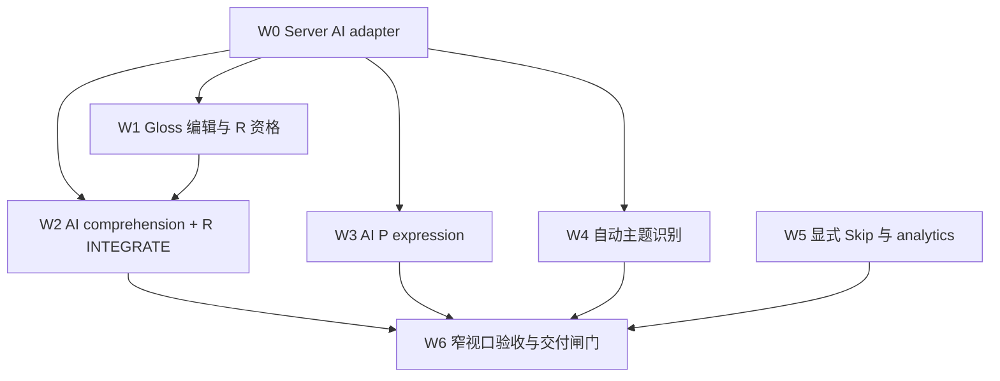

# 剩余交付计划：从可执行学习路径验收

日期：2026-11-06
依据：`docs/algorithm.md`、`docs/task-implementation-dag.md`、`implementation-status.md` 与当前源码/测试。本文不改算法规格；出现规格未定义之处，单列产品决策。

## 审计范围与结论口径

“已覆盖”表示入口、服务端派发/证据处理、状态或事件至少有现存代码；“可交付”还要求用户能实际完成并验证一条纵向行为路径。现有测试由 Node 内存 SQLite、合成任务和源码文本断言组成；它们能证明若干服务契约和状态转换，不能证明真实浏览器动作、移动端布局或材料在实际导入数据上足够。

当前没有需要重做的基础模块：抽象任务契约、双轴状态字段、目标物化、关卡回写、可核证旧数据迁移、服务端实例恢复/幂等提交、单卡外壳、四类 renderer、分析聚合均已有实现。剩余工作应针对下表中的断链或验证缺口，不重做这些模块。

## 1. 当前真实能力覆盖矩阵

链路顺序：材料来源 → 候选资格 → 调度 → 服务端实例 → 客户端动作 → 服务端证据验证 → 状态回写 → 分析事件。

| 用户行为路径 | 材料/候选/调度 | 实例/客户端 | 服务端证据、状态、事件 | 覆盖判断与证据 |
|---|---|---|---|---|
| ENCODE · R | 词表、IELTS 与书导入生成释义；书释义由 `createGoal` 尝试补词典。低先验新词可选 R。重学按 pending R 进入。 | `encode-r` 单词教学实例；展示词、释义、例句。 | ENCODE 回写 introduced、R 时间锚/冷却与 practice 事件，不加关卡分。 | **基本完整，材料边界未验证**。`lib/goals.ts`、`lib/tasks.ts`、`lib/scheduler.ts`、`components/task-renderers.tsx`、`lib/scheduler.ts:applyTaskResult`。词典未返回释义时仍可发任务；无释义处理见缺口 M1。合成旅程覆盖词表而非浏览器。 |
| ENCODE · P | 同上，P 轴选择由先验/目标缺口决定；重学按 pending P。 | `encode-p` 展示语义与表达示范。 | 仅教学状态与时间回写，事件记 practice，不提升 F_P。 | **基本完整，材料边界未验证**。同上；需行为验收确认教学完成后调度及分数不变。 |
| RETRIEVE · R | 词表释义、词典 gloss、例句可支持认读；低于 50 有 R 候选。 | R renderer 展示目标表达/例句，让用户输入语境义。 | `validatedEvidence` 从数据库释义重算词项正确性；独立且检查合格后 R 分数写回。记录轴、用途、关卡、证据和结果。 | **主要闭环存在；释义为空时可伪通过**。`lib/tasks.ts:retrieve-r`、`components/task-renderers.tsx`、`app/api/task/service.ts:deriveWordResults/validatedEvidence`、`lib/scheduler.ts:applyTaskResult`。空 expected 使 `actualNormalized.includes(expectedNormalized)` 对空串恒真；`lib/goals.ts` 在 gloss lookup 没有结果时仍插入空 meaning。 |
| RETRIEVE · P | 有释义的词表/词典/IELTS/书材料；P 候选对低分开放。 | P renderer 按语义和填空语境输入表达。 | 服务端从 chunk 重算逐词结果；合格独立提交更新 P 分、验证、时间和事件。 | **基本闭环存在**。`lib/tasks.ts:retrieve-p`、renderer、`app/api/task/service.ts`、`lib/scheduler.ts`。`test/task-flow-journey.test.cjs` 覆盖内存导入/派发/接口/重复提交/复习，不执行真实 UI。 |
| FLUENCY · R | `taskMaterial` 仅从书源切 MFI；要求连续文本、目标词、已知词覆盖及可生成 keyed comprehension 题。候选资格要求 R 分到对应范围及材料条件。 | 服务端实例带片段、目标词检查、选项/答案键和 passage 词数；公共实例去除答案字段。R renderer 先读再答，输入各目标释义及理解选择。 | 服务端以答案键核对整段选项，以数据库释义核对目标词，按实例核对材料计时模式；60+ 还检查速度阈值。逐词及整段结果回写，事件记录速度/结果。 | **路径存在但只在 MFI 有材料时可用，验证有信任边界/构念限制**。`lib/scheduler.ts:taskMaterial/makePayload`、`lib/mfi.ts`、`components/task-renderers.tsx`、`app/api/task/service.ts`。客户端可提交 duration，服务端据此算 WPM，未独立证明计时；MFI 正确选项是片段中最长句而非经验证的主旨答案（`lib/mfi.ts`）。缺 MFI 时 R FLUENCY 不能认证。 |
| FLUENCY · P | 调度检查 `step4_sentences` 连续文本，最少 30 词；没有材料就按既有候选回退 R/P 提取。当前词表仅以目标短语为 Step4，常规导入能否形成合格 P 连续文本未有真实数据证明。 | P renderer 写作，计时、字数和目标表达实例化。 | 服务端核对答案中每个 chunk、最少 30 词和客户端 duration；60+ 检查标称表达与速度门槛。状态和事件沿 P 轴写回。 | **有条件可用，文本质量检查不足**。`lib/scheduler.ts:taskMaterial`、`components/task-renderers.tsx`、`app/api/task/service.ts`。expression 当前只验证 30 词且目标词包含，不检查连贯表达；真实材料候选率与计时行为没端到端覆盖。 |
| INTEGRATE · R | 库中有 `integrate-r` 定义及 renderer，但调度池找到批次后明确以 `comprehension_context_missing` 记录材料缺口并 `continue`；无可达签发路径。 | 未从正常 scheduler 签发；不能完成该用户行为。 | 通用回写仅在收到该类型时检查任务定义、逐词及声明的检查；没有一个 scheduler/API 行为测试签发并成功提交 R 批次。 | **断裂：不可交付**。`lib/tasks.ts:integrate-r` 对照 `lib/scheduler.ts` R 分支。此跳过是显式的、会进入 material gap 分析，但仍是需求未满足，不得算完成。 |
| INTEGRATE · P | 对 P 轴达 75、verified 的词组成批次；合并各词 Step4 文本，所有目标词必须在连续材料中出现，文本需 ≥30 词。 | 可签发 `integrate-p` 多词写作实例；用户写至少 30 词并覆盖所有目标表达。 | 服务端按实例词集合逐词重算 chunk 包含、检查 30 词和声明检查；通过写 integrated_P，不动词级分。记录整体结果事件。 | **服务端路径存在；材料供应和用户体验未验证**。`lib/scheduler.ts` P integration 分支、`app/api/task/service.ts`、`lib/scheduler.ts:applyTaskResult`、renderer。DAG 测试只检查一个合成内存任务通过；没有实际导入材料批量派发/API 完整旅程。 |

### 横切生命周期

- 已实现：issued 实例刷新恢复、结果验证与事务写回、重复结果幂等，见 `app/api/task/service.ts` 与 `test/task-flow-journey.test.cjs`。覆盖的是服务层调用，不是实际网络浏览器刷新。
- 已实现但没有设备验收：提交反馈后按钮切换、仅 feedback 状态允许上滑、错误保留已挂载答案，见 `app/page.tsx`；现有“滑动/响应式/键盘”检查只用正则读取源码，见 `test/task-flow-journey.test.cjs`。
- 缺少：显式 skip/defer 行为。未提交滑动被忽略；分析表虽识别 `task_skipped`，当前 UI/API 没有 skip 入口，`instrumentation.skips=false`，`skip_count=0` 是无此功能，不代表用户从未跳过。见 `app/page.tsx`、`app/api/task/analytics/route.ts`、`lib/task-analytics.ts`、`test/task-analytics.test.cjs`。
- 已实现：材料缺口、退出、通过/失败/练习、速度事件聚合。退出是 pagehide 的生命周期标记，不是精确的“主动退出”意图；统计应按当前事件定义理解，不能外推到未记录的跳过或真实阅读时间。

## 2. 已确认的策略错误、实现缺口与测试边界

### 验收把模块存在当作能力可用

- T08 验收写“材料长度、语言覆盖、目标词归属能力”；实际函数 `assessContinuousMaterial` 具备参数，但 scheduler 调用没有 topicTerms，也没有主题元数据字段。因此函数级可选能力不是调度能力。`lib/material.ts` 的 `topicTerms` opt-in 与 `lib/scheduler.ts:taskMaterial` 调用可直接核实。
- T09 的通过证据验证了调度状态，却没有要求每个已声明轴的 INTEGRATE 从真实入口签发；R 分支明确跳过，因而模块/资格定义不等于 R 综合能力。
- T11–T13 的契约测试、TypeScript 和 build 不能证明用户真实触屏、键盘、长文阅读及提交失败恢复。`test/task-flow-journey.test.cjs` 后半段对页面/renderer/CSS 只作源码正则断言。
- T15 被称作“完整旅程”，但主要旅程直接调用 `getOrIssueTask`/`submitTaskResult` 的 service 函数。缺少 Next 页面、HTTP route、浏览器和设备上的真实操作验证。
- T16 的测试确认空数据下 `skip_count === 0` 且 `instrumentation.skips === false`。这证明分析端诚实暴露“未埋点”，并不满足原验收的跳过率能力。

### 下游才暴露的上游契约缺项

- scheduler 与 R 轴整合需要“一段同时覆盖多个目标词的篇章 + 能对应这段篇章且服务端持有答案键的整段问题”。原 `integrate-r` 定义只声明 accuracy checks；没有批次级 key 结构。T09 集成阶段才加跳过分支。
- 材料层无 topic/source topic 数据字段和导入/调度传递，因此 T08 的主题检查无法进入生产候选。
- P 表达证据目前没有可校验的语义/连贯性判据；服务端将“≥30 个按空格分词 + 每个 chunk 子串出现”作为 expression pass。T08/T10 接口定义没有先确定可核验的表达判据。
- 计时接口将 `duration_ms` 作为客户端证据。服务端根据它算速度，但不能证明计时从完整材料展示开始、读完后停止，也不能证明期间页面可见或材料确实读完。现有测试只送入合成 duration。

### 缺失能力被跳过或弱化

- R INTEGRATE：显式跳过并记录材料缺口，避免伪造通过；但整体交付必须保持未完成。
- Skip：UI 选择忽略未提交 swipe，测试特意断言没有 `/api/task/skip`。这保护了“不把未答伪造成失败”的规则，却没有实现显式跳过或延期。
- R FLUENCY 只接受有 keyed MFI 的连续文本；缺材料时转到同轴 RETRIEVE 是算法允许的回退，但该回退不能算速度能力完成。调度当前有材料缺口路径，必须分别验收 gap 与回退行为。
- P FLUENCY 的 expression 检查退化为词数与目标子串，代码并无内容/表达质量核验。不能将此检查称为整体表达质量已证明。

### 自动化测试不能证明的事项

- `test/task-implementation-dag.test.cjs` 通过伪造任务对象直接调 `applyTaskResult`，适合验证算法写回规则；不能证明由 scheduler 产生的服务端实例含真实材料、客户端能完成、server validation 符合真实动作。其 INTEGRATE 场景只有合成的 P 轴写作任务。
- `test/task-flow-journey.test.cjs` 的主要 journey 以词表记录、内存 DB 和 service 函数验证服务器状态；swipe、响应式和键盘部分是静态文本匹配，不触发浏览器 DOM/触摸/IME/焦点。
- `test/task-analytics.test.cjs` 手工插入事件验证聚合公式；不证明页面事件在真实关闭、刷新、返回中准确采集，且没有 skip 行为可测。
- 上述测试即便全绿，也不覆盖书源实际切片能否生成可理解 MFI、真实批次是否够材料、客户端伪造时长对速度认证的影响。此处是覆盖边界，不是声称测试结果失败。

### 已完整且不应重复开发

- `lib/tasks.ts` 的抽象定义、轴/目的/证据契约；不重做类型/任务库。
- `lib/db.ts` 双轴字段/迁移与 `lib/targets.ts` 目标映射；T14 已有迁移幂等与目标场景。
- `lib/scheduler.ts` 单词 R/P 资格、主调度顺序、冷却/急救/重学、同轴状态回写；现有固定 tick 单元场景通过。
- `app/api/task/service.ts` 服务端签发、答案防泄漏、结果验证、事务和重试幂等；可针对新增行为加测试，不重做接口基础。
- `components/task-renderers.tsx` 四个抽象任务类型的 renderer 和 `app/page.tsx` 单卡壳；重点做真实行为验证及必要缺口修复，不再重写 UI 架构。
- `lib/task-analytics.ts` 现有维度聚合与 material_missing/task_exit 埋点；只补决策后的 skip/defer 事件或改进定义，不重做聚合器。

### 当前 16 节点 DAG 的依赖缺陷

1. T08 只依赖 T07，却未以真实 source/import 数据和调度调用验收材料入口；T09 依赖它时才发现缺少 R 批次 comprehension key 与 topic 信息。缺失的是端到端数据契约，不是单个先后边。
2. T10 只依赖 T05/T09；服务端证据边界（哪些字段可信、是否可从响应派生、计时的信任模型）没有独立前置验收，客户端动作 T11 才能正确生成这些字段也没有先跑通。
3. T11、T12 并行虽然减少开发等待，但二者共用主页面任务状态、提交/切换契约；没有明确的接口冻结或合并后行为闸门。T13 之后才暴露集成问题。
4. T14 的单元/固定时间验收可在 UI 之前完成，但当前对交付依赖放行过宽：它没有阻止未完成的 R INTEGRATE 进入 DONE；T15 也缺独立 Verifier 的真实行为验收。
5. T16 依赖 T10/T15，却把“分析 schema 和聚合存在”与“所有所需事件可由用户行为产生”混为一体。skip 未实现仍可让测试绿。

## 3. 修正后的剩余任务 DAG

按顺序串行交付，避免 `lib/material.ts`、`lib/scheduler.ts`、`components/task-renderers.tsx` 和 service evidence contract 冲突。W0 必须先稳定 server AI contract；W1、W2 依次闭合 R gloss 和 R 理解/综合；W3、W4、W5 各自完成后进入 W6。所有节点都是首发范围。依赖节点 BLOCKED 时不能继续依赖节点，也不能宣布整体完成。

## 4. 最小纵向交付包

### W0 — Server-only LLM adapter

- **用户可观察结果**：应用服务端可用配置的 OpenAI-compatible endpoint 提供有 schema 校验的 AI 判断；客户端 bundle、API response、日志均不包含 API key。
- **入口 / 出口**：进程环境变量进入 server adapter；出口为经过 JSON/schema 校验的 typed result 或明确错误，不输出密钥。
- **涉及模块**：新增 `lib/llm.ts`（server-only）、必要的 server-only 标记、mock LLM 测试。
- **必要前置**：读取配置但不得打印值；必需项缺失返回可识别配置错误。
- **最小修改范围**：只做通用传输、JSON 解析、超时与错误分类，不在此包实现产品 prompt。
- **行为验收**：本地 mock OpenAI-compatible server 收到正确模型/语言配置并返回结构化结果；验证无 key、超时、HTTP 错误、畸形 JSON 均 fail closed；客户端公开 payload 中不存在 secret。
- **DONE**：可复现的 server adapter 行为测试全过且密钥不离开 server。**BLOCKED**：当前进程缺 `LLM_API_KEY` / `LLM_BASE_URL` / `LLM_MODEL` 等必需配置或 provider contract 不是兼容 chat completions。

### W1 — Gloss 编辑、AI 建议确认与 R 资格

- **用户可观察结果**：用户可手动填 gloss 或请求 AI 建议；只有用户保存确认的 gloss 才用于 R 学习；无 gloss 时 P 仍可继续，R 不签发依赖释义的可评分任务。
- **入口 / 出口**：wordlist/book/IELTS 词条进入编辑/建议流程；出口为保存的 gloss、明确 R 材料缺口，或 R 实例及服务端核验结果。
- **涉及模块**：词条 UI/API、`lib/material.ts`、`lib/scheduler.ts`、`app/api/task/service.ts`、DB（若需 AI suggestion 状态）、route/service 行为测试。
- **必要前置**：W0；AI gloss 是建议并由用户确认，不能后台自动覆盖人工释义。
- **最小修改范围**：最小词条 gloss 编辑和 AI suggestion 保存路径；R eligibility 排除空 gloss；R 同义判定 fail closed。不要变更迁移/调度积分逻辑。
- **行为验收**：通过实际 API 手动保存 gloss 后可调度 R；拒绝 AI 建议后 gloss 不变；确认 AI 建议后可用；R 同义回答通过、无关回答失败、模型超时失败关闭；相同词 P 任务仍可达；空 gloss 的通用输入不得通过。
- **DONE**：从词条编辑到 R 服务端通过/失败/缺口的链路可重放。**BLOCKED**：AI schema 不稳定、建议无法确认保存或任意空 gloss 可伪通过。

### W2 — AI keyed R comprehension 与 R INTEGRATE

- **用户可观察结果**：合格书源可以签发 R FLUENCY 和多目标 R INTEGRATE；用户读一段、回答目标释义和 AI 生成的篇章理解题；仅全部必要证据通过才认证。
- **入口 / 出口**：已确认 gloss 的书源目标词进入调度；出口为服务端持有题目答案键的实例、正确/错误提交后的 R 状态、或明确 material gap。
- **涉及模块**：`lib/mfi.ts`、`lib/scheduler.ts`、`components/task-renderers.tsx`、task service/API、route behavior tests。
- **必要前置**：W0、W1；AI 题目及答案键服务端持有；客户端不能提交判分值。
- **最小修改范围**：取代最长句规则；从同篇段落生成单目标与多目标 keyed check；打开已存在却被跳过的 `integrate-r` 调度分支。保留客户端计时方式。
- **行为验收**：mock AI 为 fixture 篇章返回固定合格问题/选项/key；实际 `/api/task` 签发后客户端看不到 key；正确回答更新 `speed_verified_r`/`integrated_r`，改错答案/漏目标/无效 AI 输出不认证；AI 故障返回 material gap；验证不改 P 字段、tick 仅按既有成功提交规则变化。
- **DONE**：`scheduler→instance→renderer→result endpoint→DB/event` 全链真实可重放。**BLOCKED**：AI 不能为材料生成有效题、key 泄漏，或 R integrate 仍不可达。

### W3 — AI 判定 P FLUENCY / INTEGRATE 表达

- **用户可观察结果**：≥30 词文本只有在语义连贯、目标表达正确并符合 AI 输出判据时才通过；AI 不可用时不得以词数替代判定。
- **入口 / 出口**：现有 P 连续写作实例进入 result endpoint；出口为 P 认证/综合状态或明确失败，不影响 R。
- **涉及模块**：task service、LLM evaluator、必要的 renderer 反馈和 API 行为测试。
- **必要前置**：W0；服务端把文本、目标词和 gloss 送给模型；不向客户端暴露内部判分键。
- **最小修改范围**：替换 `wordCount >= 30 && target_word` 的 expression 判据；复用现有 P task 和状态写回。
- **行为验收**：mock LLM 对合格文本通过；语法明显错误、目标词误义/只列词、无关重复文本拒绝；29 词拒绝；endpoint timeout/invalid JSON 拒绝且不写认证；通过只改 P 字段。
- **DONE**：服务端实际 AI verdict 决定 P expression 并按轴隔离写回。**BLOCKED**：AI 失败仍被当通过或模型响应不校验 schema。

### W4 — 自动主题识别和材料候选链

- **用户可观察结果**：导入的书源有自动识别主题；需要连续材料时 scheduler 使用已识别主题约束，并对识别失败/材料不匹配展示缺口。
- **入口 / 出口**：导入的书源文本进入识别并持久化；出口为 scheduler 的 eligible instance 或有理由的 gap。
- **涉及模块**：books import/persistence、DB migration、`lib/material.ts`、`lib/mfi.ts`、`lib/scheduler.ts`、测试。
- **必要前置**：W0；没有明确用户 topic goal 时只保存主题元数据，不自行施加主题要求。
- **最小修改范围**：新加主题列/字段、导入识别与 scheduler 读取；复用 `assessContinuousMaterial`。不扩展 algorithm 对主题的定义。
- **行为验收**：导入后主题字段非空且来源可查；匹配明确主题约束可派，冲突拒绝，无主题识别结果返回 material gap；AI 故障不静默放行；原有无主题任务不受影响。
- **DONE**：真实来源→持久主题→资格→实例/gap 的链路成立。**BLOCKED**：材料主题无法识别/保存或 scheduler 丢失该字段。

### W5 — 显式 Skip 与正确事件率

- **用户可观察结果**：用户点击跳过后当前卡片结束并继续下一任务；该动作不算失败、不影响掌握状态及调度锚点；重复请求不重复事件。
- **入口 / 出口**：issued 实例和明确的 UI 点击进入 skip endpoint；出口为 skipped 终态、唯一 `task_skipped` 事件和下一任务签发。defer 不实现。
- **涉及模块**：page/renderer、skip API、task service/DB instance 状态、`lib/task-analytics.ts`、tests。
- **必要前置**：analytics 已有 skip 统计结构；同一实例 exit/skip/submit 终态互斥。
- **最小修改范围**：增加 `skipped` 状态/动作，复用现有 skip 聚合字段；不改 scheduler priority/tick/score/cooldown。
- **行为验收**：点击后可继续；重复 skip 为幂等；跳过前后对比分数、tick、验证、稳定时间、冷却字段完全不变；skip 后 exit/submit 均不落事件；exit 后 skip 不落事件；rate 分子分母按决策返回。
- **DONE**：route→DB lifecycle→analytics→UI 可重放且互斥成立。**BLOCKED**：重复 lifecycle 事件或跳过引起任何学习状态变化。

### W6 — 窄视口行为验证与整体交付闸门

- **用户可观察结果**：窄视口完成 R/P retrieval、连续任务、刷新恢复、失败后重试和显式跳过；用户能直接看到结果反馈。
- **入口 / 出口**：入口为 W0–W5 全部 DONE；出口为独立 Verifier 的步骤与 endpoint/DB/event 证据，列出物理设备手动核验事项。
- **涉及模块**：真实浏览器 E2E（如现有工具允许）、app/API/DB；Integrator 只读整体验收报告。
- **必要前置**：W0–W5 通过；物理设备自动化不是必需。
- **最小修改范围**：只修 verifier 明确阻断项；不重构现有 renderer。
- **行为验收**：窄视口真实页面跑每条首发旅程并检查 endpoint response、DB、事件；由用户手动验收触摸和实际阅读速度表现。
- **DONE**：所有保留路径可复现且证据相符。**BLOCKED**：任何前置包未通过、AI 真实 provider 不可用或 UI 路径不可达。

## 5. 产品决策已确认

| 决策 | 已确认语义 |
|---|---|
| 空释义 | 用户可手动添加 gloss，也可选择 AI 生成。未确认并保存 gloss 前，不得签发依赖 R 释义判断的任务；P 学习不因缺 gloss 阻塞。AI 结果须由用户确认后成为材料。服务端 AI 核验同义表达，调用失败时 fail closed。 |
| R 连续速度 | 当前客户端计时足够作为产品接受的阅读速度证据；保留可见时长和服务端派生 WPM。 |
| R comprehension | AI 为固定篇章生成主旨问题、选项和答案键。键由服务端保存，客户端只收到问题/选项。生成失败或结构不完整时不签发该连续任务。 |
| P expression | AI 判断语法、语义连贯性和目标表达是否正确使用。最低词数可作基础约束，但不能独立认证；调用失败时 fail closed。 |
| 主题 | AI 自动识别并持久化材料主题。识别失败作为明确材料缺口；不凭空创建主题目标。 |
| Skip/defer | 首发支持显式跳过，不支持延期。跳过只结束当前卡片并记录 `task_skipped`，不改 tick、分数、验证状态、稳定时间或冷却锚点。单实例幂等；之后正常参与调度，不额外降优先级，也不保证立即重现。退出与跳过互斥；未提交上滑仍忽略。skip rate = skipped/(attempts+skipped)，exit rate = exits/(attempts+exits+skipped)，均展示分子和分母。 |
| 实机验收 | 自动化使用窄视口；不要求物理手机自动化。触摸、速度和页面行为由用户手动核验。 |

## 6. 推荐执行顺序、角色闸门与停止条件

执行模型：

1. **Planner**：为单个工作包冻结输入/输出与测试数据。一次只把一个包交给 Worker。
2. **Worker**：一次只实现一个包，提交独立 commit；不得顺手扩展其他包。
3. **Verifier**：与 Worker 独立，按包中的行为步骤对真实入口/出口运行并保存证据；失败则退回同包，不开放依赖包。
4. **Integrator**：仅集成 Verifier 通过的提交，冲突后重跑受影响包；不得把类型检查/模块单测作为纵向 DONE。

修正后的串行交付 DAG（各包独立 commit）：

1. **W0 AI 服务端能力底座（新增）**：仅服务端读取 `LLM_API_KEY`、`LLM_BASE_URL`、`LLM_MODEL`、`LLM_NATIVE_LANGUAGE`；结构化输出解析、超时和 fail-closed。mock server 验证请求/错误/缺配置，不记录密钥。
2. **W1 Gloss 补充与 R 资格**：手动编辑 gloss；可选 AI 建议且由用户确认；未保存 gloss 时只阻塞依赖释义的 R 任务；服务端 AI 核验同义表达。验收覆盖拒绝/确认建议、同义通过、错义失败、AI 故障拒绝通过。
3. **W2 AI R comprehension + R INTEGRATE**：为固定篇章生成并保存 keyed comprehension；恢复 R FLUENCY 和多目标 INTEGRATE 的调度至回写链路。注入固定模型响应验收正确/错误答案、缺目标、输出不完整及仅 R 状态变化。
4. **W3 AI P expression**：AI 评估 ≥30 词表达的连贯性、语法和目标表达语义；复用现有 renderer/写回。验收覆盖可接受、语法/语义错误、漏目标、短文本、超时及仅 P 状态变化。
5. **W4 自动主题识别**：导入/保存时识别并持久化主题，传入连续材料资格检查；失败时返回材料缺口。验收从导入到 scheduler 覆盖匹配、不匹配、识别失败。
6. **W5 显式 Skip**：UI/API/service 幂等终止实例并签发下一任务；完全不变更学习状态/调度时间锚点；复用现有事件聚合，修正互斥和率分母。验收重复跳过、已提交/已退出实例以及数据库状态不变。
7. **W6 窄视口行为回归与发布闸门**：自动化覆盖 R/P 主旅程与 skip；物理设备触摸/速度由用户手动核验。独立 Verifier 核对页面、API、DB、事件。任一依赖包未通过则不得 DONE。

W1/W2 必须 fail closed；AI 故障不能静默跳过需求。Worker 一次只实现一个包；Verifier 独立于 Worker；Integrator 只整合验证通过的提交。

## 6. 并行风险与共享文件冲突

| 并行组合 | 风险 | 约束 |
|---|---|---|
| W1 ↔ W5 | 同时改 `lib/goals.ts`、`lib/material.ts`，可能互相覆盖 meaning/topic 导入字段。 | 按文件所有权切分或先合并 source metadata 接口；禁止两 worker 同时改同一文件。 |
| W2 ↔ W4 | 共享 `lib/mfi.ts`、`lib/scheduler.ts`、`components/task-renderers.tsx`、service evidence contract；R 单目标和批次题键可能不兼容。 | W2 先定统一 MFI check schema；W4 后续使用同一契约。不要并行直接落同一文件。 |
| W2 ↔ W3 | 共享 service evidence 校验、任务事件字段、连续时长字段，但轴不同。 | 先冻结轴通用 duration/evidence schema；修改由一个 owner 合并。 |
| W3 ↔ W4 | 两者都要用 INTEGRATE renderer 与多目标 response；P 的表达判据不能误套 R。 | renderer 可共享组件，判据/答案键必须轴隔离；Verifier 检查 `integrated_p` 与 `integrated_r` 独立。 |
| W6 ↔ 任一功能包 | 浏览器验收期间 API/payload/UI 仍变会令证据失效。 | W6 开始后冻结相关接口；失败只开针对缺陷的小修复，再重跑被影响场景。 |
| W7 ↔ W6/分析 | 都会改页面生命周期、task instance 状态和 `task_analytics_events` 的率分母。 | W7 先完成决策与接口；W6 的旅程包含其最终行为，再由独立 verifier 重测。 |

## 8. 待规格澄清（非当前阻塞项）

1. AI 同义判定的置信阈值和多释义处理；不能虚构模型概率阈值，输出无效一律拒绝通过。
2. comprehension 生成失败后的重试策略；首版不签发并记录材料缺口。
3. 现有目标没有主题字段；首版只保存并用于已存在的主题约束，不创建隐含目标约束。
4. 若尚无词条编辑入口，W1 增加最小 gloss 编辑 UI；AI 内容需标为建议并由用户确认。

## 9. 执行入口

按 W0→W1→W2→W3→W4→W5→W6 串行执行。环境变量仅由进程读取，报告和日志不得回显值。若所需变量未配置，W0 标记 BLOCKED 并只列变量名。
